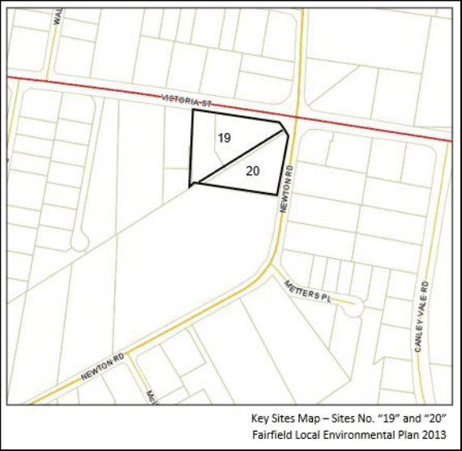

### 9.9 Development Guidelines for 449 and 449A Victoria Street and 96 Newton Road Wetherill Park

## Chapter 9  - Industrial Development

The following site specific provisions apply to land to the south-western corner of the intersection of Newton Road and Victoria Street, Wetherill Park. These properties are identified as sites “19” and “20” on the Key Sites Map of Fairfield LEP 2013. Under the provisions of Schedule 1 – Additional Permitted Uses of Fairfield LEP 2013 development for the purposes of hotel or motel accommodation and medical centres is permitted with development consent

The subject sites are known as No. 449 and No.449A Victoria Street and No.96 Newton Road Wetherill Park. The properties are also known as Lots 1 and 2 in DP 1224336 and Lot 4 in DP 851250. (Refer to Figure 1)

These site specific provisions have been prepared to guide and assist development on the land referred to above; in a manner that encourages business development and investment; and promotes local employment opportunities whilst servicing the daily needs of the workforce.

The provisions of other Chapters of this Development Control Plan (DCP), where they are relevant, will also apply but where there are any inconsistencies, the following site specific provisions prevail over those controls prescribed by the other chapters of this DCP.

> [Picture on page 27: a picture, saved as a picture (images/chapter-09-industrial-development-page-27-1.gif, 150 dpi).]

Figure 1 – Subject Site

#### 9.9.1 Layout

The layout of the buildings on the subject site shall be generally in accordance with Figure 2 but an alternate layout will be considered subject to flooding issues being addressed.
