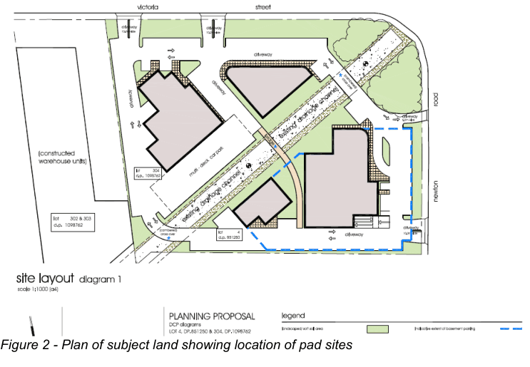
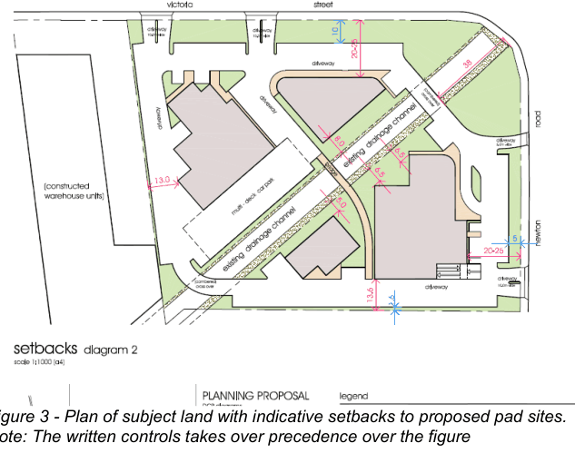

## Chapter 9  - Industrial Development

On this basis, Figure 2 depicts four (4) pad sites and landscaping on the land adjacent to either side of the drainage channel portion that crosses the North East site corner, to provide a natural setting, whilst re-enforcing the site as a destination and focal point.

The layout referred to in Figure 2 is based on extensive flood risk assessment and flood modelling of the site given possible flow implications within the catchment.

> [Picture on page 27: a picture, saved as a picture (images/chapter-09-industrial-development-page-27-13.gif, 150 dpi).]

Figure 2 - Plan of subject land showing location of pad sites

#### 9.9.2 Setbacks

Setbacks shall be provided in accordance with Clause 9.1 Site and Built Form. Notwithstanding the following is provided:

#### Controls

a) A minimum setback of 20 metres to the Victoria Street frontage shall be provided, of which 10 metres is to be used for landscaping only.

> [Picture on page 28: a picture, saved as a picture (images/chapter-09-industrial-development-page-28-7.gif, 150 dpi).]
> Words printed on the picture (title and legend, copied from the PDF):
> Note: The written controls takes over precedence over the figure

Figure 3 - Plan of subject land with indicative setbacks to proposed pad sites.

b) A minimum setback of 20 metres to the Newton road frontage shall be provided, of which 5 metres is to be used for landscaping only.

c) A minimum setback of 13.5 metres to the southern and western boundaries shall be provided, of which 1.5 metres is to be used for landscaping only.

d) A minimum setback of 5 metres to the existing concrete channel shall be provided, of which 2 metres is to be used for landscaping only.
