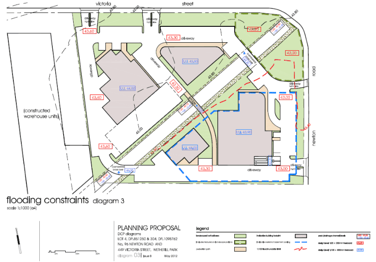

## Chapter 9  - Industrial Development

The concentration of a hub in one mass will ensure that the development has a more legible focus. On this basis, the hub will present as a place of arrival and add to the urban qualities of the area.

Crime Prevention through Environmental Design (CPTED) is an integral component of high quality urban design and must be considered holistically throughout the design and development processes.

#### Controls

a) The height of the development shall be compatible with the character and amenity of the existing and likely future development in the area.

b) An attractive streetscape shall be provided to both street frontages; in this regard buildings shall be orientated to allow surveillance from the street and adjoining buildings.

#### 9.9.6 Drainage Channel / Flooding

To enhance the appearance of the site, landscaping shall occur adjacent to the channel portion located at the North East corner of the site (as shown in Figure 2) to provide a natural setting, therefore re-enforcing the site as a destination and focal point.

In addition to the provisions and requirements of Chapter 11 - Flood Risk Management, Figure 4 of this SSDCP depicts the modelled and agreed finished ground floor building levels proposed for the site, which are 43.90 and 44.00. The driveways and accessways around the site have also adopted minimum finished levels as shown in Figure 4, being in accordance with flood modelling undertaken for the overall development. These levels have been adopted in principle by both Council and the Office of Water to assist with the location of future buildings and stipulate minimum finished floor levels.

#### Controls

a) Before granting consent to any development the Council shall have regard to the levels of the land as shown in Figure 4, with respect to:

i. The risk of entry of flood waters.

ii. Any implications for flood water storage capacity of any filling or the like.

b) The channel shall be left as open form in its current natural state.

c) The modelling and recommendations contained in the Supplementary Flood Risk Assessment for 449 Victoria Street Wetherill Park – Dated 5 July 2011 and Addendum to Flood Risk Assessment for 449 Victoria Street, Wetherill Park – Dated 4 August 2011, and will be provided upon request (quote Objective Reference: A1295652).

> [Picture on page 30: a picture, saved as a picture (images/chapter-09-industrial-development-page-30-20.gif, 150 dpi).]
