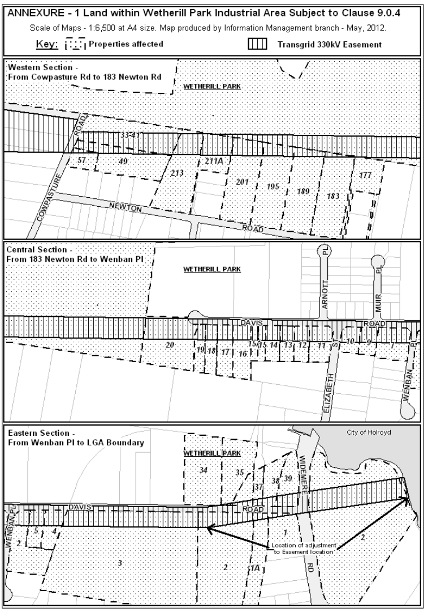

### 9.11  Site Servicing

a) Utility availability - Appropriate conditions will be inserted in any development consents granted requiring certification on the availability of suitable telecommunications, electricity, water and sewer services for the development.

b) Pre DA consultation with Endeavour Energy is helpful in identifying any existing network assets impacted by the proposed development. Applicants are advised to submit load applications to Endeavour Energy as early as possible in the design phase.

Upon receiving load applications, Endeavour Energy can work with applicants and their Accredited Services Provider L3 (network designer) with the preferred method of supply to their developments: for example, the installation of an indoor or pad mounted substation.

Space required to be allocated for any proposed indoor and pad mounted substations can be incorporated within final architecture plans submitted to Council as part of the DA approvals process.

Annexure 1- Lots within Wetherill Park Industrial Estate subject to Clause 9.0.4

> [Picture on page 35: a picture, saved as a picture (images/chapter-09-industrial-development-page-35-5.gif, 150 dpi).]
