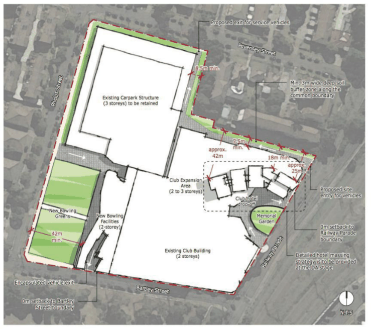

## Chapter 10 – Miscellaneous Development

Any hotel/motel development at the subject site should broadly comply with site layout arrangements identified in Figure 1 provided below.

> [Picture on page 30: a picture, saved as a picture (images/chapter-10-miscellaneous-development-page-30-1.gif, 150 dpi).]

Figure 1 Site Plan

b) Setbacks

Development should achieve the following setbacks to adjacent streets:
