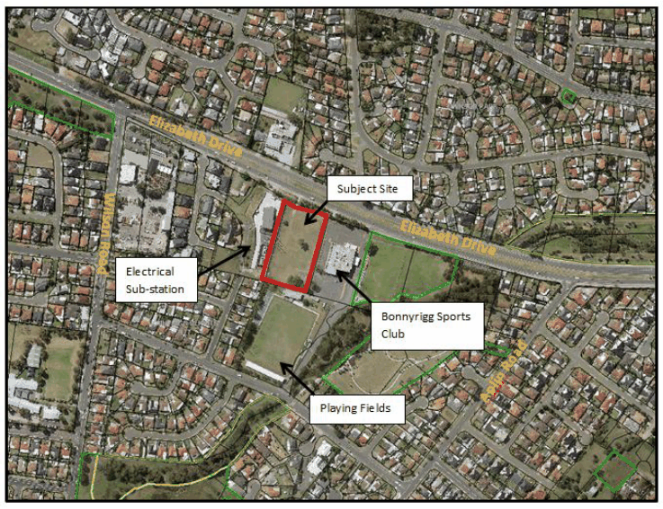

## Chapter 10 – Miscellaneous Development

i. Development on the site is sited so that it does not detract from the heritage significance of Local heritage item I17 “bandstand”.

ii. Development on the site is sited so that it does not impact upon the amenity of residences located at Phelps and Bartley Streets;

iii. Development on the site is sited to conserve and protect amenity of residence located at 141 Railway Parade and 12 Pevensey Street, Canley Vale.

### 10.12 Controls for 620 Elizabeth Drive, Bonnyrigg Heights (Service

Station, Food and Drink Premises including Take Away Food and Drink Premises and Recreation Facilities)

#### Overview

The site specific provisions contained within this section of the City Wide DCP apply to land known as No. 620 Elizabeth Drive (Lot 1 DP 781418) Bonnyrigg Heights (refer to Figure 1). Under the provisions of Fairfield Local Environmental Plan 2013 the site may be developed for the additional uses of a service station and take-away food and drink premises, subject to Council approval. The following provisions have been prepared in relation to future development of the subject site for these additional uses in conjunction with associated recreation facilities.

For land use definitions relevant to the subject site, please refer to the Dictionary contained within Fairfield Local Environmental Plan 2013.

> [Picture on page 33: a picture, saved as a picture (images/chapter-10-miscellaneous-development-page-33-3.gif, 150 dpi).]

Figure 1 Subject Site

#### Objectives

These site specific development provisions have been prepared to:

a) Guide and assist development of the subject site in a manner that encourages development and investment, and promotes local employment opportunities; whilst servicing the daily needs of the local community and travelling public.
