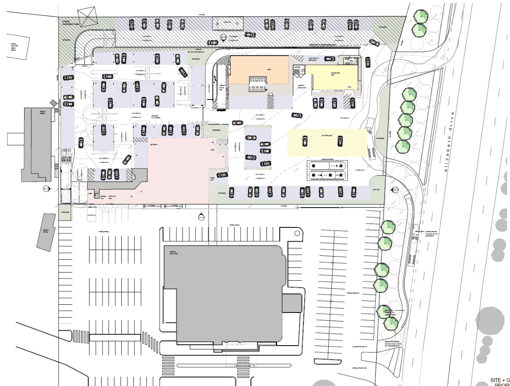
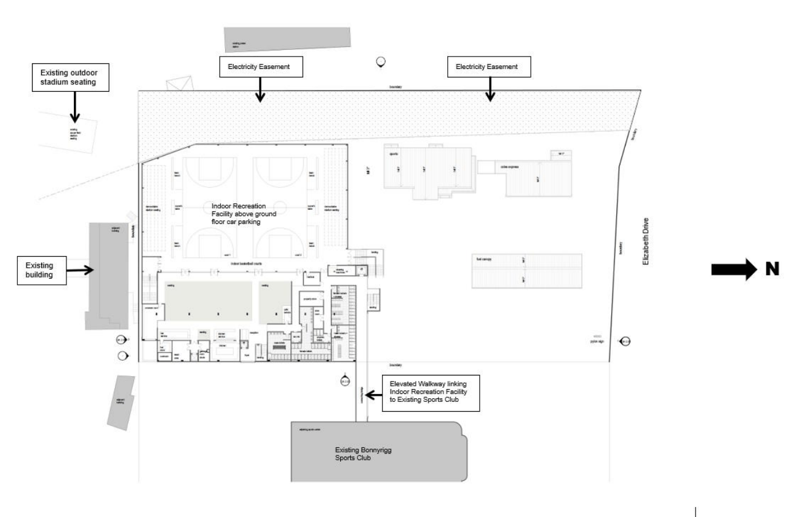

## Chapter 10 – Miscellaneous Development

> [Picture on page 38: a picture, saved as a picture (images/chapter-10-miscellaneous-development-page-38-2.gif, 150 dpi).]

Figure 2 Ground Floor Site Plan for 620 Elizabeth Dr, Bonnyrigg Heights

> [Picture on page 39: a picture, saved as a picture (images/chapter-10-miscellaneous-development-page-39-1.gif, 150 dpi).]

Figure 3 First Floor Site Plan for 620 Elizabeth Dr, Bonnyrigg Heights
