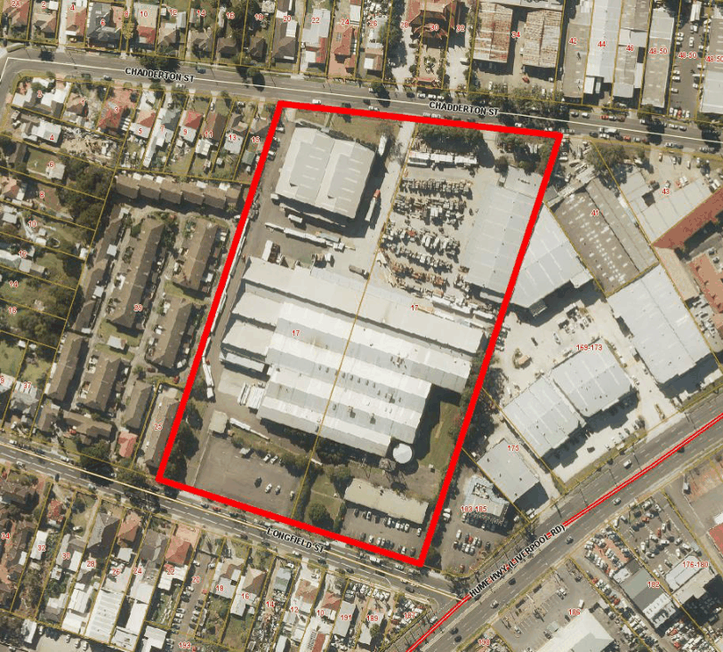

## Chapter 10 – Miscellaneous Development

### 10.13 Site Specific Development Controls for 17-23 Longfield Street,

#### Cabramatta

#### 10.13.1 Introduction

#### Land to which this section applies

This section of the DCP applies to land zoned R4 High Density Residential under the Fairfield Local Environmental Plan 2013, being Lot 34 and 35 DP456221 known as 17- 23 Longfield Street, Cabramatta as outlined in red in Figure 1 below.

> [Picture on page 40: a picture, saved as a picture (images/chapter-10-miscellaneous-development-page-40-8.gif, 150 dpi).]
