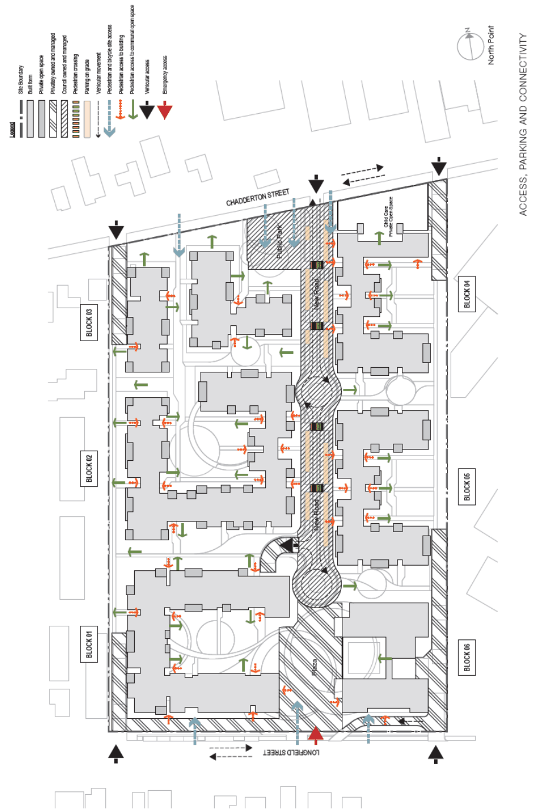

## Chapter 10 – Miscellaneous Development

> [Picture on page 47: a picture, saved as a picture (images/chapter-10-miscellaneous-development-page-47-2.gif, 150 dpi).]

Figure 3 Access, Parking and Connectivity

### 10.14 Controls for 400-404 Cabramatta Road and 2 Links Avenue,

#### Cabramatta

#### 10.14.1 Overview

The site-specific provisions contained within this section of Fairfield City Wide DCP apply to land known as 400-404 Cabramatta Road West, 2-18 Orange Grove Road and 6 Links Avenue.

The land is legally known as:

| Property Address | Title Description |
|---|---|
| 400 Cabramatta Road West, Cabramatta | Lot 1 DP 29449 |
| 6 Links Avenue, Cabramatta | Lot 3 DP 30217 |
| 404 Cabramatta Road West, Cabramatta | Lot 7 DP 709126 |
| 2 Orange Grove Road, Cabramatta | Lot 6 DP 709126 |
| 402 Cabramatta Road West, Cabramatta | Lot 1 DP 29449 |
| 402A Cabramatta Road West, Cabramatta | Lot 2 DP 503339 |
