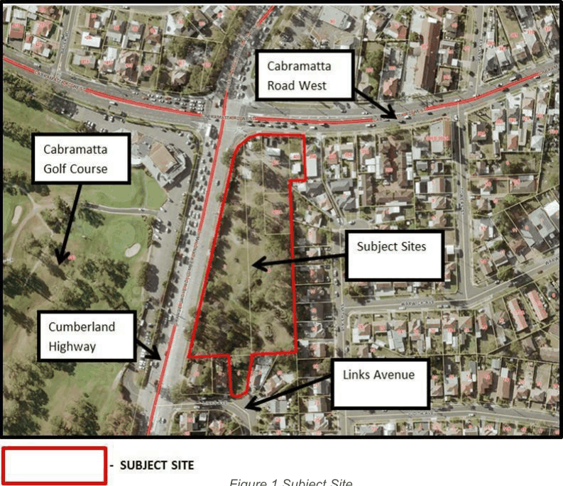

## Chapter 10 – Miscellaneous Development

> [Picture on page 49: a picture, saved as a picture (images/chapter-10-miscellaneous-development-page-49-1.gif, 150 dpi).]

Figure 1 Subject Site

Under the provisions of the Fairfield Local Environmental Plan 2013 the site may be developed for a residential flat building and multi dwelling housing, subject to development approval and consistent with the relevant provisions of FLEP 2013 and this SSDCP. The following provisions have been prepared in relation to future development of the subject site for these uses.

#### 10.14.2 Relationship to other sections of the City Wide DCP
