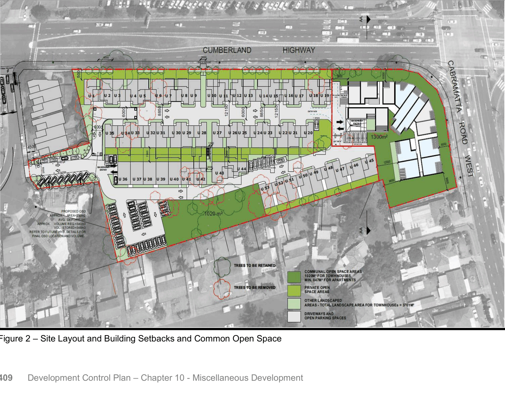

## Chapter 10 – Miscellaneous Development

#### 10.14.12 Boundary Articulation to Orange Grove Road

#### Objectives

To ensure the boundary fencing to Orange Grove Road is articulated to allow for additional landscaping along the street edge to reduce the visual impact of the boundary fence.

#### Controls

c) The boundary fence along Orange Grove Road is to be articulated generally in accordance with Figure 2 of this SSDCP.

d) Appropriate landscaping is to be provided in the articulation zones along the street frontage.

> [Picture on page 60: a picture, saved as a picture (images/chapter-10-miscellaneous-development-page-60-1.gif, 150 dpi).]

Figure 2 – Site Layout and Building Setbacks and Common Open Space

## Chapter 5B – Secondary Dwellings
