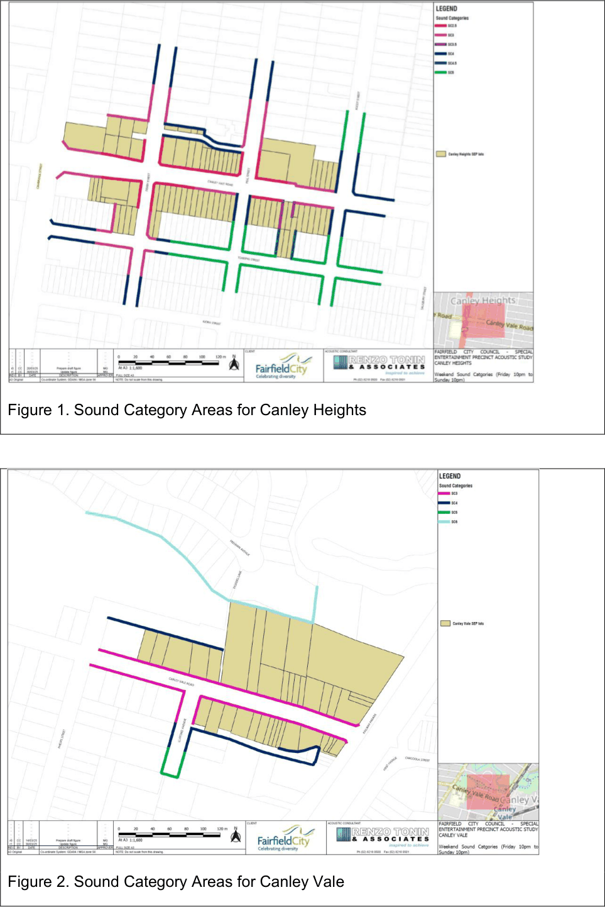
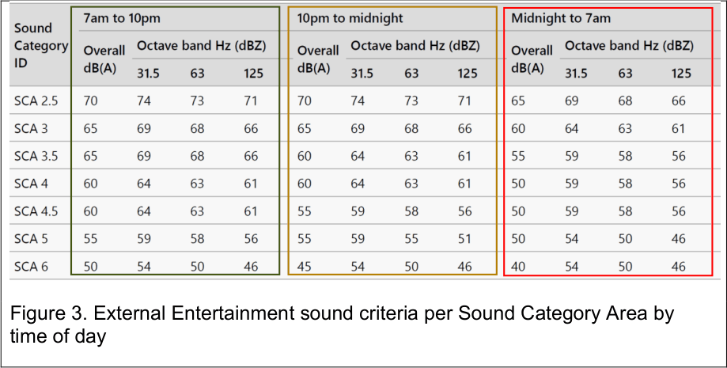
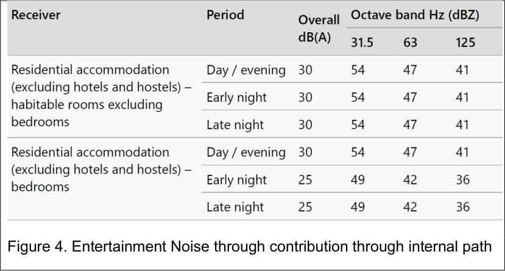
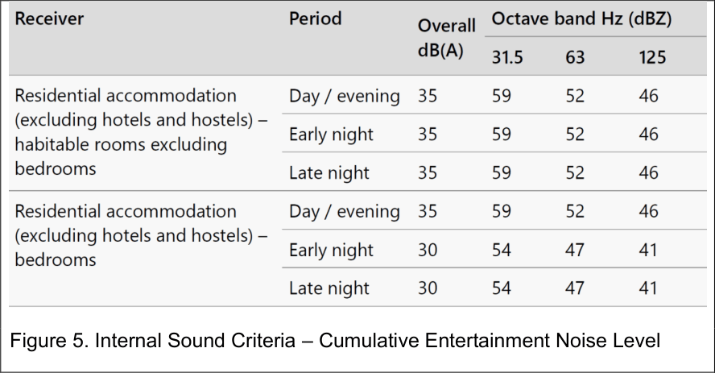

## Chapter 10 – Miscellaneous Development

### 10.15 Special Entertainment Precincts

> [Picture on page 63: a picture, saved as a picture (images/chapter-10-miscellaneous-development-page-63-2.gif, 150 dpi).]

Figure 1. Sound Category Areas for Canley Heights

Figure 2. Sound Category Areas for Canley Vale

## Chapter 5B – Secondary Dwellings

#### Objectives of Special Entertainment Precincts

1\. Support the City’s nightlife and night-time economy.

2\. Encourage businesses to provide more live entertainment opportunities in the city.

3\. Attract investment and redevelopment in the town centres by providing greater certainty for local businesses and residents regarding the operation of SEPs.

4\. Enhance tourism and economic opportunity of SEPs that promote the scope for unique cultural experiences and activities.

5\. Create opportunities for diverse entertainment and dining experiences in SEPs.

#### 10.15.1 Sound Category Area - Sound levels

#### Objectives

1\. To define the maximum external entertainment sound permitted within a Sound Category Area.

2\. To future proof new mixed-use development within Special Entertainment Precincts with appropriate noise amelioration measures to minimise noise pollution from entertainment sound.

#### Control

1\. Sound Category Areas applies at the property boundary of a property identified in Figures 1 and 2 at a height of 1.5m above the finished floor level for each floor of a building. Sound levels for each of the Sound Category Areas are detailed in Figure 3 below.

> [Picture on page 64: a picture, saved as a picture (images/chapter-10-miscellaneous-development-page-64-21.gif, 150 dpi).]

Figure 3. External Entertainment sound criteria per Sound Category Area by

## Chapter 5B – Secondary Dwellings

time of day

#### 10.15.2 Acoustic requirements for Existing Mixed-Use Developments

#### Objectives

1\. To ensure sensitive receivers are designed to attenuate against noise from existing and future entertainment venues.

2\. To ensure new and modified entertainment venues do not unreasonably impact on the amenity of sensitive receivers.

#### Controls

1\. If a new commercial tenancy or residential dwelling is proposed within an existing mixed use building the criteria set out in table 4 (Entertainment Noise through internal path) must be satisfied. o A new entertainment venue – A new entertainment venue moving into the commercial premises of an existing mixed-use building with existing residential occupancies is required to implement sound insulation performance upgrades to the building and operate in a manner such that the transmission of entertainment noise into the residential component of the mixed-use building satisfies the internal noise criteria specified in table 4 below.

o New residential premises – A new residential premises being developed in a mixed-use building with an existing entertainment venue is required to implement sound insulation performance upgrades to the building such that transmission of entertainment noise from the existing venue operations satisfies the internal noise criteria in the residential premises specified in table 4 below.

o Noise Impact Assessment - Noise impact assessment must be prepared by a suitably qualified acoustic consultant demonstrating that the proposal is able to comply with the sound levels identified in Figure 4 (below), with any application for a new or modified sensitive receiver located within a Sound Category Area.

> [Picture on page 65: a picture, saved as a picture (images/chapter-10-miscellaneous-development-page-65-23.gif, 150 dpi).]

Figure 4. Entertainment Noise through contribution through internal path

## Chapter 5B – Secondary Dwellings

2\. Where noise attenuation measures impact the provision of natural ventilation, alternative ventilation must be provided to ensure the proposal complies with the National Construction Code.

3\. Noise impact from other sources, such as road and rail must be assessed separately in accordance with relevant Standards and policies.

#### 10.15.3 Acoustic Requirements for New Mixed-Use Development

#### Objectives

1\. To ensure that new mixed-use developments can achieve compliance with internal sound criteria cumulative entertainment noise.

2\. To ensure a balance is achieved between commercial businesses and residential amenity in mixed use development.

#### Controls

1\. Submit a noise impact assessment with an application for mixed use development that demonstrates: o New mixed-use buildings will comply with the internal sound criteria specified in figure 5. o Demonstrate that proposed noise attenuation measures to be designed into the building can satisfy the internal sound criteria specified in figure 5. o The development must ensure compliance with internal criteria set out in the NSW State Environmental Planning Policy (Transport and Infrastructure) for road and rail traffic noise.

> [Picture on page 66: a picture, saved as a picture (images/chapter-10-miscellaneous-development-page-66-13.gif, 150 dpi).]

Figure 5. Internal Sound Criteria – Cumulative Entertainment Noise Level

## Chapter 5B – Secondary Dwellings

#### 10.15.4 Sound and patron management requirements for entertainment venues

#### Objectives

1\. To ensure new and modified entertainment venues do not unreasonably impact on the amenity of sensitive land uses.

#### Controls

1\. Submit a noise impact assessment prepared by a suitably qualified acoustic consultant with applications for a new or modified venue. It must: o Detail physical noise attenuation measures to demonstrate the venue can operate within the internal sound criteria for entertainment noise as specified in Figure 4 and 5.

o Demonstrate that the venue can operate without breaching the external entertainment sound for live entertainment venues specified in Figure 3.

2\. A Plan of Management must be submitted and include: o Details of the use of the site o Operational details of the premises

o Hours of Operation o Noise mitigation and management - The Plan of Management should detail all noise management measures to ensure that the development can achieve the criteria in the sound category area.

o Premises management measures o Security and safety o Performance, creative or cultural programming o Methods employed to implement harm minimisation and the responsible service of alcohol.

o (RSA) requirements

## Chapter 5B – Secondary Dwellings
