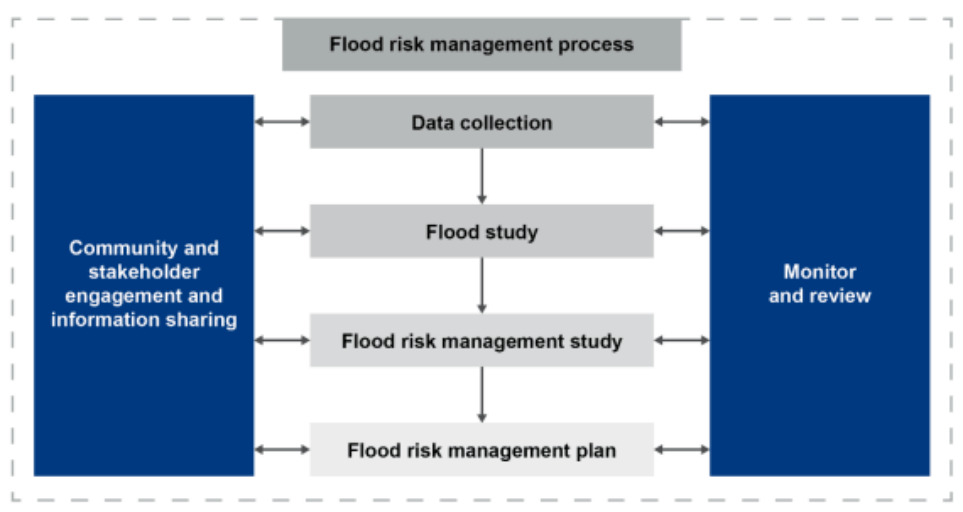

## Chapter 11 – Flood Risk Management

9\. Manage flood risk effectively

10\. Continually improve the management of flood risk

Local Government is the primary authority responsible for both flood risk management and land use planning in New South Wales.  The State Government’s flood policy provides for a flexible merit based approach to be followed by local government when dealing with planning, development and building matters on flood prone land. For Council to fully carry out its responsibilities for management of flood prone land, it is necessary to prepare a local “Floodplain Risk Management Plan” (FRMP).

The NSW FRMM requires that Councils prepare Floodplain Risk Management Studies (FRMS) as a prelude to the formulation of a FRMP that, among other things, would control development and other activity within the floodplain.  The process for preparing a FRMS and FRMP is depicted by Figure 11.1 below.

The following controls within this Chapter of the City Wide DCP are consistent with the State Government’s “Flood Prone Land Policy” and the NSW FRMM. The controls in this chapter, represent an application of the State Policy that reflects local circumstances, as identified for some floodplains, through the preparation of FRMS’s and FRMP’s.

> [Picture on page 5: a picture, saved as a picture (images/chapter-11-flood-risk-management-page-5-1.gif, 150 dpi).]

Figure 1 Flood Risk Management Process (FRMM 2023)

### 11.1 Objectives in relation to Flood Risk Management

a) To minimise the potential impact of development and other activity upon the aesthetic, recreational and ecological value of the waterway corridors.

b) Increase public awareness of the hazard and extent of land affected by all potential floods, including floods greater than the 1% Annual Exceedance Probability (AEP) (1 in 100 Year ARI) flood up to the Probable Maximum Flood (PMF) and to ensure essential services and land uses are planned in recognition of all potential floods.
