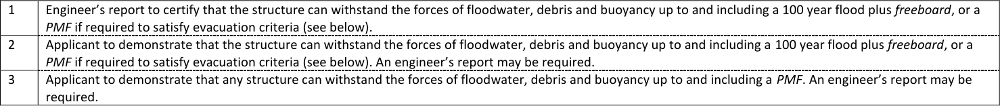

## Chapter 11 – Flood Risk Management

| Flood Risk Category | Land Use Risk Category | Planning Controls |  |  |  |  |  |  |  |
|---|---|---|---|---|---|---|---|---|---|
|  |  | Floor Level | Building Components | Structural Soundness | Flood Effects | Car Parking & Driveway Access | Evacuation | Management & Design | Fencing |
|  | Concessional Development | 4, 7 | 1 | 1 | 1 | 6, 7, 8 | 2, 3 | 2, 3, 5 | 1, 2, 3 |

Colour Legend

Not Relevant

Unsuitable Land Use

#### Floor Level

1 All floor levels to be no lower than the 20 year flood level unless justified by site specific assessment. 2 Habitable floor levels to be no lower than the 100 year flood level plus freeboard. 3 Habitable floor levels to be no lower than the PMF level. Non-habitable floor levels to be no lower than the PMF level unless justified by a site specific assessment. 4 Floor levels to be no lower than the design floor level. Where this is not practical due to compatibility with the height of adjacent buildings, or compatibility with the floor level of existing buildings, or the need for access for persons with disabilities, a lower floor level may be considered. In these circumstances, the floor level is to be as high as practical, and, when undertaking alterations or additions, no lower than the existing floor level.

5 The level of habitable floor areas is to be equal to or greater than the 100 year flood level plus freeboard. If this level is impractical for a development in a E1, E2,

MU1 or E3 zone, the floor level should be as high as possible.

6 Non-habitable floor levels to be equal to or greater than the 100 year flood level plus freeboard where possible, or otherwise no lower than the 20 year flood level unless justified by a site specific assessment.

7 A restriction is to be placed on the title of the land, pursuant to S.88B of the Conveyancing Act, where the lowest habitable floor area is elevated more than 1.5 metres above finished ground level, confirming that the under-croft area is not to be enclosed.

#### Building Components and Method

1 All structures to have flood compatible building components below the 100 year flood level plus freeboard 2 All structures to have flood compatible building components below the PMF level.

#### Structural Soundness

> [Picture on page 23: a picture, saved as a picture (images/chapter-11-flood-risk-management-page-23-23.gif, 150 dpi).]
> Words printed on the picture (title and legend, copied from the PDF):
> 1 Engineer’s report to certify that the structure can withstand the forces of floodwater, debris and buoyancy up to and including a 100 year flood plus freeboard, or a
> PMF if required to satisfy evacuation criteria (see below).
> 2 Applicant to demonstrate that the structure can withstand the forces of floodwater, debris and buoyancy up to and including a 100 year flood plus freeboard, or a
> PMF if required to satisfy evacuation criteria (see below). An engineer’s report may be required.
> 3 Applicant to demonstrate that any structure can withstand the forces of floodwater, debris and buoyancy up to and including a PMF. An engineer’s report may be
> required.
