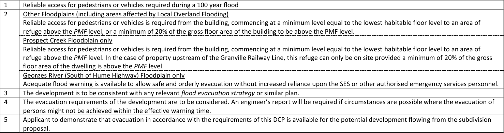

## Chapter 11 – Flood Risk Management

1 The minimum surface level of open car parking spaces or carports shall be as high as practical, and not below: (i) the 20 year flood level; or (ii) the level of the crest of the road at the location where the site has access: (which ever is the lower). In the case of garages, the minimum surface level shall be as high as practical, but no lower than the 20 year flood level.

2 The minimum surface level of open car parking spaces, carports or garages, shall be as high as practical. 3 Garages capable of accommodating more than 3 motor vehicles on land zoned for urban purposes, or enclosed car parking, must be protected from inundation by floods equal to or greater than the 100 year flood.

4 The driveway providing access between the road and parking space shall be as high as practical and generally rising in the egress direction. 5 Where the level of the driveway providing access between the road and parking space is lower than 0.3m below the 100 year flood, the following condition must be satisfied:

• The depth of inundation on the driveway during a 100 year flood shall not be greater than the larger of: (i) the depth at the road; and (ii) the depth at the car parking space. A lesser standard may be accepted for single detached dwelling houses where it can be demonstrated that the risk to human life would not be compromised.

6 Enclosed car parking and car parking areas accommodating more than 3 vehicles (other than on Rural zoned land), with a floor level below the 20 year flood level or more than 0.8m below the 100 year flood level, shall have adequate warning systems, signage and exits.

7 Restraints or vehicle barriers to be provided to prevent floating vehicles leaving a site during a 100 year flood. 8 Driveway and parking space levels are to be no lower than the design ground/floor levels. Where this is not practical, a lower level may be considered. In these circumstances, the level is to be as high as practical, and, when undertaking alterations or additions, no lower than the existing level.

Note: (1) A still water flood depth of 0.3m is sufficient to cause a small vehicle to float.   (2) Enclosed car parking is defined in the glossary and typically refers to car parks in basements.

#### Evacuation

> [Picture on page 25: a picture, saved as a picture (images/chapter-11-flood-risk-management-page-25-2.gif, 150 dpi).]
> Words printed on the picture (title and legend, copied from the PDF):
> 1 Reliable access for pedestrians or vehicles required during a 100 year flood
> 2 Other Floodplains (including areas affected by Local Overland Flooding)
> Reliable access for pedestrians or vehicles is required from the building, commencing at a minimum level equal to the lowest habitable floor level to an area of
> refuge above the PMF level, or a minimum of 20% of the gross floor area of the building to be above the PMF level.
> Prospect Creek Floodplain only
> Reliable access for pedestrians or vehicles is required from the building, commencing at a minimum level equal to the lowest habitable floor level to an area of
> refuge above the PMF level. In the case of property upstream of the Granville Railway Line, this refuge can only be on site provided a minimum of 20% of the gross
> floor area of the dwelling is above the PMF level.
> Georges River (South of Hume Highway) Floodplain only
> Adequate flood warning is available to allow safe and orderly evacuation without increased reliance upon the SES or other authorised emergency services personnel.
> 3 The development is to be consistent with any relevant flood evacuation strategy or similar plan.
> 4 The evacuation requirements of the development are to be considered. An engineer’s report will be required if circumstances are possible where the evacuation of
> persons might not be achieved within the effective warning time.
> 5 Applicant to demonstrate that evacuation in accordance with the requirements of this DCP is available for the potential development flowing from the subdivision
> proposal.

#### Management and Design

| 1 | Applicant to demonstrate that potential development as a consequence of a subdivision proposal can be undertaken in accordance with this DCP. |
|---|---|
| 2 | Site Emergency Response Flood Plan is required where floor levels are below the design floor level (except for single dwelling houses). |
| 3 | Applicant to demonstrate that area is available to store goods above the 100 year flood level plus freeboard. |

4 Applicant to demonstrate that area is available to store goods above the PMF level. 5 No storage of materials below the design floor level which may cause pollution or be potentially hazardous during any flood.

#### Fencing

| 1 | Fencing within a High Flood Risk area, Boundary of Significant Flow or floodway will not be permitted except for permeable open type fences. |
|---|---|
| 2 | Fencing is to be constructed in a manner that does not obstruct the flow of floodwaters so as to have an adverse impact on flooding. |
| 3 | Fencing shall be constructed to withstand the forces of floodwaters or collapse in a controlled manner so as not to obstruct the flow of water, become unsafe during times of flood or become moving debris. |
