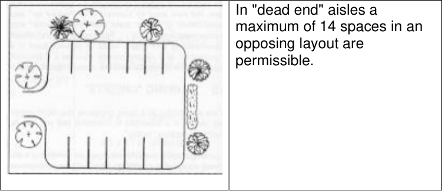

## Chapter 12 – Car Parking, Vehicle and Access Management

#### 12.2.2 Dead End Aisles

a) Dead end aisles are generally not accepted for the following reasons:

i. they do not allow through-flow of traffic

ii. they pose difficulties for vehicles exiting the rear bays

b) Council may consider an exception to the above rule if the car park:

i. has a capacity not exceeding 7 vehicles

ii. has a capacity of 14 vehicles in an opposing layout

iii. is reserved for a low turnover use (such as for employees)

> [Picture on page 14: a picture, saved as a picture (images/chapter-12-car-parking-vehicle-and-access-management-page-14-9.gif, 150 dpi).]

In "dead end" aisles a maximum of 14 spaces in an opposing layout are permissible.

#### 12.2.3 Headroom

Headroom is defined as the vertical distance between the surface level of the car park and the lowest point of any roof or structure above it.

a) In order to ensure satisfactory access for a reasonable range of cars, vans and four wheel drive vehicles, the minimum clear headroom required in an undercover parking area is 2.5 metres.

b) The above requirement may be reduced to 2.2 metres provided that all relevant aspects of Australian Standard 2890.1:2004 – Parking facilities - Off-street car parking are addressed.

c) The headroom height should be clearly signposted at entrances to car parks.

d) If access to the loading bays is via the car park, 3.6 metre headroom will be required.

#### 12.2.4 Streetscape and Car Parking

It is important to recognise that vehicle access to a site and its parking areas will have an impact on urban design, pedestrians and even vehicular conflict.
