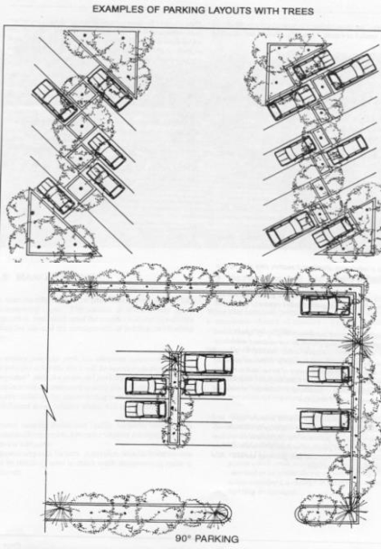

## Chapter 12 – Car Parking, Vehicle and Access Management

Perimeter Planting - On those sites where the building is set back from the front or side boundaries landscaping should be carried out along the perimeters.  Front planting beds should have a minimum depth of 3 metres and side beds a minimum depth of 1 metre.

Plant Layout - Planting height should be graded across the width of a bed from larger species in the centre to smaller at the edge. This approach will permit maximum display of species and ensure larger, overhanging plants do not obstruct vehicle or pedestrian movement.  Shade trees should be placed throughout the car park, particularly between rows of vehicles in order to provide a canopy of cover and to reduce the visual monotony of expansive hard surfaces which serve to trap and reflect

> [Picture on page 18: a picture, saved as a picture (images/chapter-12-car-parking-vehicle-and-access-management-page-18-7.gif, 150 dpi).]

heat.

Landscape “islands” should be incorporated every 10-15 vehicles.

Low growing shrubs should be placed around signs and bollard lighting in order to ensure visibility is maintained.  Similarly, entry and exit points to the site should have clear sight distances and thus planting at these points should be a combination of taller trees and low growing shrubs.  Midsized shrubs should be avoided.

Plant Choice - In choosing appropriate plants it is important to avoid those species, which may prove problematic.  Plants which have a short life, which tend to drop branches, gum or fruit, or plants which interfere with underground pipes are not suitable for car parks.

Figure 1 Example of Parking Layout with Trees

Plant Protection/Maintenance - In order to ensure your investment in landscaping is safeguarded, it will be necessary to provide adequate protection and maintenance of planting.  Protection may be achieved through the use of measures such as wheel stops, bollards, raised planter beds, gutters or timber barriers.  Plant survival rates can be enhanced and maintenance minimized through appropriate plant choice and labour saving devices such as automatic water reticulation systems. This also ensures plant survival.

#### 12.2.12 Line Marking

Maximizing the capacity of parking areas can be achieved through clear identification of all parking spaces.  Line marking parking bays provides drivers with a clear guideline on where to locate vehicles.

It is preferable to line mark plain surfaces such as concrete or asphalt with highly visible white or yellow paint.
