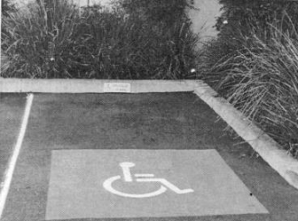

## Chapter 12 – Car Parking, Vehicle and Access Management

#### Controls

a) Spaces Required - The minimum spaces required shall be in accordance with Building Code of Australia AS1428.

b) Location - Spaces should be located close to the entry of the building to minimize travel distances and maximize accessibility. Spaces should be located on level ground.

c) Access - Parking areas should recognize the needs of the disabled by ensuring gutters/stairs or other obstacles do not impede access into the building.

> [Picture on page 21: a picture, saved as a picture (images/chapter-12-car-parking-vehicle-and-access-management-page-21-11.gif, 150 dpi).]

Figure 2 Disabled Parking Spaces are to be clearly identified through signage,

logo and colouring

d) Identification - Spaces for the disabled should be clearly identified by both signage and stenciled disabled symbol on the surface.  The space should be painted blue.

e) Width of Space - Car spaces for the disabled should be in accordance with AS2890 Building Code of Australia AS1428.

#### 12.3.2 Stack Parking

Stack parking occurs when one vehicle is parked behind/beside/beneath another in a way that prevents the other vehicle from existing. In general Council does not favour the use of stack parking.  However, Council is prepared to consider the provision of parking in a stacked arrangement when the applicant can demonstrate that such a proposal:

a) will not adversely affect use of the site;

b) only requires the removal of one vehicle to enable another vehicle to exit;

c) allows for a change of use/occupancy of a building without impacting on parking needs of tenants/users;

d) only involves a small proportion of total parking numbers (in non-residential situations);

e) will be for use by employees of the same organization or inhabitants of the same household; and

f) stack parking will be permitted for the parking needs of each dwelling unit.

#### 12.3.3 Bicycles
