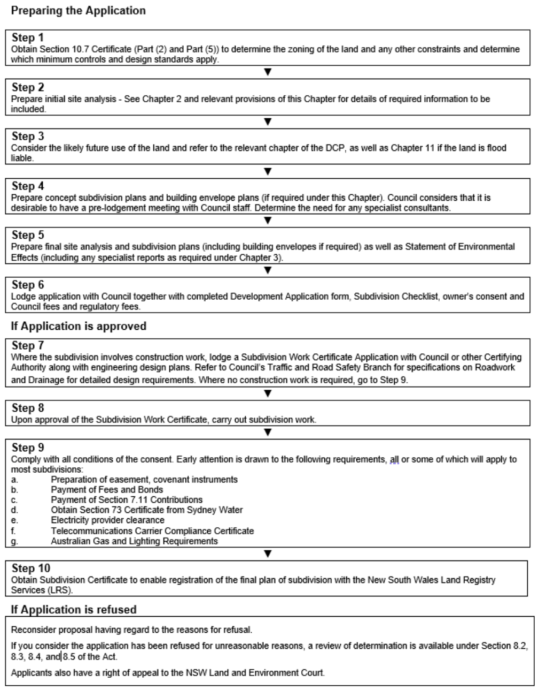

## Chapter 14 - Subdivision

Area of each lot created - Despite Clause 4.1A Minimum lot size for dual occupancy development under Fairfield LEP 2013, the subdivision of dual occupancies shall result in equal or similar proportion of lots in size as detailed in Clause 6B.1.1.7 Subdivision of Dual Occupancy – R2 Low Density Residential of Chapter 6B of Fairfield City Wide DCP 2024.

Clause 4.2 Rural subdivision of Fairfield Local Environmental Plan 2013 provides that in certain circumstances land may be subdivided so as to create a lot having a size less than the minimum shown on the Lot Size Map. The lot must be used for primary production and a dwelling cannot be erected upon such lot. Refer also to Clause 14.3.2 Vacant Lot Subdivisions – Controls (e) of this Chapter.

#### 14.1.3 The Subdivision Process - Development Application Flow Chart

> [Picture on page 5: a picture, saved as a picture (images/chapter-14-subdivision-page-5-3.gif, 150 dpi).]
