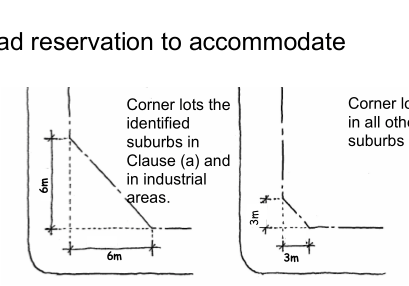

## Chapter 14 - Subdivision

#### Controls

a) Access driveways opening onto major roads will need to be widened at the entrance to allow two vehicles to pass within the driveway entry area so that delays to the traffic flow along the road are minimised.

b) Easements for drainage and services are required, sufficient to enable full servicing of all of the lots to be created.

c) Building clearances related to access handles in battle axe subdivisions shall comply with the requirements of the Building Code of Australia and rights of carriageway shall be free from any building encroachment or overhang.

d) For non-industrial access driveways of greater than 30 metre length, Council may require vehicular passing bays to be incorporated into the access handle width to enable vehicular movement in both directions.

#### 14.2.2 Frontage to Classified State and Regional Roads and Unclassified Regional Roads

#### Objective

To ensure that new subdivisions maintains the safety and efficiency of the main road system.

#### Controls

a) Subdivisions creating new allotments requiring access from a Classified State and Regional Roads will not be permitted unless in the opinion of Council and Service NSW, alternate access is neither practicable nor available from any other road.

b) Subdivision creating new lots should be designed so as to minimise the number of vehicle access points from an Unclassified Regional Road.

Note: Refer to Appendix G for a full list of Classified State, Unclassified Roads and Regional Roads

#### 14.2.3 Splay Corners

#### Objectives

a) To ensure that adequate area is provided within the road reservation to achieve

> [Picture on page 9: a map, saved as a picture (images/chapter-14-subdivision-page-9-6.gif, 150 dpi); the street names and other small labels are on the picture.]
> Words printed on the picture (title and legend, copied from the PDF):
> in all other
> Corner lots the
> Clause (a) and

adequate sight distance at road intersections.

b) To ensure adequate area is provided within the road reservation to accommodate vehicular turning paths.

#### Controls

a) For the purposes of ensuring adequate sight 6m

6 metre Splay Corner 3 metre Splay Corner
