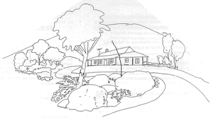

## Chapter 14 - Subdivision

cutting across the contours. Extensive cut and fill should be avoided in order to:

i. Retain the natural character of the site by reducing the intrusive appearance of driveways.

ii. Lessen the possibility of erosion thereby minimising maintenance costs.

iii. Allow an informal lot layout and dwelling placement.

iv. Allow easier manoeuvring and reduce speeding.

b) Driveways are to be landscaped along the edges and should be constructed of compacted gravel, paved or sealed in brown, green, grey or ochre tones. Regardless of the proposed method of internal construction all driveways must be sealed between the edge of sealed road and the property boundary in accordance with drawing S-226 found in Schedule 2 of this chapter.

c) The number of access points to arterial roads should be minimised. Subdivision design should provide access via adjacent local roads. Where such arrangements cannot be made, common access points/driveways should be established as part of the proposed subdivision. A buffer area of 10 metres should be provided between an arterial road and an access driveway.

This setback should be appropriately landscaped to reduce visible road. Suitable landscaping should include vegetation and moulding.

> [Picture on page 14: a picture, saved as a picture (images/chapter-14-subdivision-page-14-33.gif, 150 dpi).]

A well planned driveway which follows natural contours is pleasant and easy to drive on and preserves the natural character of the site

Driveways located straight down slopes are susceptible to erosion and will require constant maintenance.  They are clearly visible to the public and destroy the natural character of the land

### ✓

#### 14.3.5 Earthworks (Excavation & filling)

Clause 6.7 of Fairfield Local Environmental Plan 2013 sets out statutory requirements in relation to earthworks which includes land fill.

Land fill in association with subdivisional work will only be permitted where the fill is required:

a) for the reasonable economic use of the land, or

b) in connection with drainage works or,

c) the provision of utility services

The “reasonable economic use” of the land is defined as:

a) to fill a dam on the land,

b) to reinstate the land to the condition or state it was in immediately before the
