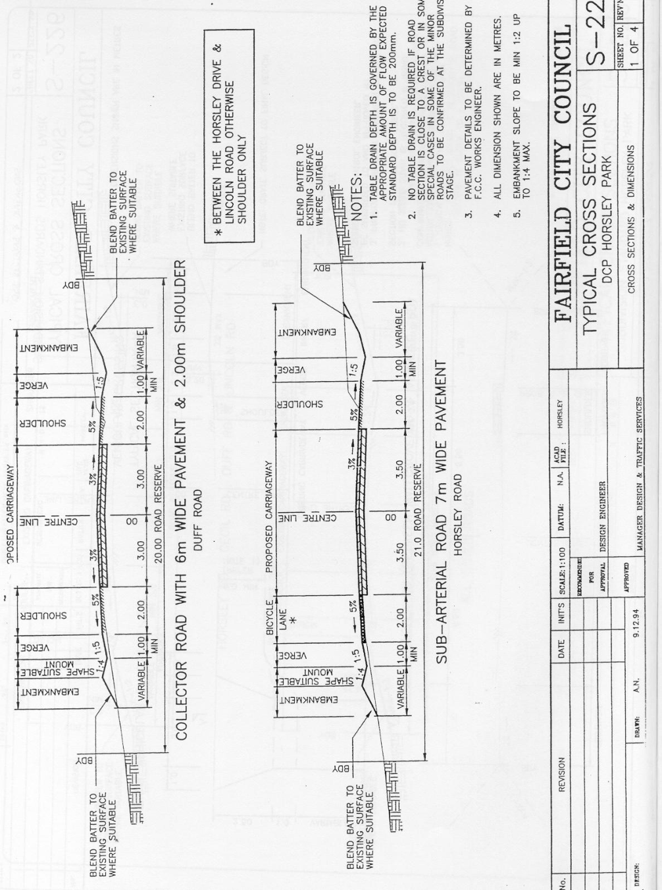

## Chapter 14 - Subdivision

#### Overview

To encourage off-road cycleways within the footpath reserve of the main road created within a new subdivision pattern.

That the subdivision pattern, including the main road is located and formed in a manner that best integrates with the Bicycle Plan adopted by Council.

#### Controls

a) Connections for a cycleway need to be:

i. 2.5 metres wide

ii. Hard paved

iii. Located within the road reserve, with a minimum requirement to be located on one side of the road reserve.

#### Exceptions

a) Where it can be demonstrated that a 2.5 metre hard paved area on this main road will affect the practicality of configuring allotments, then a minimum width of 1.8 metres will be considered.

b) Applicants will need to examine Council’s Bicycle Plan and cycleway network when preparing their application to determine whether allocation of an off-road cycleway along the main road of their subdivision is the only cycleway provision they need to accommodate.

### 14.8  Site Specific Subdivision Development Plans

Specific subdivision development plans for sites throughout the City are contained in Schedule 5.

#### Schedule 1

> [Picture on page 24: a picture, saved as a picture (images/chapter-14-subdivision-page-24-2.gif, 150 dpi).]
