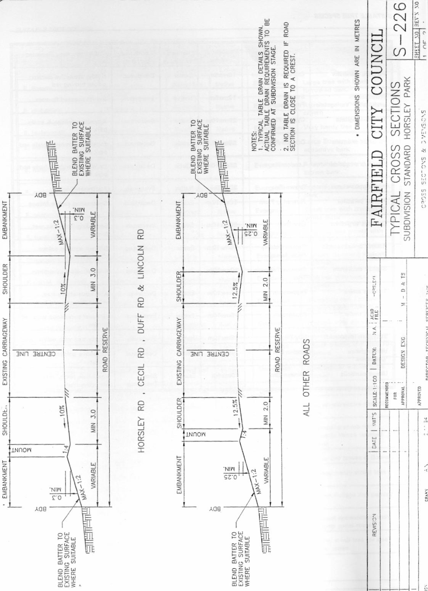

## Chapter 14 - Subdivision

> [Picture on page 26: a picture, saved as a picture (images/chapter-14-subdivision-page-26-2.gif, 150 dpi).]

#### Schedule 3

Right of Carriageway Variable Width and Positive Covenant for Maintenance and

#### Repair

Full and free right for every person who is at any time entitled to an estate or interest in possession in the land identified in the abovementioned plan as a lot benefited or any part thereof with which the right shall be capable of enjoyment, and every person authorised by that person to go, pass and re-pass at all times and for all purposes with or without animals or vehicles or both to and from the said lot benefited or any part thereof, subject to the following provisions. The proprietors of the lots hereby benefited shall at all times and from time to time maintain and repair without delay any part of any lot hereby burdened identified on the above mentioned plan as the site of the right of carriage way variable width and in respect of any part of any such lot hereby burdened on which any part of such right of carriage way variable width is constructed or located PROVIDED THAT all costs and expenses of such maintenance and repair shall be borne equally by the proprietors of the lots hereby benefited or the proprietors of any part or parts thereof with which the right shall be capable of enjoyment.
