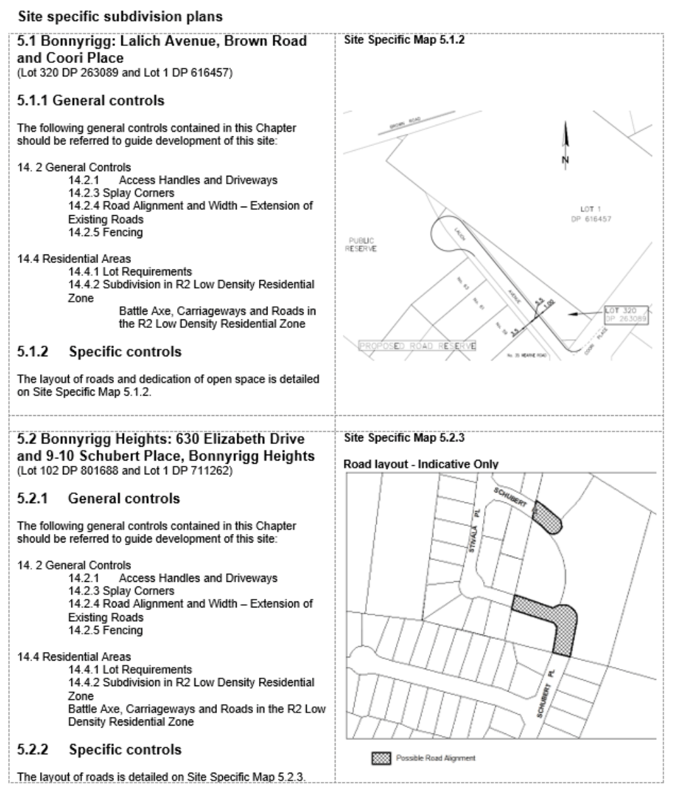

## Chapter 14 - Subdivision

The land to which the benefit of the positive covenant referred to in paragraph 2 hereof is appurtenant is any lot hereby burdened by the right of carriage way variable width identified in the abovementioned plan. The land which is subject to the burden of the positive covenant referred to in paragraph 2 hereof is any lot hereby benefited by the right of carriage way variable width identified in the abovementioned plan. 5If any dispute arises relating to the need to carry out any maintenance and repair pursuant to the positive covenant referred to in paragraph 2, including the nature of work or its reasonable cost, that dispute shall be determined by an arbitrator appointed by the proprietors under the Commercial Arbitration Act, 1984 whose determination shall be final and binding on all proprietors. For the purposes of the positive covenant referred to in paragraph 2 hereof, unless inconsistent with the context:- Maintain and repair includes in relation to the lots burdened, the maintenance,

repair and replacement of any pavement, surface or finish to the site of the right of carriage way variable width together with any foundation to same and any gutters, drains, trenches, earth banks and kerbs forming part of the site of the right of carriage way variable width. Proprietor includes the registered proprietor of any lot from time to time and all

the heirs, executors, assigns and successors in title to any lot and where there are two or more registered proprietors of such lot the terms of the positive covenant shall bind all those registered proprietors jointly and severally.

#### Schedule 4

> [Picture on page 28: a picture, saved as a picture (images/chapter-14-subdivision-page-28-2.gif, 150 dpi).]
