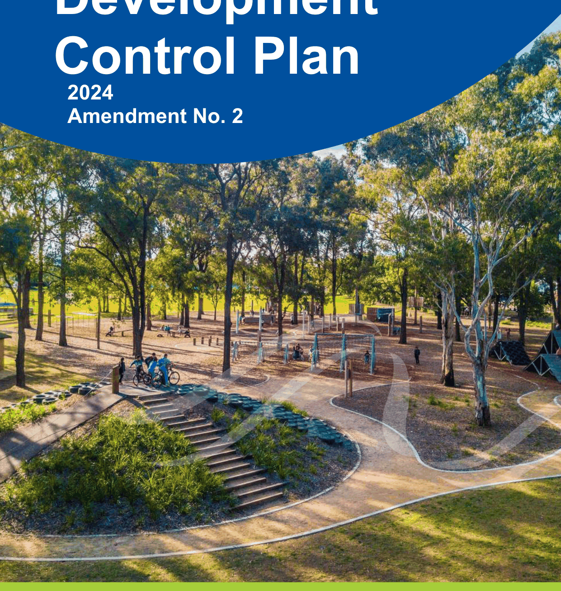

# Fairfield City Wide Development Control Plan 2024 - Cover and Contents

Source PDF: [fairfield-city-wide-dcp-2024-amendment-no.2 - Cover and Contents.pdf](https://planfortomorrow.sharepoint.com/sites/Planfortomorrow/Shared%20Documents/00%20NSW-Planning-Resources/dcp/fairfield-city-wide-development-control-plan-2024/cover-and-contents/fairfield-city-wide-dcp-2024-amendment-no.2%20-%20Cover%20and%20Contents.pdf)

### Fairfield CityWide

> [Picture on page 1: a picture, saved as a picture (images/cover-and-contents-page-1-2.gif, 150 dpi).]

### Development Control Plan

### 2024 Amendment No. 2

1      Development Control Plan – Table of Contents

#### Acknowledgements

We would like to Acknowledge the Cabrogal of the Darug Nation who are the Traditional Custodians of this Land. We also pay our respect to the Elders both past and present and future of the Darug Nation.

We acknowledge your rich culture and your unique role here in the Fairfield region. Your heritage and traditions are important to us all, and part and parcel of the great history of Australia.

Copyright © 2021 Fairfield City Council 86 Avoca Road, Wakeley 2176 Monday-Friday 8.30am-4.30pm 9725 0222

www.fairfieldcity.nsw.gov.au mail@fairfieldcity.nsw.gov.au

#### Acknowledgements

We would like to Acknowledge the Cabrogal of the Darug Nation who are the Traditional Custodians of this Land. We also pay our respect to the Elders both past and present and future of the Darug Nation.

We acknowledge your rich culture and your unique role here in the Fairfield region. Your heritage and traditions are important to us all, and part and parcel of the great history of Australia.

2      Development Control Plan – Table of Contents
