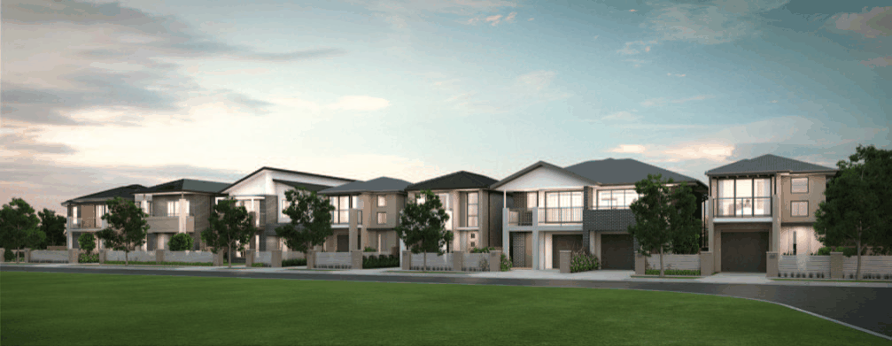

### 5.1 Introduction

Part Five provides design guidelines applicable to the private realm areas of the Bonnyrigg Masterplan.  These guidelines are broad design rules that instruct the physical development of the area.  These guidelines build upon and deliver the design vision and principles outlined in Part 1, 2 and 3 of the Masterplan.

> [Picture on page 3: a picture, saved as a picture (images/bonnyrigg-living-communities-masterplan-page-3-6.gif, 150 dpi).]

Streetscape Perspective

### PART FIVE  PRIVATE REALM GUIDELINES

### Distribution of Housing
