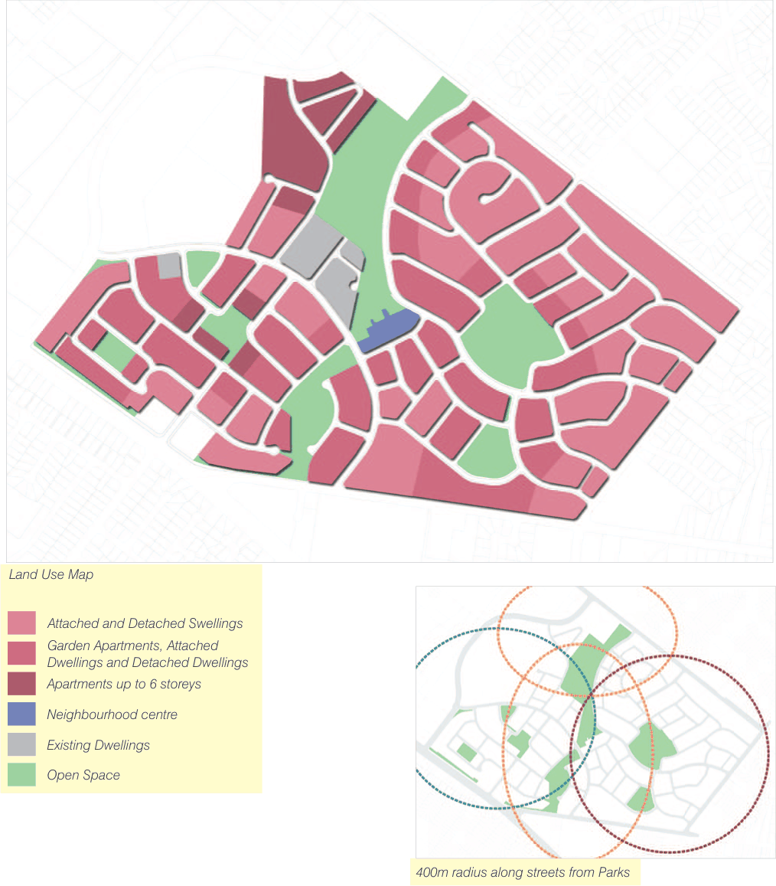

### 5.2 Distribution of Housing

Although the Masterplan allows for flexibility in the ultimate layout and design of individual stages of the project, overall objectives shaping the distribution of new housing include:

■

■ Increasing residential access to transport, services, and parks. This includes locating apartment sites and providing more attached homes close to Bonnyrigg Town Centre and the T-way, lining park edges with attached homes, and planning for all housing to be within 400m of a park;

■

■ Providing for a complete and diverse community through a mix of housing types appropriate for diverse households. New housing types to be introduced include lifted apartments of 3 to 6 storeys, garden apartments up to 3 storeys, attached homes in plex or row configurations of up to 8 dwellings and detached houses. New housing provides a range of bedroom combinations and varying levels of outdoor space and maintenance requirements;

■

■ Increasing density while maintaining the suburban feel and character of the area. This includes designing attached homes to look and feel like large 2-storey houses, as well as more traditional building typologies such as garden apartments and detached/attached dwellings on compact lots;

■

■ Reducing the stigma of social housing. This includes making social housing indistinguishable from private housing from the street, and providing social housing throughout the neighbourhood; and

■

■ Providing quality lifted apartment dwellings as an area appropriate housing option, including as a solution for aging in place. This includes designing apartment buildings to be accessible and to relate to the leafy suburban character of the area via ground level courtyards and landscaped spaces between buildings.

Flexibility in Design Outcomes Beyond nominating the lifted apartment precincts and outlining a strategy for locating density across the balance of the estate. The Masterplan does not prescribe specific housing types on specific allotments.  This enables each stage to meet social housing requirements while remaining responsive to changes in the community and the market, as well as potential changes to requirements related to building performance. The new Bonnyrigg Masterplan is intended to be developed in 18 stages to be built over approximately 13 years. Although the Masterplan itself is largely determined by key requirements of the project (including the need to preserve private homes scattered throughout the existing estate), completing the project in stages encourages greater flexibility in design outcomes. However, changes in dwelling design with time are expected to be minor. Regardless, new dwellings will achieve the general requirements of the project.

### PART FIVE  PRIVATE REALM GUIDELINES

### Distribution of Housing

> [Picture on page 5: a picture, saved as a picture (images/bonnyrigg-living-communities-masterplan-page-5-3.gif, 150 dpi).]
> Words printed on the picture (title and legend, copied from the PDF):
> Land Use Map
> Attached and Detached Swellings
> Garden Apartments, Attached
> Dwellings and Detached Dwellings
> Apartments up to 6 storeys
> Neighbourhood centre
> Existing Dwellings
> Open Space
> 400m radius along streets from Parks

### PART FIVE  PRIVATE REALM GUIDELINES

### Detached and Attached Housing - General Guidelines
