### 5.3 Detached and Attached Housing - General Guidelines

The following guideling have been developed for detached and attached housing within the Bonnyrigg Masterplan area, to deliver high-quality living environments for all residents of Bonnyrigg.  These guidelines have been developed to ensure that each dwelling type can be placed adjacent to the other with minimum impact on amenity.  As the Masterplan will be realised through staged development, design variations within each dwelling type over time is expected.  Future potential design variations will be tested to ensure that dwelling types continue to be complimentary to each other.

Lot Size The size of lots determines the type of dwellings that can be constructed in an

area.  The following table depicts minimum lot dimensions within Bonnyrigg for each proposed attached and detached dwelling type.

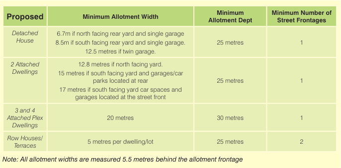

> [Picture on page 6: a map, saved as a picture (images/bonnyrigg-living-communities-masterplan-page-6-16.gif, 150 dpi); the street names and other small labels are on the picture.]
> Words printed on the picture (title and legend, copied from the PDF):
> Minimum Number of
> Proposed Minimum Allotment Width
> Allotment Dept Street Frontages
> 6.7m if north facing rear yard and single garage
> 8.5m if south facing rear yard and single garage.
> 12.5 metres if twin garage.
> 12.8 metres if north facing yard.
> 15 metres if south facing yard and garages/car
> parks located at rear
> 17 metres if south facing yard car spaces and
> garages located at the street front
> 3 and 4
> 5 metres per dwelling/lot
> Note: All allotment widths are measured 5.5 metres behind the allotment frontage

Site Coverage

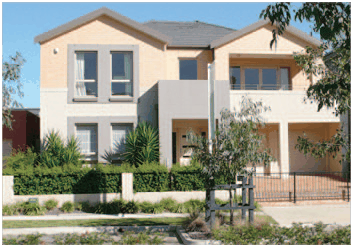

> [Picture on page 6: a picture, saved as a picture (images/bonnyrigg-living-communities-masterplan-page-6-18.gif, 150 dpi).]

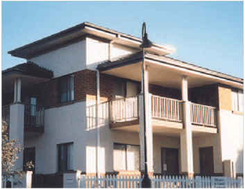

> [Picture on page 6: a picture, saved as a picture (images/bonnyrigg-living-communities-masterplan-page-6-19.gif, 150 dpi).]

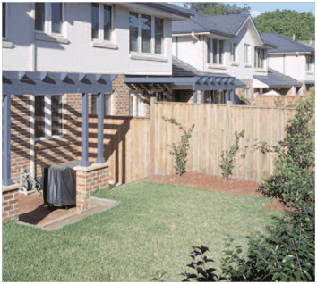

> [Picture on page 6: a picture, saved as a picture (images/bonnyrigg-living-communities-masterplan-page-6-20.gif, 150 dpi).]

Soft Landscaping & Deep Soil Landscaping

The amount of landscape area, along with the size of the building footprint, within individual allotments will help determine useability, privacy, and social opportunities for residents.  Landscape area will add to residents’ quality of life while providing habitat for indigenous plants and animals.  Building footprint can shape both private and public amenity. For Landscape Area:

■

■ A minimum of 35% of each allotment will be used as landscape area (including soft and hard landscaping, and ancillary structures such as sheds and pagodas, but excluding garages and car parking spaces); and

■

■ A minimum of 30% of the landscape area must be deep soil landscaping, to accommodate the growth of large trees, allow infiltration of rainwater, and reduce stormwater runoff.

### PART FIVE  PRIVATE REALM GUIDELINES

### Detached and Attached Housing - General Guidelines

For Building Footprint:

■

■ A maximum of 65% of any allotment can be built upon, including garages and car parking spaces. Streetscape Streetscape contributes significantly to the quality of a neighbourhood. Bonnyrigg will offer a high quality residential address characterised by a suburban leafy amenity.   Garages and various other building elements help determine streetscape. For Garages:

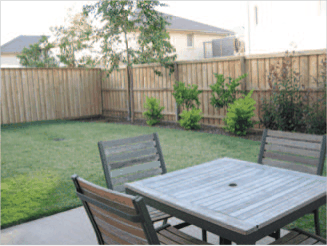

> [Picture on page 7: a picture, saved as a picture (images/bonnyrigg-living-communities-masterplan-page-7-13.gif, 150 dpi).]

Soft Landscaping & Deep Soil Landscaping

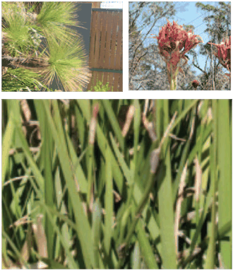

> [Picture on page 7: a picture, saved as a picture (images/bonnyrigg-living-communities-masterplan-page-7-15.gif, 150 dpi).]

■

■ All garages must be setback a minimum of 5.5m from the street frontages (not including rear access streets or secondary frontages which are considered on merit)

■

■ Garages fronting rear access streets and secondary frontages may be constructed to the allotment boundary subject to demonstrating safe vehicle and pedestrian movements can be maintained with an appropriate streetscape.

■

■ The maximum combined width of garages fronting a street (not including rear access streets) is 50% of the allotment width;

■

■ The maximum combined width of garages fronting a rear access street is 80% of the allotment width; and

■

■ No triple or more garages side-by-side are permitted except where fronting access places.

Native & Drought Resistant Landscaping

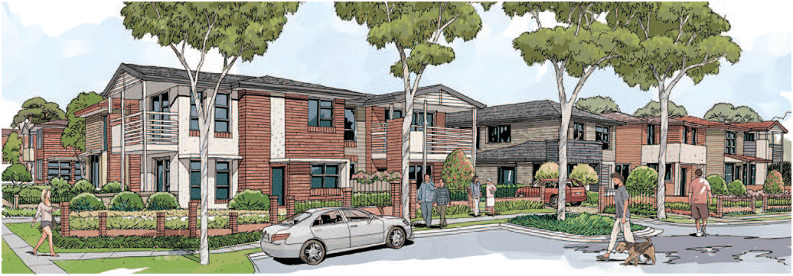

> [Picture on page 7: a picture, saved as a picture (images/bonnyrigg-living-communities-masterplan-page-7-35.gif, 150 dpi).]

Example Perspective

### PART FIVE  PRIVATE REALM GUIDELINES

### Detached and Attached Housing - General Guidelines

For Building Elements:

■

■ Dwellings are to have a direct entry and address from a street frontage;

■

■ Front doors to dwellings are to be visible and/or easily identifiable from the street;

■

■ Dwellings on corner allotments are to be designed so that one elevation addresses the street.  The secondary elevation is to be visually interesting, including articulation to the dwelling and roof form; and

■

■ Long blank walls are to be avoided.

Bulk and Scale

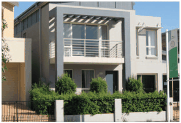

> [Picture on page 8: a picture, saved as a picture (images/bonnyrigg-living-communities-masterplan-page-8-16.gif, 150 dpi).]

Building height will generally be two-storeys for attached and detached dwellings

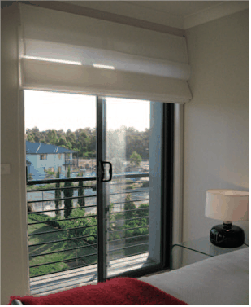

> [Picture on page 8: a picture, saved as a picture (images/bonnyrigg-living-communities-masterplan-page-8-19.gif, 150 dpi).]

Building bulk and scale has a significant impact on private and public amenity.  Elements of bulk and scale include building height and ceiling height. For Building Height:

■

■ Detached and attached dwellings will achieve a predominate building height of two storeys, with some three story elements permitted in select locations as specified in Section 3.9 of the Masterplan .

For Ceiling Height;

■

■ Ceiling heights can help increase perceptions of spaciousness within dwellings, as well as assist in the provision of ample access to natural light and air.

■

■ All dwellings must have minimum ceiling heights of 2.4m measured from finished floor to finished ceiling level in all habitable rooms

Setbacks

Ceiling heights can help increase perceptions of spaciousness within dwellings

Setbacks help determine streetscape and provide adequate separation between dwellings.  Setbacks also help to ensure privacy to dwellings from the street and between properties.

For Front Setbacks:

■

■ A minimum of 80% of the front building facade (excluding garages) is to be setback a minimum of 4.5m from the allotment frontage;

■

■ A maximum of 20% of the front building facade may be setback a minimum of 1.2m from the allotment frontage; and

■

■ A zero setback may be permitted for limited building elements and only on secondary street frontages.

■

■ Terraces - A minimum setback of 2m from the allotment frontage, a maximum of 20% of the building footprint can be set back 800mm from the allotment frontage. For Side and Rear Setbacks:

■

■ 80% of the side building facade must be setback a minimum of 0.9m from the side boundary (except for zero setbacks)

### PART FIVE  PRIVATE REALM GUIDELINES

### Detached and Attached Housing - General Guidelines

■

■ Where there is a zero side setback, a minimum 0.9m access path must be provided between the front and rear yards elsewhere;

■

■ Zero side setbacks must not exceed a maximum length of 12m where it adjoins a private allotment; Windows or openings are permitted within these walls only where they satisfy BCA requirements for fire safety and where no privacy impacts arise; and

■

■ Where a gutter is required on the zero setback boundary, a 0.2m offset from the allotment line must be established, with the placement of a maintenance easement on the adjoining allotment for access.

Privacy The Bonnyrigg Masterplan design encourages visual privacy while maximising outlook and views from principal rooms.  New design will also assure acoustic privacy. For Visual Privacy:

■

■ Internal layout of buildings must be designed to minimise overlooking of living areas and private open spaces;

■

■ A balcony or window from a habitable room must not be located to have a direct view into the balcony or window of another habitable room of another dwelling located within 6m;

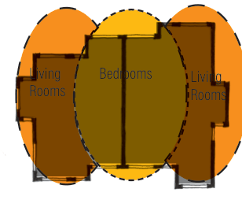

> [Picture on page 9: a picture, saved as a picture (images/bonnyrigg-living-communities-masterplan-page-9-27.gif, 150 dpi).]
> Words printed on the picture (title and legend, copied from the PDF):
> Bedrooms Living
> Rooms
> Living
> Rooms

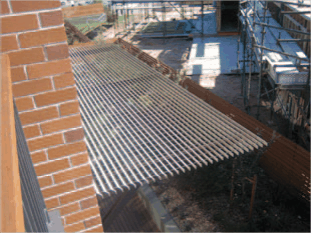

> [Picture on page 9: a picture, saved as a picture (images/bonnyrigg-living-communities-masterplan-page-9-28.gif, 150 dpi).]

Horizontal Screen

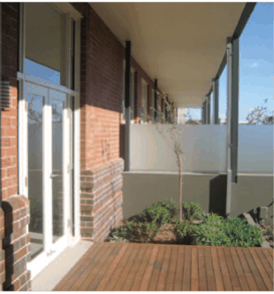

> [Picture on page 9: a picture, saved as a picture (images/bonnyrigg-living-communities-masterplan-page-9-30.gif, 150 dpi).]

■

■ Windows of upper level primary living rooms that face ground level private open spaces of another dwelling must be either of a high level with a deep sill, or have a sill height of minimum 1.5m above floor level, or must be fitted with a horizontal privacy screen from its base (or similar) to screen a proportion of the private open space from the window.; and

■

■ An alternative to the horizontal privacy screen may be a pergola or similar fitted within the private open space of the adjacent dwelling. For Acoustic Privacy:

■

■ Development that adjoins significant noise sources (such as Elizabeth Drive and Cabramatta Road) must be designed to achieve an acceptable internal noise level, based on the recognised Australian Standards and those regulated by the relevant State Government Authority;

Screen between Back yards

■

■ Any on-site noise generating sources, such as plant rooms and equipment, air conditioning units, pool filters, and recreation areas, must be designed to not exceed 5dB(A) above the existing background noise level at the nearest residential receiver;

■

■ Air conditioning units are to meet appropriate acoustic standards; and

■

■ Attached dwellings must be designed (and their material specified) to the relevant BCA requirements for acoustic privacy.

Offset balconies

### PART FIVE  PRIVATE REALM GUIDELINES

### Detached and Attached Housing - General Guidelines

Safety and Security Bonnyrigg will be a mixed income community.  The Masterplan is designed to minimise potential conflicts between residents. All development within Bonnyrigg will be designed through the NSW Police Crime Prevention through Environmental Design (CPTED) principles.  The proposed Masterplan will create safe and secure private domain through a range of design treatments. In general, safety and security will be increased by: Avoiding any ambiguous semi-private spaces:

■

■ Ensuring that all areas are obviously owned by either the body corporate or owner of the dwelling.

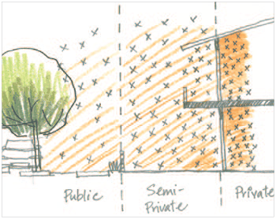

> [Picture on page 10: a picture, saved as a picture (images/bonnyrigg-living-communities-masterplan-page-10-14.gif, 150 dpi).]

Transition - Territorial Reinforcement Public - Semi Private - Private Spaces

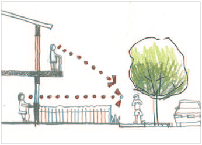

> [Picture on page 10: a picture, saved as a picture (images/bonnyrigg-living-communities-masterplan-page-10-17.gif, 150 dpi).]

■

■ Defining the  edges of spaces using a mixture of height change, landscape, hedges, fences, walls, and gates; and

■

■ Ensuring each dwelling has safe well-lit access to and from their car parks and their dwelling.

Controlling access to homes:

■

■ Making homes inaccessible from balconies, roofs and windows of neighbouring buildings; and

■

■ Providing direct access from the car park to the home wherever possible. Enhancing the visibility and safety of building entrances;

■

■ Orienting entrances towards a public street;

Passive Surveillance

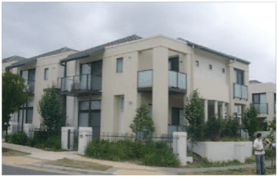

> [Picture on page 10: a picture, saved as a picture (images/bonnyrigg-living-communities-masterplan-page-10-34.gif, 150 dpi).]

■

■ Providing clear site lines from and to the street; and

■

■ Minimising the number of dwellings using shared entrance ways; Increasing opportunities for casual surveillance;

■

■ Orienting living areas and providing balconies with views over public and any communal open spaces or areas of car parking.

Minimising opportunities for entrapment and concealment;

■

■ Avoiding any dead ends and other areas of possible entrapment;

Dwellings on Corner Lots Provide Good Opportunities for Casual Surveillance

■

■ Ensuring that lighting is sufficient to allow for facial recognition of approaching pedestrians within 15m;

■

■ Avoiding blind or dark alcoves near where people will need to walk - such as entrances, car parks, corridors or walkways;

■

■ Providing good lighting along any paths and areas that people are likely to use at night. Such as over entry doors and car parking areas; and

■

■ Utilising white light instead of sodium vapour to ensure proper colour and textural rendition.

### PART FIVE  PRIVATE REALM GUIDELINES

### Detached and Attached Housing - General Guidelines

Open Space The Masterplan for Bonnyrigg encompasses a vision of streets and pathways operating as important ‘neighbourhood spaces’.  For this to occur, there needs to be a strong demarcation between public, semi-private and private spaces, so residents feel comfortable interacting with passers-by from their front yards. Important elements of open space include  private open space, fencing, and retaining walls. For Private Open Space:

■

■ The Bonnyrigg Masterplan will provide each dwelling private open space designed to offer residents quality usable outdoor living areas for recreation and outdoor activities;

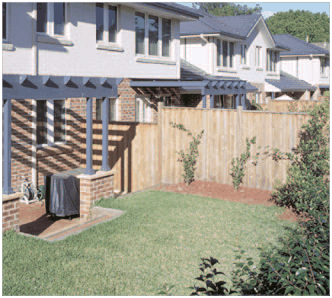

> [Picture on page 11: a picture, saved as a picture (images/bonnyrigg-living-communities-masterplan-page-11-15.gif, 150 dpi).]

Soft Landscaping & Deep Soil Zone

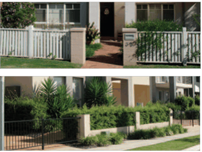

> [Picture on page 11: a picture, saved as a picture (images/bonnyrigg-living-communities-masterplan-page-11-17.gif, 150 dpi).]

■

■ Each dwelling must have a minimum of 25m2 of ground level private open space with a minimum dimension of 4m, or 10m2 of above ground level open space in the form of a balcony with a minimum dimension of 2.5 m;

■

■ Private open space should generally be accessible from a living area of dwellings; and

■

■ The private open space should generally be located to maximise solar access. For Fencing:

■

■ Fencing will be constructed in accordance with the site fencing strategy. For Retaining Walls:

Examples of Front Fencing

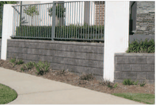

> [Picture on page 11: a picture, saved as a picture (images/bonnyrigg-living-communities-masterplan-page-11-33.gif, 150 dpi).]

■

■ Retaining walls will be designed to not exceed a height of more than 1m. When located within sight of a public place ,the material and colour will be complementary to the character and quality of the streetscape.

Example of Retaining Walls

### PART FIVE  PRIVATE REALM GUIDELINES

### Detached and Attached Housing - General Guidelines

Car Parking and Garages Car parking and garages impact streetscape as well as neighbourhood character and movement patterns.  The overall objective of the car parking and garage guidelines offered here is to ensure that car parking and garages are appropriate to the Masterplan vision. For Car Parking and Garages:

■

■ Car parking must be designed to ensure that cars are not parked across pedestrian or cycle paths located in the street verge;

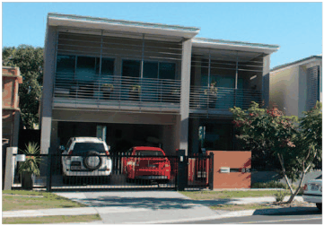

> [Picture on page 12: a picture, saved as a picture (images/bonnyrigg-living-communities-masterplan-page-12-12.gif, 150 dpi).]

Example - Carparking behind allotment line

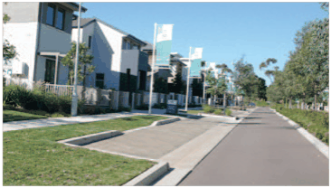

> [Picture on page 12: a picture, saved as a picture (images/bonnyrigg-living-communities-masterplan-page-12-14.gif, 150 dpi).]

■

■ The minimum dimensions of any parking space is 2.5m x 5.5m. The minimum internal dimensions of an enclosed garage must be 3m x 5.5m. The maximum width of driveways for individual dwellings at the allotment line must be 6m;

■

■ All housing types must have a minimum of 1 car parking space per dwelling;

■

■ Detached homes will provide two car spaces per dwelling which may be tandem.  Visitor parking will be provided on street and;

■

■ Attached home types will provide car spaces as follows:

-- 1 or 2 bedroom homes will have a minimum 1 car space; and

Example - Carparking Formalised Car Parking Bays in collector streets.

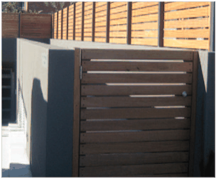

> [Picture on page 12: a picture, saved as a picture (images/bonnyrigg-living-communities-masterplan-page-12-31.gif, 150 dpi).]

-- 3 bedroom homes will have a minimum 1.5 car spaces per home (the extra car space will be distributed to one or the other 3 bedroom home within the attached group of homes); and

-- Visitor parking will be provided on-street.

Service Areas For the Bonnyrigg Masterplan to deliver a high quality streetscape, it is important that the service areas of homes are designed to be complementary to the neighbourhood. The Masterplan will ensure this through the following design measure:

Service areas for garbage bins that are screened from the street

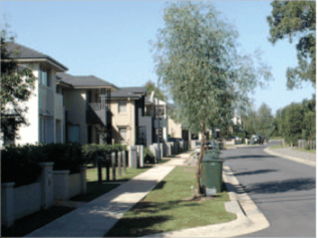

> [Picture on page 12: a picture, saved as a picture (images/bonnyrigg-living-communities-masterplan-page-12-43.gif, 150 dpi).]

■

■ Each dwelling will have access to a service court for garbage that is screened from the street and placed in a convenient location for access from both the home and the public point of pick up for garbage.

Garbage Service Areas in easy access to the garbage pick up location.

### PART FIVE  PRIVATE REALM GUIDELINES

### Detached and Attached Housing - General Guidelines

Storage Adequate storage space was a common desire expressed by both the existing and potential future residents of the neighbourhood.  An appropriate amount and balance of internal and external storage space needs to be provided for each dwelling, having regard to the likely needs of the occupant of that dwelling, The following storage space should be provided in addition to kitchen cupboards and bedroom wardrobes:

■

■ 1 bedroom  dwelling – 6m3.

■

■ 2 bedroom  dwelling – 8m3; and

■

■ 3+ bedroom dwelling – 10m3.

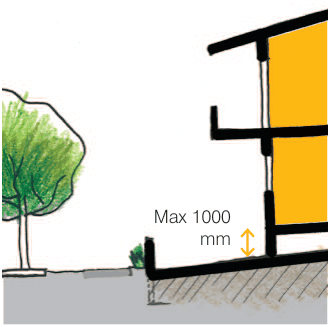

> [Picture on page 13: a picture, saved as a picture (images/bonnyrigg-living-communities-masterplan-page-13-17.gif, 150 dpi).]
> Words printed on the picture (title and legend, copied from the PDF):
> Max 1000
> mm

Maximum height of Finished Floor Level above ground

Sloping Sites Bonnyrigg has a natural rolling topography that adds to the area’s unique character.  The Bonnyrigg Masterplan retains these slopes, as well as key existing vegetation profiles For Cut and Fill:

■

■ The maximum level of cut must not exceed 1m below the natural ground level and the maximum level of fill must not exceed 1m above natural ground level, measured at any corner of the building platform; and

■

■ If basement car parking or similar underground floors are developed, the finished floor levels of the ground floor of the building must finish with a maximum level of 1m above natural ground level, measured from any corner of the building platform.

Sustainable Environmental Design and BASIX

### PART FIVE  PRIVATE REALM GUIDELINES

### Detached and Attached Housing - General Guidelines

The Masterplan establishes stretch targets for the environmental design of the dwellings that exceed those required of the NSW Government.  The Building Sustainability Index (BASIX) is an interactive, internet-based planning tool designed to assess the potential performance of residential development against a range of sustainability indices.  The focus of BASIX is on the key indices of water and energy, and the related indices of landscape, stormwater and thermal comfort. The base and stretch targets for attached and detached housing (as stated in Part 3 of the Masterplan, but repeated here) are as follows: Energy Efficiency

#### Energy Efficiency

Criteria

Base Target

Stretch Target

Compliance with the minimum BASIX requirements (35 or 40% reduction in

BASIX Energy Score

50% reduction in per capita

C02 emissions compared to the

/ Greenhouse Gas

per capita C02 emissions compared to the national average as quantified national average as quantified

Emissions

by BASIX depending on dwelling

by BASIX

types)

To avoid an increase in electricity

Peak Electricity To avoid a per capita increase in infrastructure required to service Demand

peak electricity demand the site, despite an increase in

density

Water and Wastewater Management

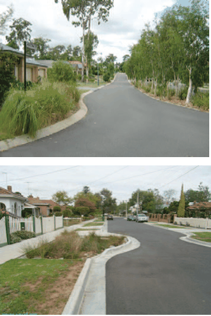

> [Picture on page 14: a picture, saved as a picture (images/bonnyrigg-living-communities-masterplan-page-14-35.gif, 150 dpi).]

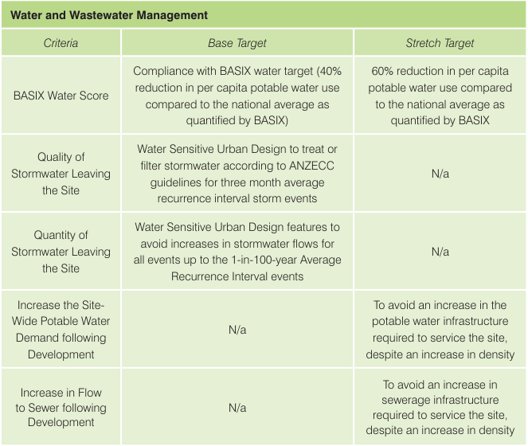

> [Picture on page 14: a picture, saved as a picture (images/bonnyrigg-living-communities-masterplan-page-14-36.gif, 150 dpi).]
> Words printed on the picture (title and legend, copied from the PDF):
> Water and Wastewater Management
> Criteria
> Base Target
> Stretch Target
> Compliance with BASIX water target (40%
> reduction in per capita potable water use
> 60% reduction in per capita
> potable water use compared
> BASIX Water Score
> compared to the national average as to the national average as
> quantified by BASIX)
> quantified by BASIX
> Water Sensitive Urban Design to treat or
> filter stormwater according to ANZECC
> Quality of
> Stormwater Leaving
> N/a
> guidelines for three month average
> the Site
> recurrence interval storm events
> Water Sensitive Urban Design features to
> Quantity of
> Stormwater Leaving
> N/a
> avoid increases in stormwater flows for
> all events up to the 1-in-100-year Average
> the Site
> Recurrence Interval events
> Increase the Site-
> Wide Potable Water
> N/a
> Demand following
> Development
> To avoid an increase in the
> potable water infrastructure
> required to service the site,
> despite an increase in density
> Increase in Flow
> to Sewer following
> N/a
> Development
> To avoid an increase in
> sewerage infrastructure
> required to service the site,
> despite an increase in density

Bioretention to capture site stormwater runnoff

Occupant amenity and thermal comfort

### PART FIVE  PRIVATE REALM GUIDELINES

### Detached and Attached Housing - General Guidelines

| Occupant Health, wellbeing and Amenity |  |  |
|---|---|---|
| Criteria | Base Target | Stretch Target |
| Natural Ventilation | Compliance with minimum SEPP 65 requirement that 60% of dwellings have a dual aspect | Provision of dual aspect facades for no less than 90% of dwellings |
| Natural Light | Building forms should provide a maximum northerly exposure for as many rooms as possible in each dwelling | Provision of a daylight factor of no less than 25% of 60% of all living spaces |
| Thermal Comfort | Compliance with BASIX requirements for Thermal Comfort | Design to provide thermal comfort such that a majority of occupants are comfortable for 98% of the year, using the thermal comfort standard ISO7730 |
| Indoor Air Pollutants | Use of low-VOC paints and carpets for all internal wall and ceiling paint and dwelling carpets; Use of low-formaldehyde MDF | N/a |
| Shading Devices | Shading devices will be used, such as eaves, awnings, external louvres, and pergolas to filter the summer sun. | N/a |

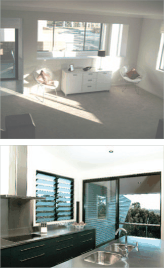

> [Picture on page 15: a picture, saved as a picture (images/bonnyrigg-living-communities-masterplan-page-15-4.gif, 150 dpi).]

Kitchen with access to natural light

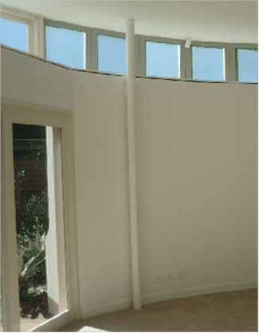

> [Picture on page 15: a picture, saved as a picture (images/bonnyrigg-living-communities-masterplan-page-15-6.gif, 150 dpi).]

Solar Access

■

■ Building forms should provide a maximum northerly exposure for as many rooms as possible in each dwelling and minimise casting of shadows;

■

■ Glazing facing west to southwest should be minimized and protected with effective sun shades; and

■

■ Detached and attached dwellings must be designed to ensure the adjoining living area windows and more than 50% of their private open space on the subject site or any adjoining site receives at least 3 hours of direct sunlight between 9am and 3pm on the 21st of June.

Clerestory Window - to achieve natural light when access or open space of another home is adjacent

### PART FIVE  PRIVATE REALM GUIDELINES

### Apartments and Seniors Living

Ground Floor Courtyard apartments Potential Ground Floor mixed use Private Open Space for Apartments

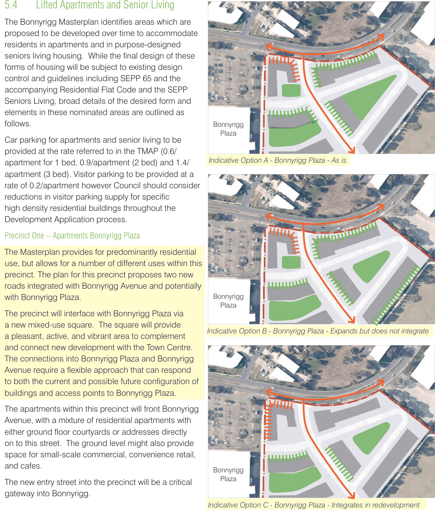

> [Picture on page 16: a picture, saved as a picture (images/bonnyrigg-living-communities-masterplan-page-16-9.gif, 150 dpi).]
> Words printed on the picture (title and legend, copied from the PDF):
> Bonnyrigg
> Plaza
> Indicative Option A - Bonnyrigg Plaza - As is
