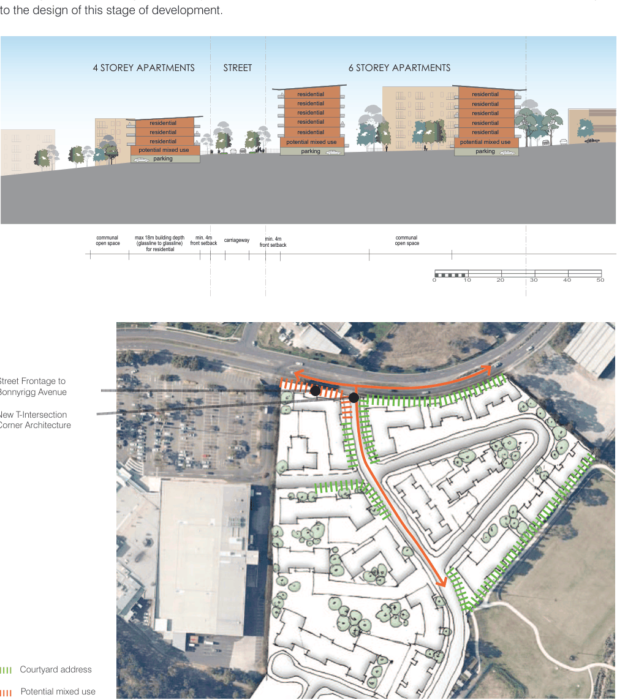
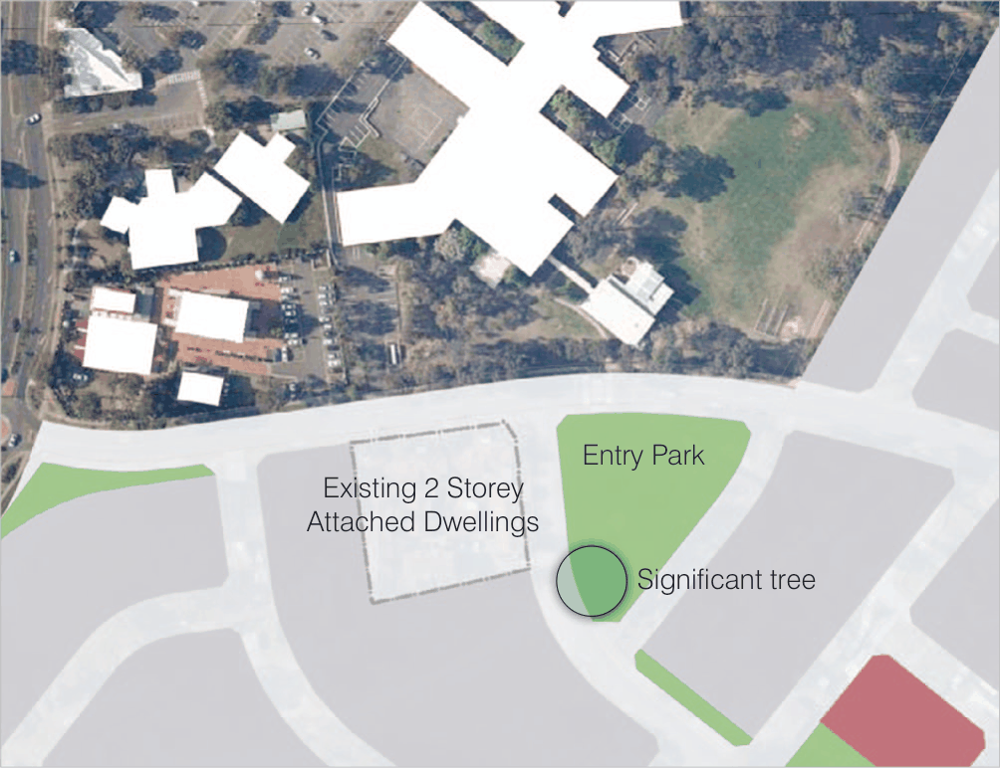
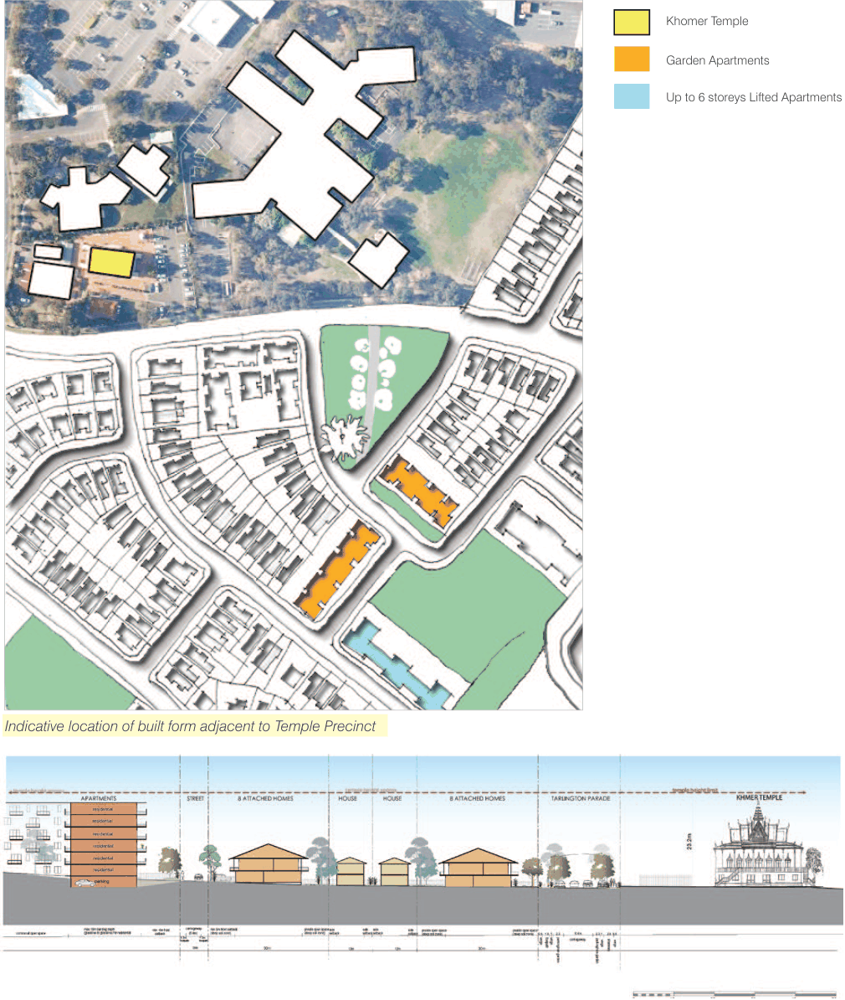

### 5.4 Lifted Apartments and Senior Living

The Bonnyrigg Masterplan identifies areas which are proposed to be developed over time to accommodate residents in apartments and in purpose-designed seniors living housing.  While the final design of these forms of housing will be subject to existing design control and guidelines including SEPP 65 and the accompanying Residential Flat Code and the SEPP Seniors Living, broad details of the desired form and elements in these nominated areas are outlined as follows. Car parking for apartments and senior living to be provided at the rate referred to in the TMAP (0.6/ apartment for 1 bed, 0.9/apartment (2 bed) and 1.4/

> Words printed on the picture (title and legend, copied from the PDF):
> Indicative Option B - Bonnyrigg Plaza - Expands but does not integrate
> Indicative Option C - Bonnyrigg Plaza - Integrates in redevelopment

apartment (3 bed). Visitor parking to be provided at a rate of 0.2/apartment however Council should consider reductions in visitor parking supply for specific high density residential buildings throughout the Development Application process. Precinct One – Apartments Bonnyrigg Plaza The Masterplan provides for predominantly residential use, but allows for a number of different uses within this precinct. The plan for this precinct proposes two new roads integrated with Bonnyrigg Avenue and potentially with Bonnyrigg Plaza. The precinct will interface with Bonnyrigg Plaza via a new mixed-use square.  The square will provide a pleasant, active, and vibrant area to complement and connect new development with the Town Centre. The connections into Bonnyrigg Plaza and Bonnyrigg Avenue require a flexible approach that can respond to both the current and possible future configuration of buildings and access points to Bonnyrigg Plaza. The apartments within this precinct will front Bonnyrigg Avenue, with a mixture of residential apartments with either ground floor courtyards or addresses directly on to this street.  The ground level might also provide space for small-scale commercial, convenience retail, and cafes. The new entry street into the precinct will be a critical gateway into Bonnyrigg.

### PART FIVE  PRIVATE REALM GUIDELINES

### Apartments and Seniors Living

The buildings on this corner will reinforce the importance of this entrance through suitable corner treatments, such as a stepping in or stepping out of the building footprint or a curvilinear form. The heights of the buildings within the precinct will be a maximum of six-stories and a minimum of two-stories, subject

> [Picture on page 17: a map, saved as a picture (images/bonnyrigg-living-communities-masterplan-page-17-6.gif, 150 dpi); the street names and other small labels are on the picture.]
> Words printed on the picture (title and legend, copied from the PDF):
> 4 STOREY APARTMENTS STREET
> 6 STOREY APARTMENTS
> potential mixed use
> potential mixed use
> potential mixed use
> max 18m building depth
> (glassline to glassline)
> 0 10 20 30 40 50
> Street Frontage to
> Potential mixed use

to the design of this stage of development.

Indicative location of built form adjacent to Bonnyrigg Plaza

### PART FIVE  PRIVATE REALM GUIDE LINES | Bonnyrigg Masterplan

### PART FIVE  PRIVATE REALM GUIDELINES

### Apartments and Seniors Living

Precinct Two – Apartment Temple Precinct This precinct is located in close proximity to the Khmer Temple to the north of Tarlington Parade which requires sensitivity from proposed new built form. The masterplan seeks to provide appropriate siting, street alignment and building heights which respect the current visual prominence of the Temple.  Attached and detached dwellings will be provided in the in closer proximity to the temple, with apartments located further to the south. The existing grouping of villas to the north of this precinct will be retained.  The precinct will place a group of two-storey attached dwellings to the immediate boundary of this site to complement their amenity.  A private street network will separate these two-storey forms and the parks from the apartments. A pedestrian link will be incorporated through the apartment area to the park on the eastern edge of the apartments.

> [Picture on page 18: a picture, saved as a picture (images/bonnyrigg-living-communities-masterplan-page-18-13.gif, 150 dpi).]

### Entry Park

### Existing 2 Storey

### Attached Dwellings

### Significant tree

Street aligned to provide a view of the Temple. Building form is complimentary to the Temple.

### PART FIVE  PRIVATE REALM GUIDELINES

> [Picture on page 19: a picture, saved as a picture (images/bonnyrigg-living-communities-masterplan-page-19-2.gif, 150 dpi).]
> Words printed on the picture (title and legend, copied from the PDF):
> Indicative location of built form adjacent to Temple Precinct

### Apartments and Seniors Living

Khomer Temple

Garden Apartments

Up to 6 storeys Lifted Apartments

### PART FIVE  PRIVATE REALM GUIDELINES

### Walk Up Apartments
