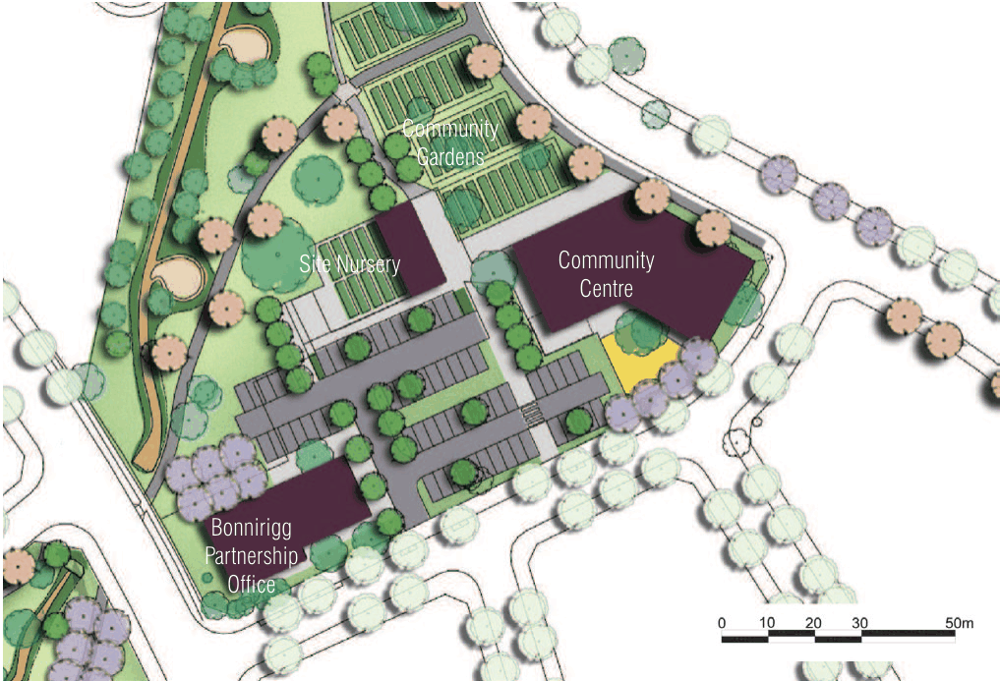
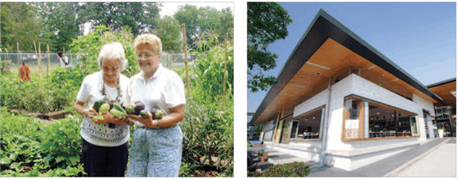

### 5.6 Bonnyrigg Neighbourhood Centre

As described earlier in Part 3 of this Masterplan, the site for Bonnyrigg Neighbourhood Centre has been selected based on a number of factors, including:

■

■ To provide residents of the eastern portion of the Masterplan area with easier access to community services. The Masterplan area is adjacent to the Bonnyrigg Town Centre, and the eastern portion of the neighbourhood is located over a kilometre from the Town Centre, with an even greater walking distance. It is appropriate to provide a community centre in closer proximity for residents within the eastern portion of the Masterplan area as the western portion of the site enjoys excellent access to the extensive range of retail, commercial, community and recreational activities provided within the Town Centre;

■

■ It is considered appropriate to provide a limited range of retail and commercial services within the neighbourhood to meet the convenience needs of local residents.  An economic impact assessment has confirmed that such activities will not have a detrimental impact upon the existing viability of Bonnyrigg Town Centre;

■

■ It is also considered appropriate to provide community facilities within the neighbourhood, including office accommodation for social housing tenancy management.  There is also a need for a community centre that provides meeting facilities and office space for community organisations; and

■

■ It is important that these facilities are provided in a central location within the neighbourhood to maximise its accessibility to residents and encourage walking and cycling as a means of travel. It is considered that the co-location of facilities within a new Neighbourhood Community Centre will provide a significant opportunity to create a focal point for community interaction and to foster a sense of place and local identity.

In regards to the proposed location of Bonnyrigg Neighbourhood Centre:

■

■ The location links the two major “halves” of Bonnyrigg at a natural centre of the community and within a prominent valley;

■

■ The site fronts Tarlington Parade, Bunker Parade, and a new street that will connect these two thoroughfares.  This provides the new Bonnyrigg Neighbourhood Centre with three important street frontages and offers the site good vehicular access;

■

■ The site is adjacent to Valley Park, an important aspect of the open space network, allowing the Bonnyrigg Neighbourhood Centre to interface with the open space network.  The pedestrian and cycle path network running north-south through the open space network joins the east-west footpath and shareway near this location; and

■

■ The location provides a truly central destination for the community, helping to form neighbourhood cohesion.

### PART FIVE  PRIVATE REALM GUIDELINES

### Bonnyrigg Neighbourhood Centre

> [Picture on page 22: a picture, saved as a picture (images/bonnyrigg-living-communities-masterplan-page-22-3.gif, 150 dpi).]

#### Community Gardens

#### Community

#### Site Nursery

#### Centre

> [Picture on page 22: a picture, saved as a picture (images/bonnyrigg-living-communities-masterplan-page-22-9.gif, 150 dpi).]

#### Bonnirigg Partnership Office

Bonnyrigg Neighbourhood Centre - Indicative Layout

Cafe

Community Garden

Example of Pavilion Style Architecture

### living Communities

### Sydney

### Brisbane

Level 21, 321 Kent Street Sydney,  NSW 2000 Tel: 02 8233 9900 Fax: 02 8233 9966

Level 12, 120 Edward Street Brisbane, QLD 4000 Tel: 07 3007 3800 Fax: 07 3007 3811

### Melbourne

### Perth

Australia • Asia • Middle East

Level 12, 120 Collins Street Melbourne, VIC 3000 Tel: 03 8663 4888 Fax: 03 8663 4999

Level 1, 55 St Georges Terrace Perth WA 6000 Tel: 08 9346 0500 Fax: 08 9221 1779

urbis.com.au info@urbis.com.au
