# Fairfield City Wide Development Control Plan 2024 - Fairfield City Centre Master Plan

Source PDF: [fmast_adopted_7_may_2007.pdf](https://planfortomorrow.sharepoint.com/sites/Planfortomorrow/Shared%20Documents/00%20NSW-Planning-Resources/dcp/fairfield-city-wide-development-control-plan-2024/supporting-guides/fairfield-city-centre-master-plan/fmast_adopted_7_may_2007.pdf)

### FAIRFIELD

### TOWN CENTRE

### MASTER PLANS

| Introduction and Background | 2 |
|---|---|
| Fairfield Town Centre Analysis The Metropolitan Strategy Location of Master Plan Sites Local land use and active street frontage Local building height Local pedestrian access Local transport | 4 5 6 7 8 9 |
| The Barbara Street Master Plan Site Photographs Analysis Master Plan Principles The Vision | 11 12 13 14 |
| The Master Plan Site Plan Ground Plan Elevations, Sections, Models Staging and Feasibility Traffic and Parking Strategy | 15 16 17 18 19 |
| The Crescent Master Plan Site Photographs Analysis Master Plan Principles | 21 22 23 |
| Master Plan Option 1 Site Plan Elevations, Sections, Models Street Section Traffic and Parking | 24 25 26 27 |
| The Master Plan Option 2 Site Plan Elevations, Sections, Models | 28 29 |

#### The Barbara Street Master Plan Site

its current role as the

focus of community and

civic uses in Fairfield Town

Centre could be extended

and enhanced

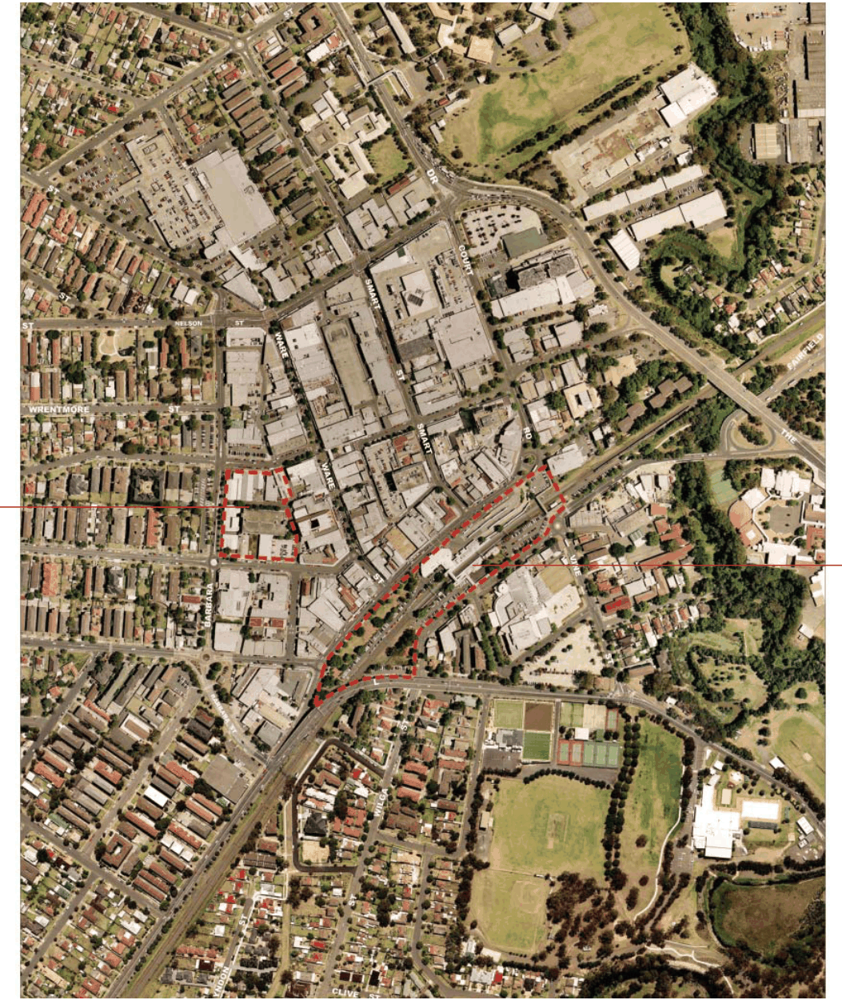

> [Picture on page 2: a picture, saved as a picture (images/fairfield-city-centre-master-plan-page-2-8.gif, 150 dpi).]

### INTRODUCTION AND BACKGROUND

#### Introduction And Background

In 2004, Fairfield Council adopted a Strategic Plan for the Fairfield Town Centre, which forms the basis for managing the town centre, its development, built form, residential density and public places.  Council developed the Strategic Plan through extensive community involvement where 1500 people expressed their views and concerns.  Two actions identified in the Strategic Plan were to prepare Master Plans for two precincts in the town centre - Barbara Street Precinct and The Crescent and Railway Precinct.

The Master Plans will provide a planning and development framework for the two precincts, identifying options for:

- new buildings and open spaces

- upgrades of existing buildings, streets and parks

- the mix of commercial, retail and residential uses

- connections to public transport

- traffic movement and parking

- both public and private sector involvement

Fairfield City Council has engaged design consultants HASSELL to explore options, and produce a Master Plan, for the two precincts.

#### The Crescent Master Plan Site

an important gateway to the

Fairfield Town Centre that

requires better access, amenity

and safety

### FAIRFIELD

### TOWN CENTRE

### ANALYSIS

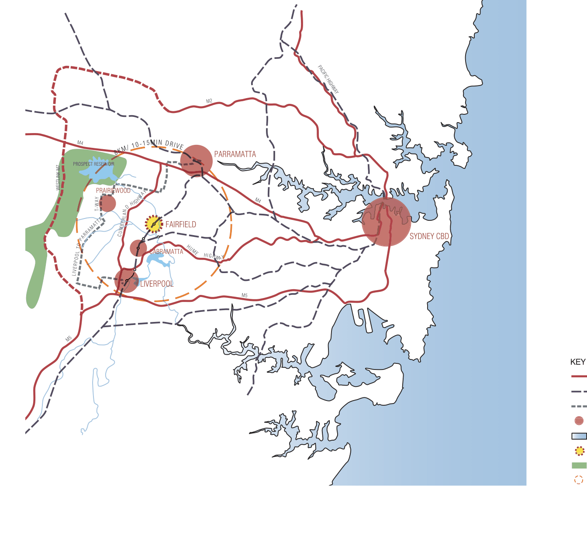

> [Picture on page 4: a map, saved as a picture (images/fairfield-city-centre-master-plan-page-4-1.gif, 150 dpi); the street names and other small labels are on the picture.]
> Words printed on the picture (title and legend, copied from the PDF):
> CABRAMATTA HUME HI

### THE METROPOLITAN STRATEGY

#### Metropolitan Strategy

The Metropolitan Strategy is a major planning initiative of the Department of Planning to meet the challenges associated with:

- Sydney’s population growth over the next 25 years, expected to be an additional 1.1 million people

- Dwindling land supply and the need to contain growth to protect conservation areas and agricultural land

- Improvements to infrastructure particularly public transport; and

- More effective use of natural resources particularly energy and water

The Metropolitan Strategy determines where growth will occur, identified broadly in the Metropolitan Strategy Map.  The Metropolitan Strategy map also identifies cities, specialised centres, major centres – existing, planned and potential.

Fairfield Town Centre is identified as a planned major centre, together with Prairiewood and Cabramatta in close proximity (all located in Fairfield local government area).  Planned major centres have existing infrastructure, open space and other assets that will allow them to become important shopping and service hubs, with associated residential development.  It is envisaged that one of these town centres may grow to take on the role as major centre to support Liverpool and Parramatta cities.  Fairfield Town Centre is well positioned to develop into a major centre, as it is well connected to Liverpool and Parramatta, by both rail and bus services.

Fairfield Council’s vision for Fairfield Town Centre is to enhance the existing town centre, as well as its future role as a major regional centre.  The council envisages the town centre as predominantly housing, to provide for the growing metropolitan population, and specifically, as a dormitory centre for the Liverpool and Parramatta workforce.

Motorway

Rail line

T-way

Urban centre

Water

Fairfield town centre

Western Sydney regional parkland

Appro. 8km radius/ 10-15min drive

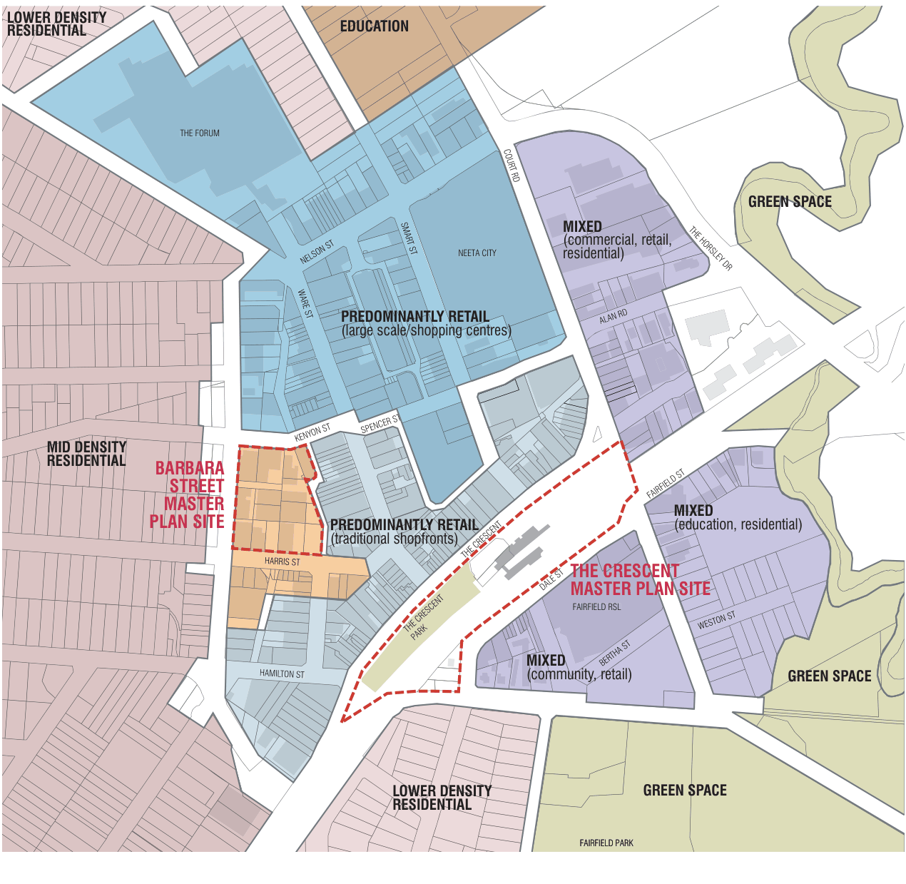

> [Picture on page 5: a map, saved as a picture (images/fairfield-city-centre-master-plan-page-5-1.gif, 150 dpi); the street names and other small labels are on the picture.]
> Words printed on the picture (title and legend, copied from the PDF):
> SMART ST NEETA CITY
> THE HORSLEY DR
> (large scale/shopping centres)

#### EDUCATION

#### LOWER DENSITY

#### RESIDENTIAL

#### GREEN SPACE

#### MIXED

#### PREDOMINANTLY RETAIL

#### MID DENSITY

#### RESIDENTIAL

#### BARBARA

#### STREET

#### MASTER

#### PLAN SITE

#### MIXED

#### PREDOMINANTLY RETAIL

#### THE CRESCENT

#### MASTER PLAN SITE

#### MIXED

#### GREEN SPACE

#### GREEN SPACE

#### LOWER DENSITY

#### RESIDENTIAL

### LOCATION OF MASTER PLAN SITES

#### Fairfield Town Centre

Fairfield Town Centre is an established centre with several distinctive nodes of activity, and mix of retail, commercial and residential uses.  The core of the Town Centre is predominantly retail with two large scale shopping centres and traditional street front shops. The core includes the Fairfield railway station to the south, an important gateway to the town centre.

To the east, there is a strip of low rise mixed use development, offering some retail, residential and commercial operations. To the southern side of the railway station there is both mixed use and low density residential, with significant parkland further south. There are also educational facilities to the north (Fairfield High School) and south (Patrician Brothers College) of the town centre.

The north and west of the town centre is predominantly medium-density residential development, with a relatively formal street pattern. There are some new residential developments although the majority are older style, established apartment buildings, semi-detached homes and single houses.

This study is of two sites in the Town Centre:

The Barbara Street Master Plan Site - bounded by Kenyon, Barbara and Harris Streets, and housing a number of civic/community functions, some retail functions and a multi-storey car park.

The Crescent Master Plan Site - the railway precinct of Fairfield, bounded by The Crescent to the north and Dale Street to the south, and primarily within the ownership of RailCorp.  The site currently supports the railway station, bus interchange, retail complex and open space.

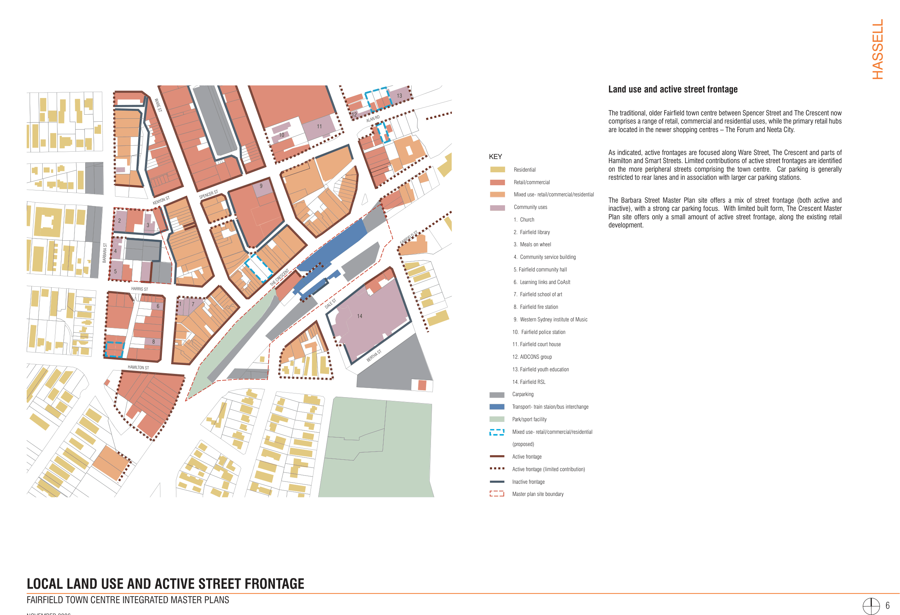

> [Picture on page 6: a map, saved as a picture (images/fairfield-city-centre-master-plan-page-6-1.gif, 150 dpi); the street names and other small labels are on the picture.]
> Words printed on the picture (title and legend, copied from the PDF):
> Mixed use- retail/commercial/residential
> 2\.  Fairfield library
> 3\.  Meals on wheel
> 4\.  Community service building
> 5\. Fairfield community hall
> 6\.  Learning links and CoAslt
> 7\.  Fairfield school of art
> 8\.  Fairfield fire station
> 9\.  Western Sydney institute of Music
> 10\.  Fairfield police station
> 11\. Fairfield court house
> 12\. AIDCONS group
> 13\. Fairfield youth education
> 14\. Fairfield RSL
> Transport- train staion/bus interchange
> Mixed use- retail/commercial/residential
> Active frontage (limited contribution)
> Master plan site boundary

### LOCAL LAND USE AND ACTIVE STREET FRONTAGE

#### Land use and active street frontage

The traditional, older Fairfield town centre between Spencer Street and The Crescent now comprises a range of retail, commercial and residential uses, while the primary retail hubs are located in the newer shopping centres – The Forum and Neeta City.

As indicated, active frontages are focused along Ware Street, The Crescent and parts of Hamilton and Smart Streets. Limited contributions of active street frontages are identified on the more peripheral streets comprising the town centre.  Car parking is generally restricted to rear lanes and in association with larger car parking stations.

The Barbara Street Master Plan site offers a mix of street frontage (both active and inactive), with a strong car parking focus.  With limited built form, The Crescent Master Plan site offers only a small amount of active street frontage, along the existing retail development.

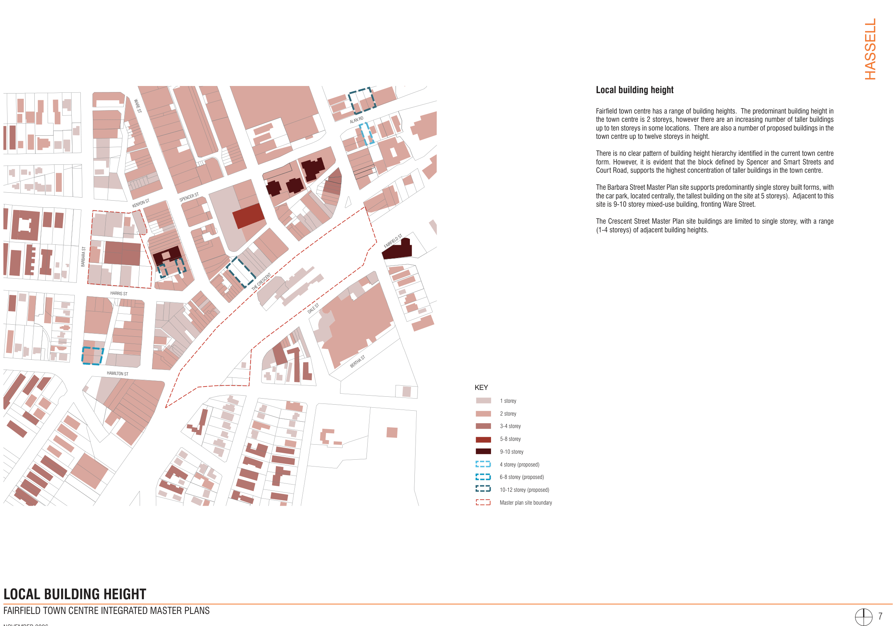

> [Picture on page 7: a map, saved as a picture (images/fairfield-city-centre-master-plan-page-7-1.gif, 150 dpi); the street names and other small labels are on the picture.]
> Words printed on the picture (title and legend, copied from the PDF):
> 4 storey (proposed)
> 6-8 storey (proposed)
> 10-12 storey (proposed)
> Master plan site boundary

### LOCAL BUILDING HEIGHT

#### Local building height

Fairfield town centre has a range of building heights.  The predominant building height in the town centre is 2 storeys, however there are an increasing number of taller buildings up to ten storeys in some locations.  There are also a number of proposed buildings in the town centre up to twelve storeys in height.

There is no clear pattern of building height hierarchy identified in the current town centre

form. However, it is evident that the block defined by Spencer and Smart Streets and Court Road, supports the highest concentration of taller buildings in the town centre.

The Barbara Street Master Plan site supports predominantly single storey built forms, with the car park, located centrally, the tallest building on the site at 5 storeys).  Adjacent to this site is 9-10 storey mixed-use building, fronting Ware Street.

The Crescent Street Master Plan site buildings are limited to single storey, with a range (1-4 storeys) of adjacent building heights.

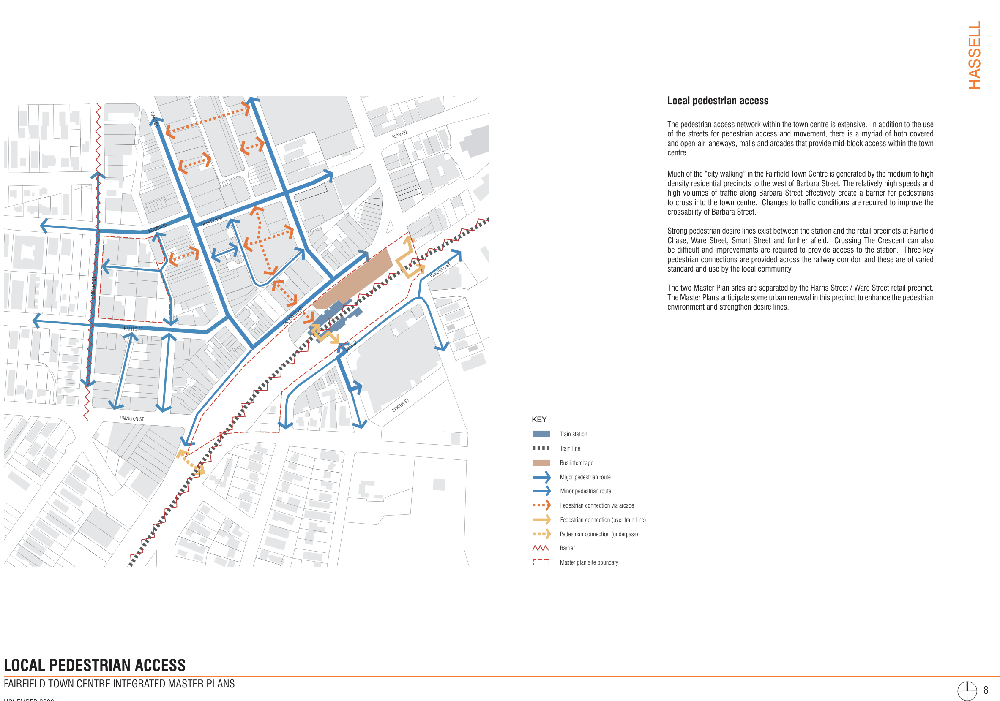

> [Picture on page 8: a map, saved as a picture (images/fairfield-city-centre-master-plan-page-8-1.gif, 150 dpi); the street names and other small labels are on the picture.]
> Words printed on the picture (title and legend, copied from the PDF):
> Major pedestrian route
> Minor pedestrian route
> Pedestrian connection via arcade
> Pedestrian connection (over train line)
> Pedestrian connection (underpass)
> Master plan site boundary

### LOCAL PEDESTRIAN ACCESS

#### Local pedestrian access

The pedestrian access network within the town centre is extensive.  In addition to the use of the streets for pedestrian access and movement, there is a myriad of both covered and open-air laneways, malls and arcades that provide mid-block access within the town centre.

Much of the “city walking” in the Fairfield Town Centre is generated by the medium to high density residential precincts to the west of Barbara Street. The relatively high speeds and high volumes of traffic along Barbara Street effectively create a barrier for pedestrians to cross into the town centre.  Changes to traffic conditions are required to improve the crossability of Barbara Street.

Strong pedestrian desire lines exist between the station and the retail precincts at Fairfield Chase, Ware Street, Smart Street and further afield.  Crossing The Crescent can also be difficult and improvements are required to provide access to the station.  Three key pedestrian connections are provided across the railway corridor, and these are of varied standard and use by the local community.

The two Master Plan sites are separated by the Harris Street / Ware Street retail precinct. The Master Plans anticipate some urban renewal in this precinct to enhance the pedestrian environment and strengthen desire lines.

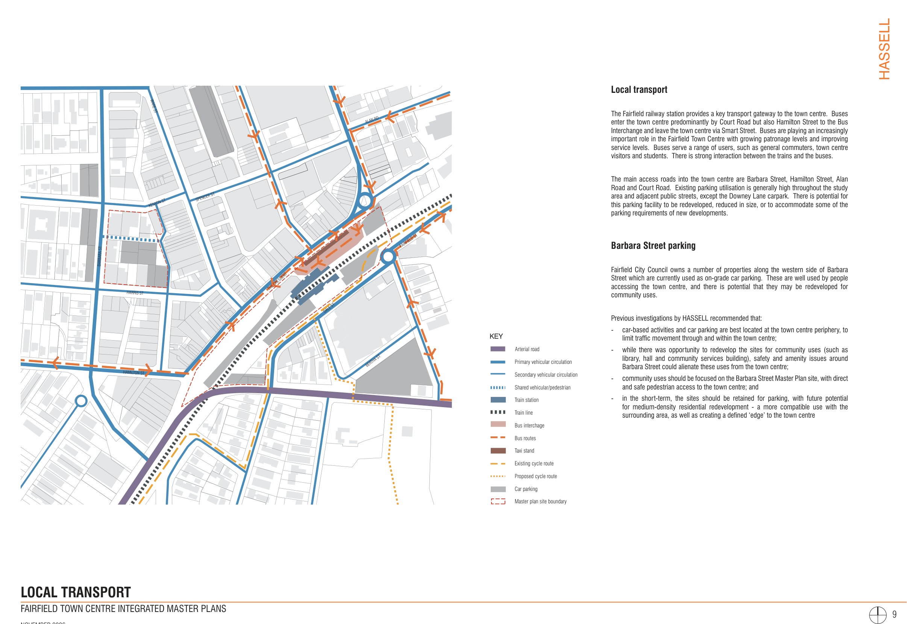

> [Picture on page 9: a map, saved as a picture (images/fairfield-city-centre-master-plan-page-9-1.gif, 150 dpi); the street names and other small labels are on the picture.]
> Words printed on the picture (title and legend, copied from the PDF):
> Primary vehicular circulation
> Secondary vehicular circulation
> Existing cycle route
> Proposed cycle route
> Master plan site boundary

### LOCAL TRANSPORT

#### Local transport

The Fairfield railway station provides a key transport gateway to the town centre.  Buses enter the town centre predominantly by Court Road but also Hamilton Street to the Bus Interchange and leave the town centre via Smart Street.  Buses are playing an increasingly important role in the Fairfield Town Centre with growing patronage levels and improving service levels.  Buses serve a range of users, such as general commuters, town centre visitors and students.  There is strong interaction between the trains and the buses.

The main access roads into the town centre are Barbara Street, Hamilton Street, Alan Road and Court Road.  Existing parking utilisation is generally high throughout the study area and adjacent public streets, except the Downey Lane carpark.  There is potential for this parking facility to be redeveloped, reduced in size, or to accommodate some of the parking requirements of new developments.

#### Barbara Street parking

Fairfield City Council owns a number of properties along the western side of Barbara Street which are currently used as on-grade car parking.  These are well used by people accessing the town centre, and there is potential that they may be redeveloped for community uses.

Previous investigations by HASSELL recommended that:

-  car-based activities and car parking are best located at the town centre periphery, to limit traffic movement through and within the town centre;

-  while there was opportunity to redevelop the sites for community uses (such as library, hall and community services building), safety and amenity issues around Barbara Street could alienate these uses from the town centre;

-  community uses should be focused on the Barbara Street Master Plan site, with direct and safe pedestrian access to the town centre; and

-  in the short-term, the sites should be retained for parking, with future potential for medium-density residential redevelopment - a more compatible use with the surrounding area, as well as creating a defined ‘edge’ to the town centre

### THE

### BARBARA STREET

### MASTER PLAN SITE

Pedestrian movement is relatively high around

the site

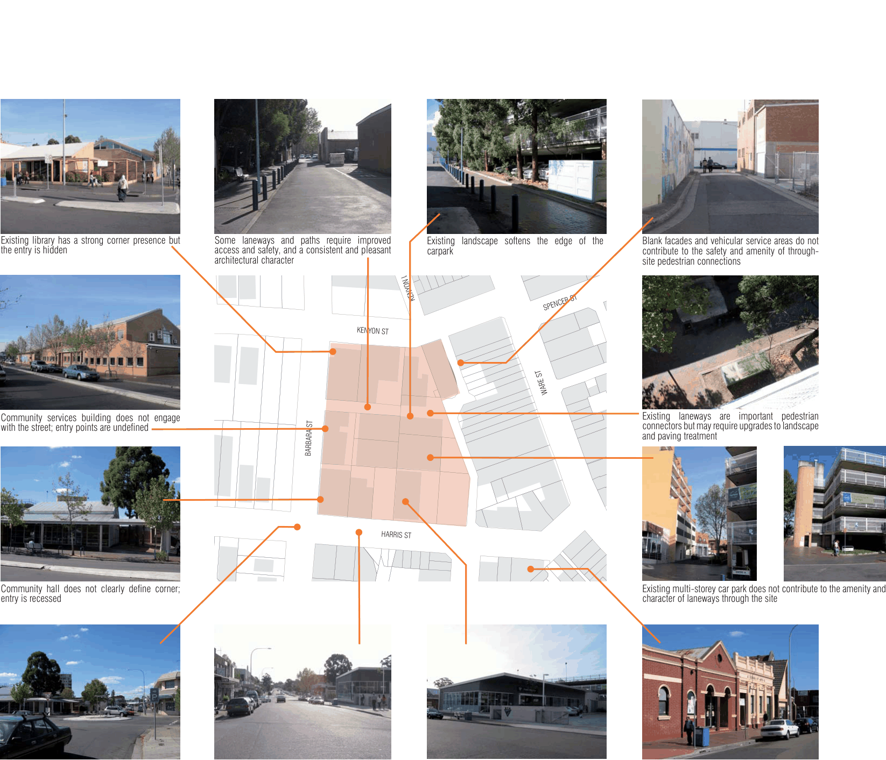

> [Picture on page 11: a picture, saved as a picture (images/fairfield-city-centre-master-plan-page-11-3.gif, 150 dpi).]
> Words printed on the picture (title and legend, copied from the PDF):
> the entry is hidden
> entry is recessed
> KENYON LA
> KENYON ST
> BARBARA ST
> HARRIS ST
> carpark
> SPENCER ST
> WARE ST

Existing library has a strong corner presence but

Community services building does not engage

with the street; entry points are undefined

Community hall does not clearly define corner;

A major intersection into the Town Centre but does

not provide safe pedestrian conditions and lacks

definition by surrounding buildings

### BARBARA STREET MASTER PLAN SITE - PHOTOS

Some laneways and paths require improved

access and safety, and a consistent and pleasant

architectural character

Harris Street is generous in scale but adjacent

buildings do not define or activate the street

Existing landscape softens the edge of the

Existing RTA building has a blank facade to Harris

Street as well as a car-based function that conflicts

with pedestrian movements

Blank facades and vehicular service areas do not

contribute to the safety and amenity of through-

site pedestrian connections

Existing laneways are important pedestrian

connectors but may require upgrades to landscape

and paving treatment

Existing multi-storey car park does not contribute to the amenity and

character of laneways through the site

The School of Arts and church provide a link to

the built heritage of the Town Centre and may be

integrated into a future civic precinct

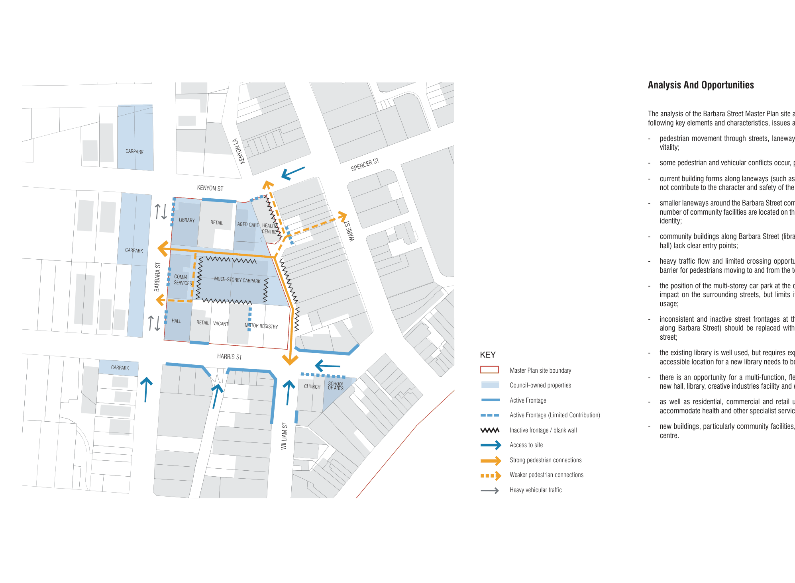

> [Picture on page 12: a map, saved as a picture (images/fairfield-city-centre-master-plan-page-12-1.gif, 150 dpi); the street names and other small labels are on the picture.]
> Words printed on the picture (title and legend, copied from the PDF):
> HALL RETAIL VACANT
> BUS INTERCH - the position of the multi-storey car park at the centre of the site minimises its visual
> Master Plan site boundary
> Active Frontage (Limited Contribution)
> Inactive frontage / blank wall
> Access to site
> Strong pedestrian connections
> Weaker pedestrian connections
> Heavy vehicular traffic

### BARBARA STREET MASTER PLAN SITE - ANALYSIS

#### Analysis And Opportunities

The analysis of the Barbara Street Master Plan site and its surrounding area identified the following key elements and characteristics, issues and opportunities:

- pedestrian movement through streets, laneways and arcades provides access and

- some pedestrian and vehicular conflicts occur, particularly along Downey Lane;

### SMART ST

- current building forms along laneways (such as blank walls and offset pathways) do not contribute to the character and safety of the laneways;

- smaller laneways around the Barbara Street community buildings are not well used; a number of community facilities are located on the Master Plan site but lack a coherent identity;

- community buildings along Barbara Street (library, community services building and

hall) lack clear entry points;

- heavy traffic flow and limited crossing opportunities along Barbara Street act as a barrier for pedestrians moving to and from the town centre;

impact on the surrounding streets, but limits it visibility and access, and thus, its usage;

- inconsistent and inactive street frontages at the perimeter of the site (particularly along Barbara Street) should be replaced with uses that address and activate the street;

- the existing library is well used, but requires expanded floor area - a convenient and accessible location for a new library needs to be identified;

- there is an opportunity for a multi-function, flexible community building housing a new hall, library, creative industries facility and exhibition spaces;

### DALE ST

- as well as residential, commercial and retail uses, the Master Plan site may also accommodate health and other specialist services; and

- new buildings, particularly community facilities, need to link to the established town

### ANZAC AV

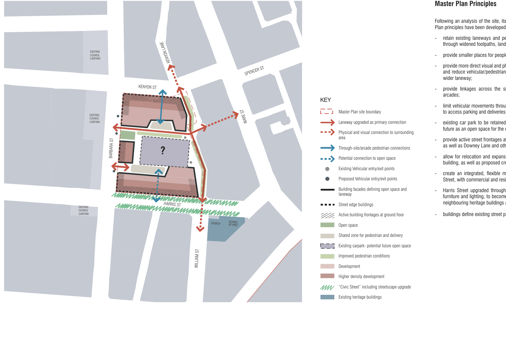

> [Picture on page 13: a map, saved as a picture (images/fairfield-city-centre-master-plan-page-13-1.gif, 150 dpi); the street names and other small labels are on the picture.]
> Words printed on the picture (title and legend, copied from the PDF):
> Master Plan site boundary
> Laneway upgraded as primary connection
> Physical and visual connection to surrounding
> Through-site/arcade pedestrian connections
> Potential connection to open space
> Existing Vehicular entry/exit points
> Proposed Vehicular entry/exit points
> Building facades defining open space and
> Street edge buildings
> Active building frontages at ground floor
> Shared zone for pedestrian and delivery
> Existing carpark- potential future open space
> Improved pedestrian conditions
> Higher density development
> “Civic Street” including streetscape upgrade
> Existing heritage buildings

#### Master Plan Principles

Following an analysis of the site, its opportunities and constraints, a number of Master Plan principles have been developed:

- retain existing laneways and pedestrian connections, and enhance pedestrian use through widened footpaths, landscaping, lighting and street furniture;

- provide smaller places for people to gather, such as pocket parks and seating areas;

- provide more direct visual and physical access along Downey Lane to enhance safety and reduce vehicular/pedestrian conflicts - new buildings are set back to provide a wider laneway;

### SMART ST

- provide linkages across the site, connected to existing adjacent laneways and

- limit vehicular movements through the site by encouraging the use of Barbara Street to access parking and deliveries;

- existing car park to be retained and upgraded, with potential for redevelopment in future as an open space for the community/civic precinct;

- provide active street frontages at ground level to Harris, Barbara and Kenyon Streets, as well as Downey Lane and other laneways;

### ?

- allow for relocation and expansion of existing library, hall and community services building, as well as proposed creative industries facility;

- create an integrated, flexible multi-use community building that addresses Harris Street, with commercial and residential buildings facing Kenyon and Barbara Streets;

- Harris Street upgraded through footpath widening, consistent landscape strategy, furniture and lighting, to become a ‘civic’ street, linking community functions to the neighbouring heritage buildings and the town centre; and

- buildings define existing street patterns and proposed green ‘pockets’.

### THE CRESCENT

### DALE S

### ANZAC AV

### BARBARA STREET MASTER PLAN SITE - MASTER PLAN PRINCIPLES

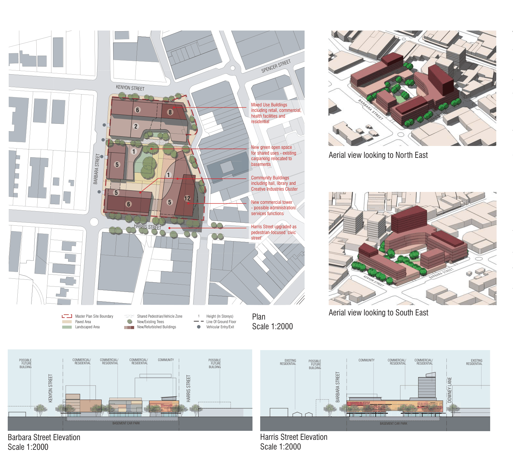

> [Picture on page 14: a map, saved as a picture (images/fairfield-city-centre-master-plan-page-14-1.gif, 150 dpi); the street names and other small labels are on the picture.]
> Words printed on the picture (title and legend, copied from the PDF):
> Mixed Use Buildings
> including retail, commercial,
> health facilities and
> New green open space
> for shared uses - existing
> carparking relocated to
> including hall, library and
> Creative Industries Cluster
> New commercial tower
> - possible administration/
> Harris Street upgraded as

Master Plan Site Boundary

Paved Area

Landscaped Area

Shared Pedestrian/Vehicle Zone New/Existing Trees New/Refurbished Buildings

#### LIBRARYC

#### BRARC

#### C

#### Barbara Street Elevation Scale 1:2000

1 Height (In Storeys) Line Of Ground Floor Vehicular Entry/Exit

#### Aerial view looking to North East

#### Aerial view looking to South East

#### Plan Scale 1:2000

> Words printed on the picture (title and legend, copied from the PDF):
> BASEMENT CAR PARK
> BASEMENT CAR PARK

#### CIC

#### Harris Street Elevation Scale 1:2000

### BARBARA STREET MASTER PLAN SITE - THE VISION

#### The Vision for The Barbara Street Precinct

The Barbara Street Precinct has been identified as the focus of Fairfield’s community and civic buildings, and this has guided the master planning of the site.  This process has produced a long-term vision for the precinct, as well as shorter term, more achievable proposals.  It is important that as each of these proposals is developed, they contribute to the vision for the precinct.

The Barbara Street vision is for a number of community buildings that are integrated and complementary, both in appearance and function, and supported by a mix of other uses such as residential, commercial and retail.  The existing multi-storey car park is removed, with car parking accommodated within the new buildings, possibly in a number of basement levels.  This allows a new courtyard/open space of approximately 1500 sqm to be created at the centre of the precinct, a shared external space for the buildings that surround it.

A new multi-use, flexible community building, including new hall, library and creative industries facility, addresses Harris Street.  Harris Street  is upgraded as Fairfield’s ‘civic’ street, creating a safe and pedestrian-friendly link between the precinct and the town centre, especially Ware Street and the railway station.

New buildings are primarily 5-7 storeys, with two taller elements (up to 12 storeys) adjacent to the existing towers on Ware Street.

Existing laneways are retained, with new lanes and arcades connecting streets with the new landscaped open space.  Ground floor retail spaces within the buildings activate the perimeter streets, as well as the laneways, making the precinct safer and more attractive. Vehicular access to the buildings (both cars and service vehicles) is primarily from Barbara Street, providing safer pedestrian access across the site.

This vision for the Barbara Street site is exciting and forward-looking, and will consolidate and enliven the community precinct of Fairfield.  It is also a complex undertaking, involving the sale and acquisition of different properties, the redevelopment of community facilities and extensive public domain upgrading.

The following Master Plan for the precinct outlines the first steps that can be taken, to ensure short-term achievements within the framework of the long-term vision.

Mixed use buildings including retail, commercial, health facilities and residential

New retail/residential building with possible component of community uses, integrated with adjacent building

Shared service area

New community building containing community hall, library, creative industries facility and other uses

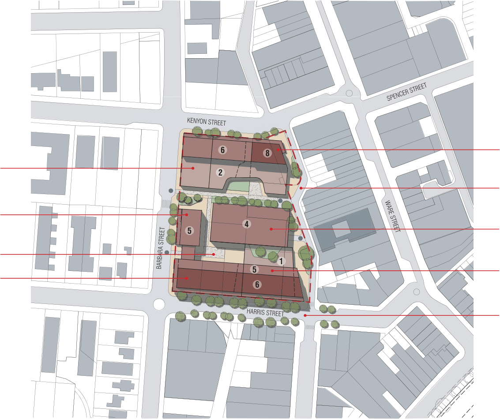

> [Picture on page 15: a map, saved as a picture (images/fairfield-city-centre-master-plan-page-15-13.gif, 150 dpi); the street names and other small labels are on the picture.]

Master Plan Site Boundary Paved Area

Landscaped Area

Shared Pedestrian/Vehicle Zone New/Existing Trees New/Refurbished Buildings

#### Master Plan - Site Plan Scale 1:2000

1 Height (In Storeys)

Line Of Ground Floor

Vehicular Entry/Exit

### BARBARA STREET MASTER PLAN SITE - THE MASTER PLAN

Mixed use buildings including retail, commercial, health facilities and residential

Existing laneways upgraded with wider footpaths, landscaping, furniture and lighting

Existing carpark retained and upgraded

Building redeveloped as retail and commercial/residential, or as a future extension to the adjacent community building

Harris Street upgraded as pedestrian-focused ‘civic street’

#### The Master Plan - taking the first steps

The Master Plan outlines the first stages of the vision, providing achievable outcomes for the Barbara Street precinct.

The existing multi-storey car park is retained and upgraded, and sites around it are redeveloped with a mix of retail, residential, commercial and community buildings.

Existing laneways are retained and upgraded with landscape ‘pockets’, paving and furniture, and improved lighting.  Along Downey Lane, new buildings are set back to provide a generous footpath, improving safety for pedestrians.  This also allows better visual access to the car park from surrounding streets, improving its useability and safety.

A new community building, containing community hall, library, creative industries facility and associated uses, is constructed on the corner of Harris and Barbara Streets.  Depending on the floor space and configuration required, the adjacent building on Barbara Streets may also house community and/or civic functions that integrate with the main building. Similarly, The RTA site on Harris Street will ultimately be redeveloped as an extension of the community building, with the potential for commercial and administrative uses on this

site.  This grouping of community uses will address and activate Harris Street, creating a pedestrian-focused ‘civic’ street that connects the precinct with neighbouring heritage buildings (such as the School of Arts) and to the town centre.

The council-owned lots along Kenyon Street will be amalgamated with neighbouring sites, to encourage development that contributes to the upgrade of the precinct’s public domain.  For example, the amalgamation of the two lots on the corner of Kenyon Street and Downey Lane allows a generous setback along the laneway.

Key elements and opportunities of the master plan include:

- new retail tenancies activating streets and laneways

- a shared delivery/loading area behind the Harris Street buildings that provides direct service access from Barbara Street, as well as an elevated landscaped area

- the upgrading of Harris Street, including wider footpaths, new crossings, trees and street furniture, provides enhanced pedestrian amenity and safety

- Harris Street becomes Fairfield’s ‘civic’ street, linking new and existing community buildings to the town centre

- improved pedestrian conditions at intersections such as signalised crossings (this requires further study from specialist consultants)

- the sale/redevelopment of Council owned sites along Kenyon and Barbara Streets may fund new community buildings

Retail, professional suites or health facility on ground floor

Enhanced connectivity through

arcades

Vehicular access to buildings from the existing laneway

Retail or professional suites on ground floor

Shared service area

Ground floor lobby and cafe shared by community uses on levels above

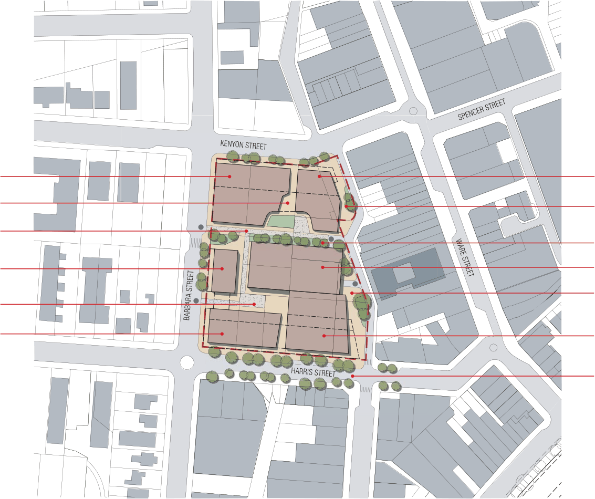

> [Picture on page 16: a picture, saved as a picture (images/fairfield-city-centre-master-plan-page-16-13.gif, 150 dpi).]
> Words printed on the picture (title and legend, copied from the PDF):
> KENYON STREET
> BARBARA STREET
> HARRIS STREET
> SPENCER STREET
> WARE STREET

Master Plan Site Boundary Paved Area

Landscaped Area

Shared Pedestrian/Vehicle Zone New/Existing Trees New/Refurbished Buildings

#### Master Plan - Ground Plan Scale 1:2000

1 Height (In Storeys)

Line Of Upper Floor

Vehicular Entry/Exit

Retail uses activate Kenyon Street and Downey Lane frontages

New building is set back to provide visual connection through laneway, enhancing safety for pedestrians

Existing trees and landscaping retained

Existing carpark

Wide footpath established along the western side Downey Lane

Retail uses activate Harris Street and Downey Lane frontages

Street upgrade includes landscaping and furniture, taxi/drop-off zone and widened footpaths in some locations

#### The Master Plan - taking the first steps

The ground floor of the Master Plan provides an active and well-connected environment for pedestrains, with increased circulation space, landscaping and furniture.  Blank building facades to internal laneways are replaced with active uses (including space for retail, commercial, medical and other services), creating safer and more pleasant edges to public spaces.  This is particularly important along the laneway behind the Kenyon Street properties - currently used for servicing and deliveries.

Downey Lane is enhanced through setting back of new buildings along the western side, and the location of retail spaces fronting the lane at either end.  The promotion of activity within Downey Lane will improve its safety and character.

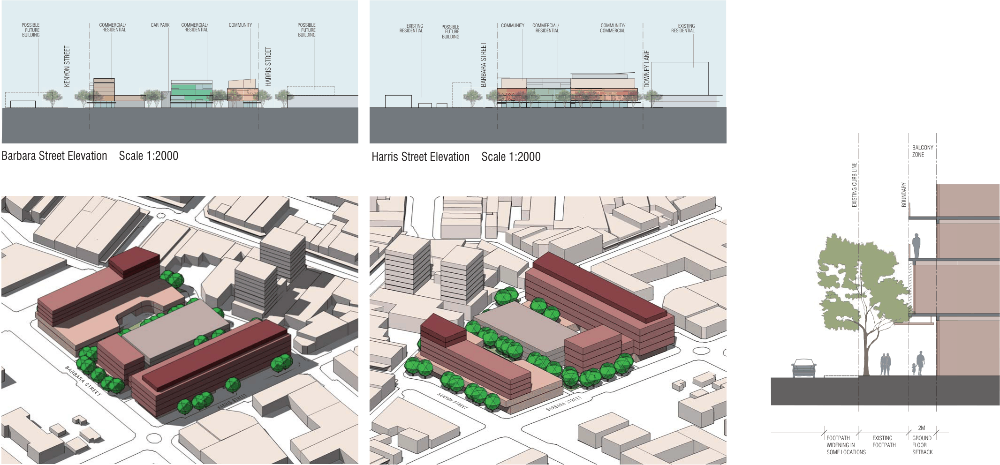

> [Picture on page 17: a map, saved as a picture (images/fairfield-city-centre-master-plan-page-17-1.gif, 150 dpi); the street names and other small labels are on the picture.]

#### Barbara Street Elevation    Scale 1:2000

#### Aerial view looking to North East

#### CIC

#### Harris Street Elevation    Scale 1:2000

#### Aerial view looking to South East

> Words printed on the picture (title and legend, copied from the PDF):
> EXISTING CURB LINE

#### Typical Street Section Scale 1:200

#### INDICATIVE FLOOR SPACE SCHEDULE

(shown are approximate gross floor areas)

Site A       Retail 760 sqm

Commercial 760 sqm

Residential/commercial 1080 sqm

Site B       Retail 720 sqm

Commercial 900 sqm

Residential/commercial 1520 sqm

Site C       Retail 800 sqm

Commercial 800 sqm

Residential/commercial 1800 sqm

Site D       Retail 410 sqm

Commercial 680 sqm

Community 680 sqm

Site E       Community 5930 sqm

Site F       Retail 750 sqm

Commercial 4320 sqm

Total         Retail 3440 sqm

Commercial 7460 sqm

Residential/commercial 4400 sqm

Community 6610 sqm

#### Total

#### 21910 sqm

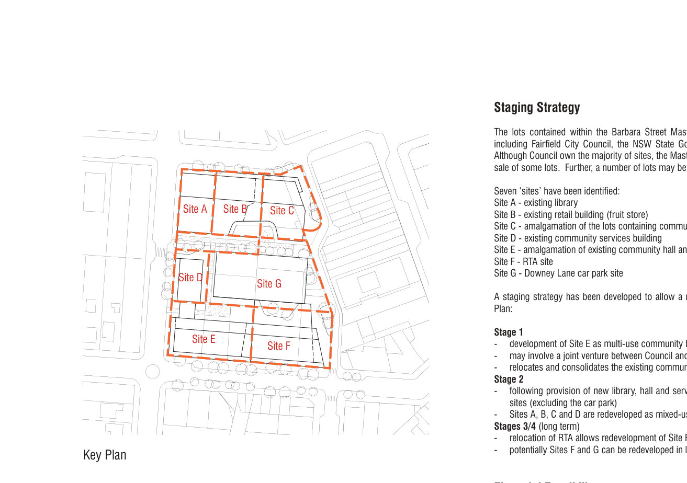

> [Picture on page 18: a picture, saved as a picture (images/fairfield-city-centre-master-plan-page-18-24.gif, 150 dpi).]
> Words printed on the picture (title and legend, copied from the PDF):
> Site A Site B Site C
> Site D
> Site G
> Site E
> Site F

#### Key Plan

### BARBARA STREET MASTER PLAN SITE - STAGING AND FEASIBILITY

#### Staging Strategy

The lots contained within the Barbara Street Master Plan have different ownership -including Fairfield City Council, the NSW State Government and private land-holders. Although Council own the majority of sites, the Master Plan relies on the  acquisition and sale of some lots.  Further, a number of lots may be amalgamated.

Seven ‘sites’ have been identified:

Site A - existing library

Site B - existing retail building (fruit store)

Site C - amalgamation of the lots containing community services and health centre Site D - existing community services building

Site E - amalgamation of existing community hall and adjacent two lots Site F - RTA site

Site G - Downey Lane car park site

A staging strategy has been developed to allow a more feasible delivery of the Master Plan:

#### Stage 1

-  development of Site E as multi-use community building

- may involve a joint venture between Council and the neighbouring land holder

- relocates and consolidates the existing community uses from Sites A, C and D

#### Stage 2

- following provision of new library, hall and services, Council may sell its remaining sites (excluding the car park)

-  Sites A, B, C and D are redeveloped as mixed-use buildings

Stages 3/4 (long term)

- relocation of RTA allows redevelopment of Site F

- potentially Sites F and G can be redeveloped in line with the Barbara Street ‘vision’

#### Financial Feasibility

An economic analysis was undertaken by Hill PDA to the determine the financial feasibility of the Barbara Street Master Plan, and the expected investments that council would need to undertake.  Further information is found within Appendix A.

Key findings of this analysis were that:

-  Council could consolidate all of its community uses into one site (Site E) and then dispose of its surplus sites to assist the funding of the new community building;

-  the Site E community building has a cost estimated to be $22.5m, which could be offset by the sale of surplus Council land in the Barbara Street Precinct to the value of approximately $8.3m and the sale of retail strata tenancies within this new Council building for an estimated $5.9m;

-  the estimated net cost to Council for this new community use/service building would be $8.2m with an end value of $27.9m upon completion in May 2009; and

-  this development proposal would provide Council with improved community facilities and an improvement in net asset value.

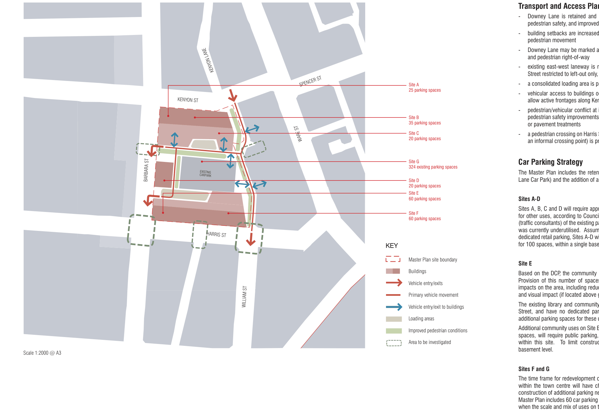

> [Picture on page 19: a map, saved as a picture (images/fairfield-city-centre-master-plan-page-19-1.gif, 150 dpi); the street names and other small labels are on the picture.]
> Words printed on the picture (title and legend, copied from the PDF):
> and pedestrian right-of-way
> 25 parking spaces
> 35 parking spaces
> 20 parking spaces
> 324 existing parking spaces
> 20 parking spaces
> 60 parking spaces
> 60 parking spaces
> Master Plan site boundary
> Primary vehicle movement
> Vehicle entry/exit to buildings
> Improved pedestrian conditions
> Area to be investigated
> Scale 1:2000 @ A3

#### Transport and Access Plan

-  Downey Lane is retained and widened to allow clearer sight-lines and enhanced pedestrian safety, and improved vehicular access to the rear of Ware Street buildings

- building setbacks are increased to provide more room for seating, landscaping and

- Downey Lane may be marked as a formal “shared zone”, with a 10km/h speed limit

- existing east-west laneway is retained as a ‘shared zone’, with access to Barbara Street restricted to left-out only, for both general and service vehicles

- a consolidated loading area is provided within Site E

### SMART ST

- vehicular access to buildings occurs from Barbara Street and internal laneways, to allow active frontages along Kenyon and Harris Streets

- pedestrian/vehicular conflict at intersections requires further study, but may include pedestrian safety improvements, such as signalised crossings, pedestrian crossings, or pavement treatments

- a pedestrian crossing on Harris Street between William and Barbara Streets (currently an informal crossing point) is proposed

#### Car Parking Strategy

The Master Plan includes the retention of 324 car parking spaces (within the Downey Lane Car Park) and the addition of a further 220 spaces.

#### Sites A-D

Sites A, B, C and D will require approximately 178 spaces - 85 spaces for retail, and 93 for other uses, according to Council’s DCP for parking.  An analysis by Jamieson Foley (traffic consultants) of the existing parking onsite showed that the Downey Street Car Park was currently underutilised.  Assuming that 81 (25%) of these spaces are transferred to dedicated retail parking, Sites A-D will need to provide 97 spaces.  The Master Plan allows for 100 spaces, within a single basement level of each building.

### THE CRESCENT

#### Site E

### DALE ST

Based on the DCP, the community uses on Site E will require 621 car parking spaces. Provision of this number of spaces would be very costly and would have significant impacts on the area, including reduced pedestrian amenity, increased traffic movements and visual impact (if located above ground). The existing library and community hall rely on the car parks of Barbara and Downey Street, and have no dedicated parking facilities.  The Master Plan does not provide additional parking spaces for these uses. Additional community uses on Site E, such as the creative industries centre and exhibition spaces, will require public parking, and the Master Plan proposes 60 new car spaces within this site.  To limit construction costs, these are accommodated on a single basement level.

### ANZAC AVE

### HAMILTON ST

#### Sites F and G

The time frame for redevelopment of these sites is 15-20 years.  Transport and parking within the town centre will have changed significantly, with for instance, the possible construction of additional parking nearby, or the reduction in use of private vehicles.  The Master Plan includes 60 car parking spaces on Site F, but this provision will require review when the scale and mix of uses on these sites is determined.

### BARBARA STREET MASTER PLAN SITE - TRAFFIC AND PARKING

### THE CRESCENT

### MASTER PLAN SITE

The Crescent Park is under utilised due to its

separation from other functions, inaccessibility

and a lack of natural surveillance

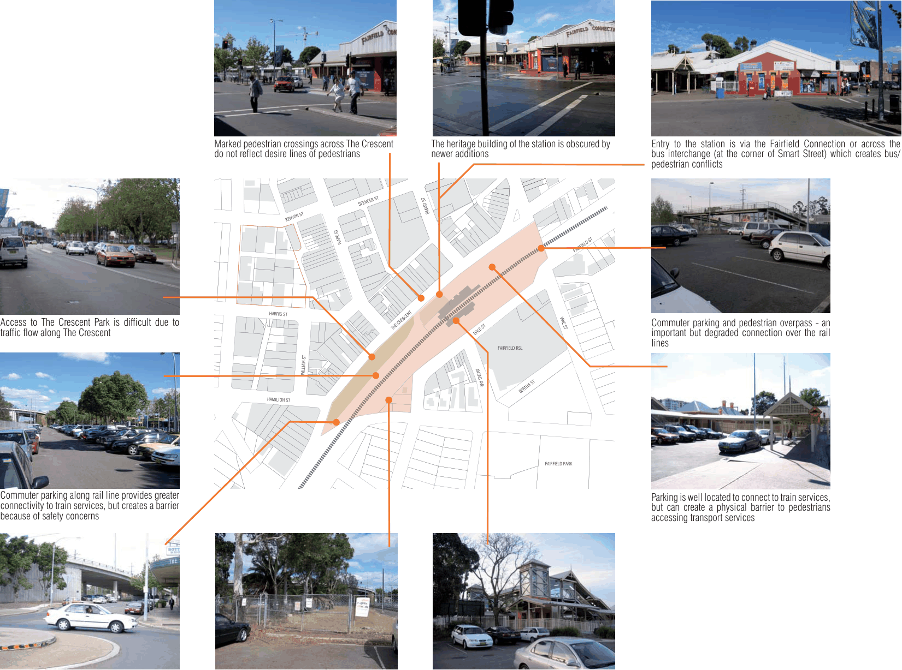

> [Picture on page 21: a map, saved as a picture (images/fairfield-city-centre-master-plan-page-21-4.gif, 150 dpi); the street names and other small labels are on the picture.]

Access to The Crescent Park is difficult due to

traffic flow along The Crescent

Commuter parking along rail line provides greater

connectivity to train services, but creates a barrier

because of safety concerns

The Lambert Street overpass creates a significant

visual barrier at the southern end of the site

### THE CRESCENT MASTER PLAN SITE - PHOTOS

The heritage building of the station is obscured by

Marked pedestrian crossings across The Crescent

do not reflect desire lines of pedestrians

Southern entry to Fairfield Station is well defined

by tower/lift element but access to overpass and

station is indirect

Council owned property intended for use as

commuter parking currently acts as barrier to

movement

Entry to the station is via the Fairfield Connection or across the

bus interchange (at the corner of Smart Street) which creates bus/

pedestrian conflicts

Commuter parking and pedestrian overpass - an

important but degraded connection over the rail

lines

Parking is well located to connect to train services,

but can create a physical barrier to pedestrians

accessing transport services

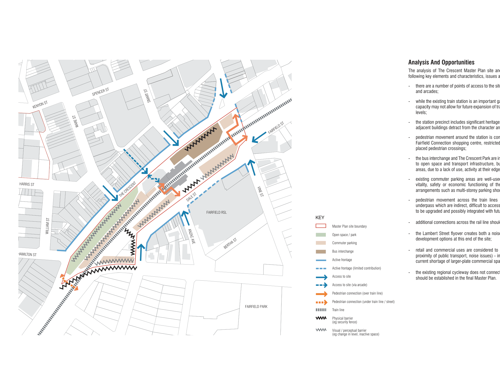

> [Picture on page 22: a map, saved as a picture (images/fairfield-city-centre-master-plan-page-22-1.gif, 150 dpi); the street names and other small labels are on the picture.]
> Words printed on the picture (title and legend, copied from the PDF):
> Master Plan site boundary
> Open space / park
> Active frontage (limited contribution)
> Access to site
> Access to site (via arcade)
> Pedestrian connection (over train line)
> Pedestrian connection (under train line / street)
> (eg security fence)
> Visual / perceptual barrier
> (eg change in level, inactive space)

#### FAIRFIELD PARK

### THE CRESCENT MASTER PLAN SITE - ANALYSIS

#### Analysis And Opportunities

The analysis of The Crescent Master Plan site and its surrounding area identified the following key elements and characteristics, issues and opportunities:

- there are a number of points of access to the site from surrounding streets, laneways

- while the existing train station is an important gateway to the town centre, its current capacity may not allow for future expansion of train services and increasing patronage levels;

- the station precinct includes significant heritage items, but subsequent additions and adjacent buildings detract from the character and use of these buildings;

- pedestrian movement around the station is constrained by the bus interchange, the Fairfield Connection shopping centre, restricted footpath widths and inappropriately placed pedestrian crossings;

- the bus interchange and The Crescent Park are important in terms of their contribution to open space and transport infrastructure, but are both considered to be unsafe areas, due to a lack of use, activity at their edges and natural surveillance;

- existing commuter parking areas are well-used, but they do not contribute to the vitality, safety or economic functioning of the Fairfield town centre - alternative arrangements such as multi-storey parking should be considered;

- pedestrian movement across the train lines is limited to two bridges and one underpass which are indirect, difficult to access and considered unsafe - these need to be upgraded and possibly integrated with future buildings;

- additional connections across the rail line should be considered;

- the Lambert Street flyover creates both a noise and visual barrier, which limits the development options at this end of the site;

- retail and commercial uses are considered to be the most appropriate (due to the proximity of public transport, noise issues) - in particular, the site may address the current shortage of larger-plate commercial space in Fairfield;

- the existing regional cycleway does not connect across the site, and this connection should be established in the final Master Plan.

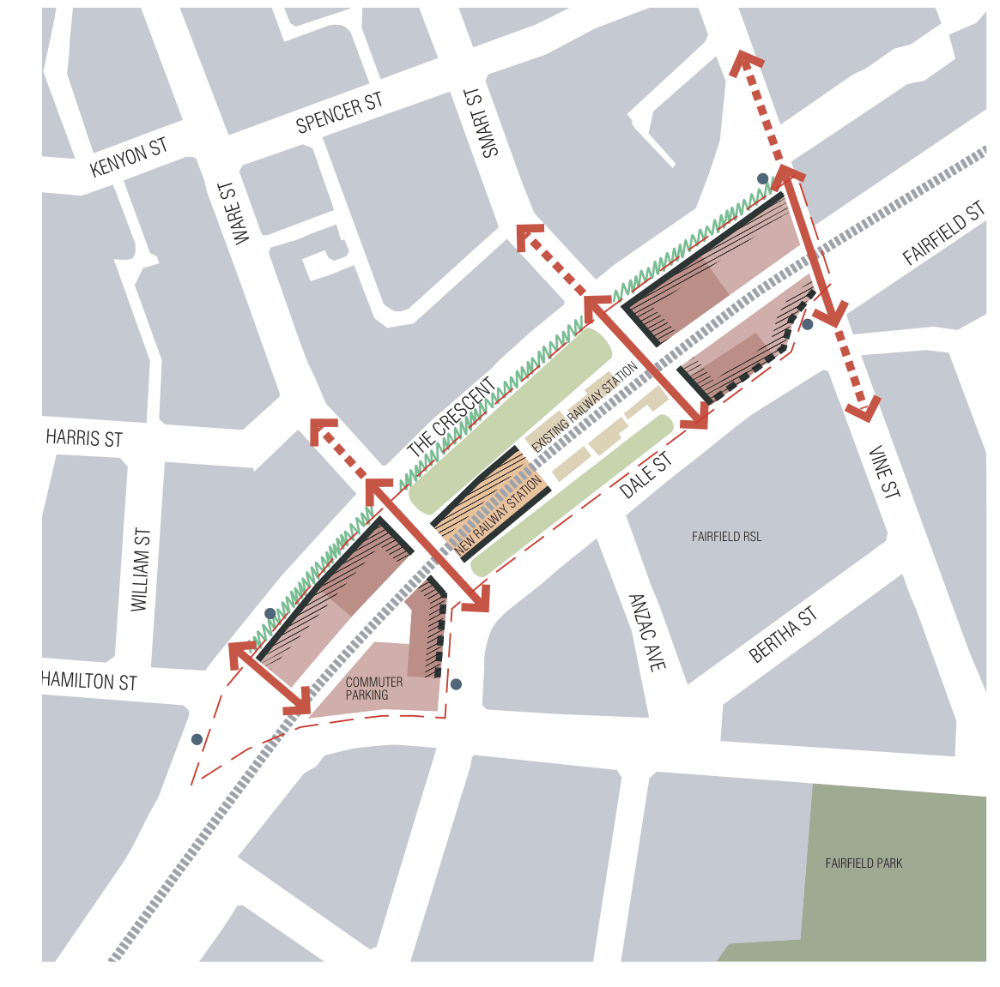

> [Picture on page 23: a picture, saved as a picture (images/fairfield-city-centre-master-plan-page-23-1.gif, 150 dpi).]
> Words printed on the picture (title and legend, copied from the PDF):
> EXISTING RAILWAY STATION
> NEW RAILWAY STATION
> COMMUTER
> PARKING
> FAIRFIELD RSL
> FAIRFIELD PARK

#### KENYON ST

#### WARE ST

#### HARRIS ST

#### WILLIAM ST

#### HAMILTON ST

#### SPENCER ST

#### SMART ST

#### THE CRESCENT

#### DALE ST

#### ANZAC AVE

#### FAIRFIELD ST

#### VINE ST

#### BERTHA ST

### THE CRESCENT MASTER PLAN SITE - MASTER PLAN PRINCIPLES

KEY

Master Plan site boundary

Existing railway station

New railway station

Proposed/upgraded cross-rail connection

Physical and visual connection to surrounding area

Widened footpath to accomodate bus stops, landscaping +street furniture

Proposed Vehicular entry/exit points

Building facades defining open space

Street edge buildings

Active building frontages at ground floor

Open space

Development

Higher density development

#### Master Plan Principles

Following an analysis of the site, its opportunities and constraints, a number of Master Plan principles have been developed:

- retain and upgrade existing connections across the train lines especially bridges at the station and the northern end of the site;

- strengthen connections into the town centre via Smart and Ware Streets by creating more direct access across The Crescent;

- relocate existing park to the front of the station to allow increased area, greater useability and retailing activity at edges;

- relocate the existing Fairfield Connection to open up viewlines to the station and provide safer and more direct access;

- allow for expansion or redevelopment of the station to meet future demand, including a safe, direct and accessible bridge connection across the train lines;

- frame the existing heritage station buildings with new buildings that are complementary in terms of scale, use and architectural character;

- relocate existing bus interchange by providing bus stops along The Crescent, allowing more direct linkage to the train station as well as retail spaces;

- rationalise and upgrade the Dale Street entry to the station, with a park/plaza, landscaping and lighting, and provision for taxi/kiss+ride functions;

- widening of footpaths along The Crescent allows for bus stops/queuing areas, consistent landscaping, street furniture and lighting, and potential for outdoor cafe seating;

- relocate existing commuter parking into multi-storey structure(s) at the southern end of the site adjacent to the Lambert Street flyover;

- provide new retail/commercial buildings along both sides of The Crescent to activate streets and open space at ground level, while providing commercial space directly linked to transport services; and

- continue existing cycle routes by providing a link along The Crescent.

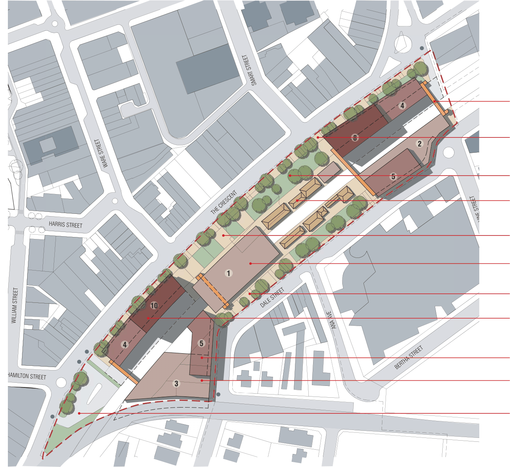

> [Picture on page 24: a map, saved as a picture (images/fairfield-city-centre-master-plan-page-24-1.gif, 150 dpi); the street names and other small labels are on the picture.]

#### Master Plan Scale 1:2000

Master Plan Site Boundary Paved Area

Landscaped Area

1

New/Existing Trees

New/Refurbished Buildings

Existing Train Station Buildings

Height (In Storeys) Line Of Ground Floor Vehicular Entry/Exit

Existing/New Connection

### THE CRESCENT MASTER PLAN SITE - OPTION 1

New connections integrated with buildings

Bus stops relocated to The Crescent

New public park

Existing station buildings refurbished for retail/ community uses

New public plaza in front of station

New railway station including upgraded connection across rail lines

Footpaths widened; new street trees and furniture

Retail/commercial buildings, potentially to accommodate community/council uses

Retail/commercial buildings along Dale Street

New multi-storey parking station with bridge connection to new buildings

Possible bus lay-over area or turning bay

#### Master Plan Option 1

All existing commuter parking is shifted to a new multi-storey structure, with some also integrated into new building developments.  Existing bus stops, taxi rank and ‘kiss+ride’ are relocated to The Crescent, and a new train station is constructed adjacent to the existing station.  New retail/commercial buildings are located on both sides of the train corridor.

A new park and landscaped plaza are located in front of the station.  The footpath along The Crescent is widened to provide space for bus stops, as well as improved amenity through consistent street tree planting, new paving, lighting and street furniture.

The key opportunities of this Master Plan option include:

- new station provides a modern facility for current and future needs, as well as an enhanced ‘gateway’ to the town centre;

- existing station buildings refurbished as community/cultural buildings, or retail such as cafe and restaurants;

- existing retail spaces are relocated to be more visible, functional and attractive buildings;

- new park and plaza provide open space that is more accessible and safer than the existing park, and a direct connection to the town centre via Smart and Ware Streets;

- safety and convenience of bus passengers is improved by the location of bus stops adjacent to other uses, such as retail and commercial spaces, and the train station;

- streetscape improvements and improved station entry from Dale Street;

- new retail/commercial development along The Crescent creates activity and definition of the street edge;

- ‘large-plate’ commercial office space provides the opportunity for use as community facilities, council administration or government departments;

- existing bridges across the rail lines upgraded (possibly integrated with new buildings) for improved safety and access; and

- existing cycle routes can be linked along The Crescent within shared traffic lanes

Some challenges which require further investigation:

- bus movements/stopping arrangements need further study by a specialist consultant, as well as discussion with bus operators; and

- negotiation with Rail Corp and current leaseholders to provide integrated delivery of buildings and new public domain / infrastructure

#### Financial Feasibility

Hill PDA have completed a financial analysis of the two options for The Crescent precinct (see Appendix A) to determine their feasibility.  The analysis found that:

- Option 1 provides the highest land value return to RailCorp of $12m and a $30m development profit to the developer;

- it would generate significant job growth for Fairfield estimated to be 1,500 additional jobs annually;

- the total project cost will be in excess of $109m, and that staging will be required to allow take up of market demand for office space; and

- Option 1 would require substantial (>50%) pre-commitment of office space.

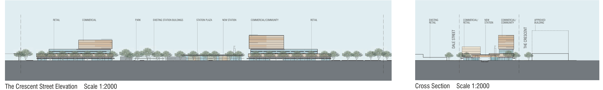

> [Picture on page 25: a map, saved as a picture (images/fairfield-city-centre-master-plan-page-25-1.gif, 150 dpi); the street names and other small labels are on the picture.]
> Words printed on the picture (title and legend, copied from the PDF):
> EXISTING STATION BUILDINGS

#### The Crescent Street Elevation    Scale 1:2000

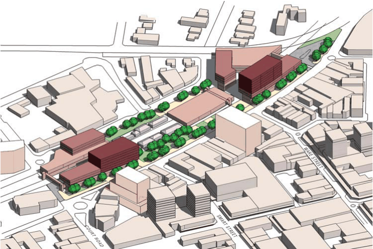

> [Picture on page 25: a picture, saved as a picture (images/fairfield-city-centre-master-plan-page-25-3.gif, 150 dpi).]
> Words printed on the picture (title and legend, copied from the PDF):
> WARE STREET
> SMART STREET
> COURT ROAD

#### Aerial view looking to South

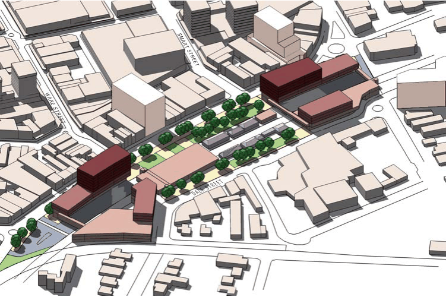

> [Picture on page 25: a picture, saved as a picture (images/fairfield-city-centre-master-plan-page-25-5.gif, 150 dpi).]
> Words printed on the picture (title and legend, copied from the PDF):
> WARE STREET
> SMART STREET
> DALESTREET

#### Aerial view looking to North

#### Cross Section    Scale 1:2000

#### INDICATIVE FLOOR SPACE SCHEDULE

(shown are approximate gross floor areas)

Site A Site B

Site A       Retail 1800 sqm

Commercial 7200 sqm

Site C

Site B       Retail 1470 sqm

Commercial 3880 sqm

Site D

Site C       New station 1380 sqm

Retail 580 sqm

Site E

Site D       Retail 1780 sqm

Commercial 7900 sqm

#### Key Plan

Site E       Retail 680 sqm

Commercial 2740 sqm

Residential 330 sqm

Total         Retail 6310 sqm

Commercial 21720 sqm

Residential 330 sqm

New station 1380 sqm

#### Total Floor Space 29740 sqm

#### OPEN SPACE

Northern park/plaza 3800 sqm

Southern plaza

2000 sqm

#### Total

#### 5800 sqm

(existing park is approximately 5000 sqm)

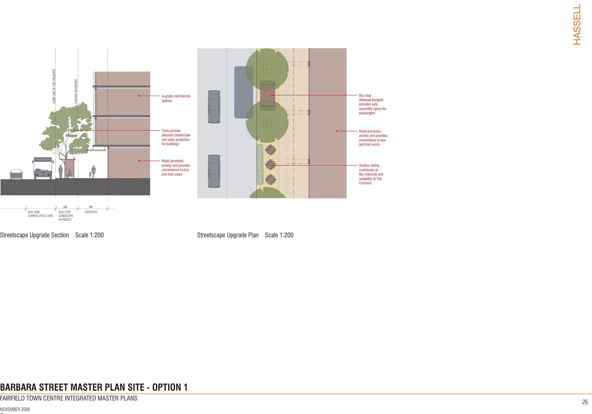

> [Picture on page 26: a map, saved as a picture (images/fairfield-city-centre-master-plan-page-26-1.gif, 150 dpi); the street names and other small labels are on the picture.]
> Words printed on the picture (title and legend, copied from the PDF):
> CURB LINE OF THE CRESCENT
> SHARED CYCLE LANE
> and solar protection
> activity and provides
> convenience to bus
> and train users
> assembly space for
> activity and provides
> convenience to bus
> and train users
> the character and
> useability of The

#### Streetscape Upgrade Section    Scale 1:200

#### Streetscape Upgrade Plan    Scale 1:200

### BARBARA STREET MASTER PLAN SITE - OPTION 1

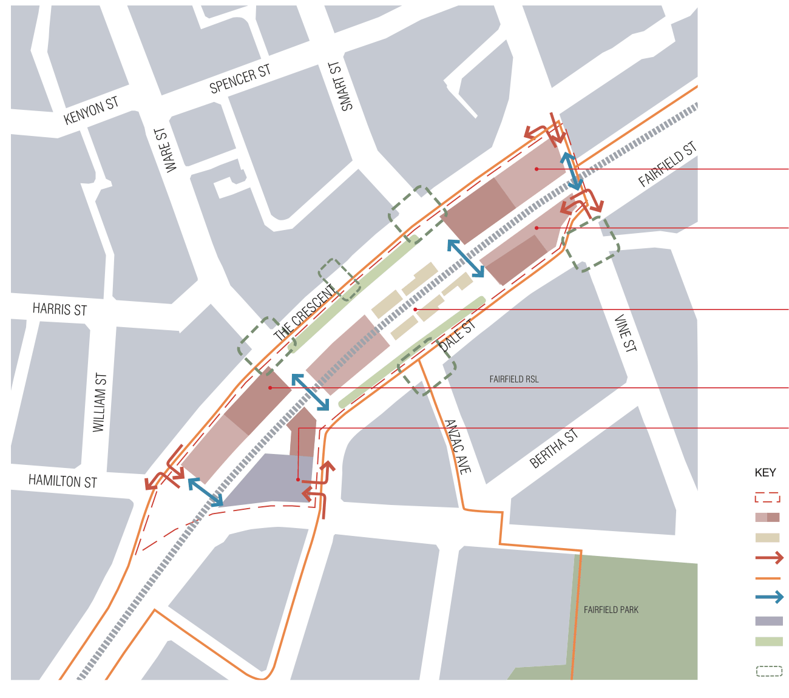

> [Picture on page 27: a picture, saved as a picture (images/fairfield-city-centre-master-plan-page-27-1.gif, 150 dpi).]
> Words printed on the picture (title and legend, copied from the PDF):
> FAIRFIELD RSL
> FAIRFIELD PARK
> KEY

#### KENYON ST

#### HARRIS ST

#### WILLIAM ST

#### HAMILTON ST

#### SPENCER ST

#### SMART ST

#### WARE ST

#### THE CRESCENT

#### FAIRFIELD ST

#### VINE ST

#### DALE ST

#### BERTHA ST

#### ANZAC AVE

Site A

130 parking spaces

Site B

10 parking spaces

Site C

10 parking spaces

Site D

130 parking spaces

Site E

220 parking spaces

Master Plan site boundary

Buildings

Existing railway station

Vehicle entry/exits

Cycle routes to connect existing paths

Pedestrian connection over rail line

Commuter Parking

Pedestrian improvement, bus/taxi service and kiss+ride

Area to be investigated

### THE CRESCENT MASTER PLAN SITE - TRAFFIC AND PARKING

#### Transport and Access Plan

- the area around the station is pedestrian-focused, allowing enhanced access to the station and safer crossing of The Crescent

- improved crossing conditions are provided at the corner of Smart and Ware Streets, with the mid-block crossing relocated to align with the existing shipping arcade

- the principal entry to the new station is located for more direct access to Ware Street

- new station and buildings allow for more direct, accessible and safer pedestrian connections across the rail lines - this creates better connectivity between the two sides of the town centre

- relocation of buses along The Crescent significantly improves interaction between bus passengers and new active frontages along The Crescent, with a wider traffic lane to avoid conflict between moving traffic and stationary buses

- the impact of vehicles entering and exiting buildings is reduced by locating access at the ends of the Master Plan site

- on-road cycle links are provided in a mixed traffic, slow speed environment (40km/h High Pedestrian Activity Area) on both sides of the railway line, connecting to the existing Parramatta to Liverpool Rail Trail on the northern and southern approaches to Fairfield Station - these require further study by a specialist consultant

#### Car Parking Strategy

The existing commuter parking spaces (295 in total) are retained, and relocated to a multi-storey structure at the southern end of the site.  This minimises the impact of vehicle movements by providing a single point of access, and enhances pedestrian connection to the town centre by the provision of a bridge across the rail lines.

Under Council’s current DCP for parking, an additional 538 parking spaces would be required, including 195 spaces for retail uses.  As the majority of retail uses will service commuters and other public transport users, the Master Plan assumes that this requirement will be satisfied by the existing commuter parking.

Car parking for commercial uses has been provided within the building envelopes, as shown below.  This configuration allows for the parking space to be reallocated for future expansion of the rail corridor.

This Master Plan option proposes a total of 500 car parking spaces, but has potential to accommodate additional spaces.  The total number of parking spaces depends upon the refinement of floor area and mix of uses.

Potential to expand

rail corridor while

retaining parking

Existing railway line

Parking

Retail+commercial

Footpath+

bus stop

#### Parking Concept

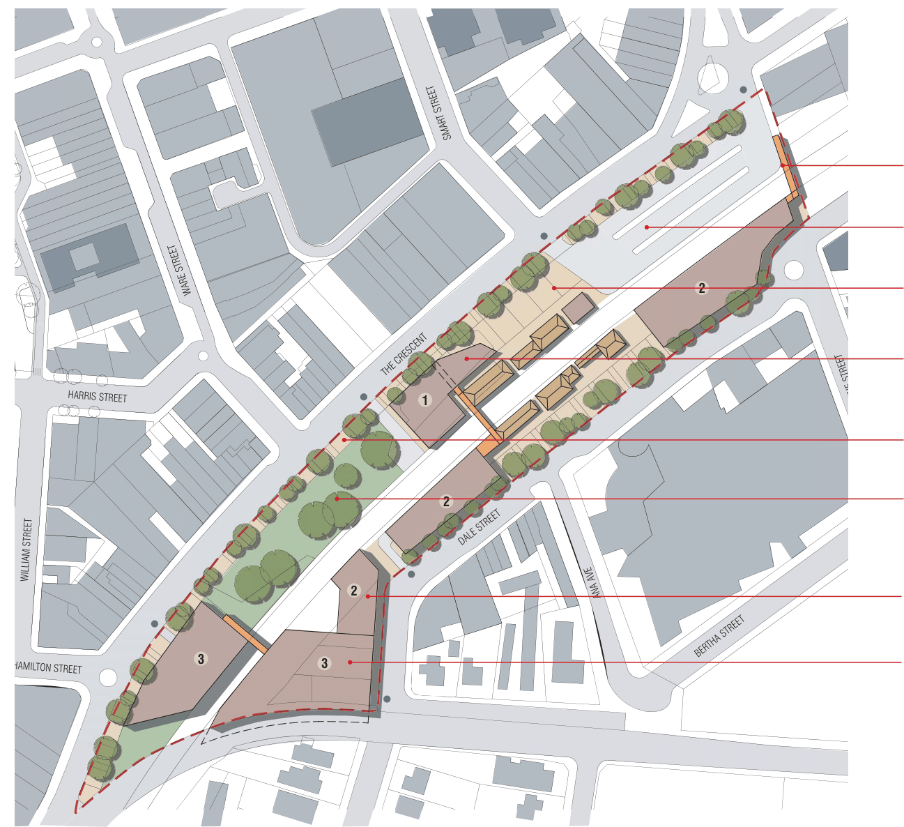

> [Picture on page 28: a map, saved as a picture (images/fairfield-city-centre-master-plan-page-28-1.gif, 150 dpi); the street names and other small labels are on the picture.]

#### Master Plan Scale 1:2000

Master Plan Site Boundary Paved Area Landscaped Area

1

New/Existing Trees

New/Refurbished Buildings

Existing Train Station Buildings

Height (In Storeys) Line Of Ground Floor Vehicular Entry/Exit

Existing/New Connection

Existing connections upgraded

Existing Interchange relocated and upgraded

New public plaza in front of station

Existing station and shopping centre refurbished

Footpath widened; new street trees and furniture

Existing commuter parking removed; The Crescent Park expanded and upgraded

Retail/commercial buildings along Dale Street

New multi-storey parking stations with bridge connection over train lines

#### Master Plan Option 2

All existing commuter parking is relocated to two new multi-storey structures at the southern end of the site.  This allows the bus interchange to be shifted further north, providing more direct bus movement from Court Road and into Smart Street.  In turn, this provides space for a new forecourt adjacent to the rail station.

The existing park is reconfigured around the revised parking arrangements, with upgraded landscaping and lighting.  The footpath along The Crescent is widened, and its amenity improved through consistent street tree planting, new paving, lighting and street furniture.

The key opportunities of this Master Plan option include:

- refurbishment of the Fairfield Connection allows a wider footpath, greater visual/ physical access to the station, and creates active edges to the station forecourt and park;

- station upgrade includes improved station functioning, and more accessible and safer connection across the rail lines;

- streetscape improvement and more legible station entry from Dale Street;

- taxi rank and ‘kiss+ride’ accommodated along The Crescent, reducing conflict with bus services within the interchange;

- bus interchange upgrade including larger passenger assembly areas and improved shelter;

- new retail/commercial development along Dale Street activates the street and provides uses complementary to the existing transport functions (eg convenience retailing);

- existing bridges across the rail lines upgraded (possibly integrated with new buildings) for improved safety and access; and

- existing cycle routes can be linked along The Crescent within shared traffic lanes

Some challenges which require further investigation:

- safety and amenity issues within the park and bus interchange may not be adequately addressed;

- significant public domain improvements may not be offset by the limited amount of development on the site; and

- station facilities may not be adequate for future expansion of Fairfield town centre

#### Financial Feasibility

Hill PDA have completed a financial analysis of the two options for The Crescent precinct (see Appendix A) to determine their feasibility.  The analysis found that:

- as a smaller development proposal including mostly retail uses, Option 2 would respond to current local market demand without significant risk;

- approximate project cost is $35m and would not need to be staged or to be dependent upon a substantial pre-commitment of office or retail space prior to construction commencement; and

- could be considered a realistic “fallback” development scenario if government underwriting for office leasing can not be obtained for the Option 1 proposal

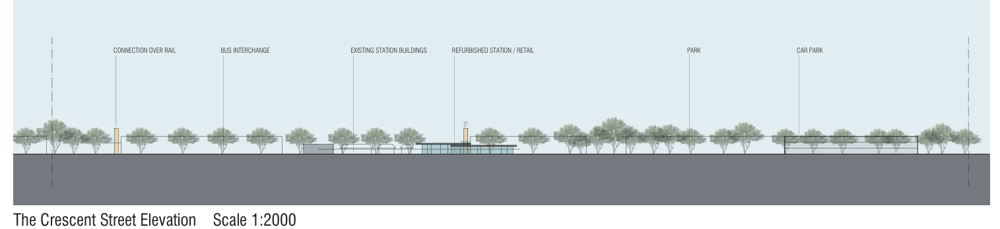

> [Picture on page 29: a picture, saved as a picture (images/fairfield-city-centre-master-plan-page-29-1.gif, 150 dpi).]
> Words printed on the picture (title and legend, copied from the PDF):
> CAR PARK
> EXISTING STATION BUILDINGS
> BUS INTERCHANGE
> CONNECTION OVER RAIL
> PARK
> REFURBISHED STATION / RETAIL
> F

#### The Crescent Street Elevation    Scale 1:2000

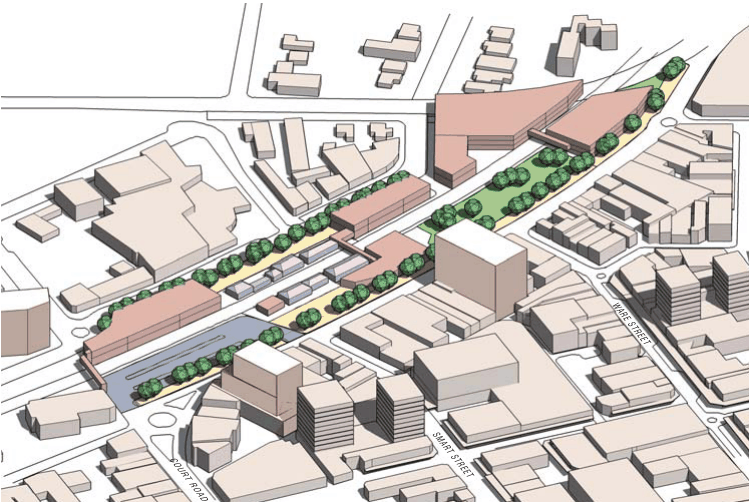

> [Picture on page 29: a picture, saved as a picture (images/fairfield-city-centre-master-plan-page-29-3.gif, 150 dpi).]
> Words printed on the picture (title and legend, copied from the PDF):
> WARE STREET
> SMART STREET
> COURT ROAD

#### Aerial view looking to South

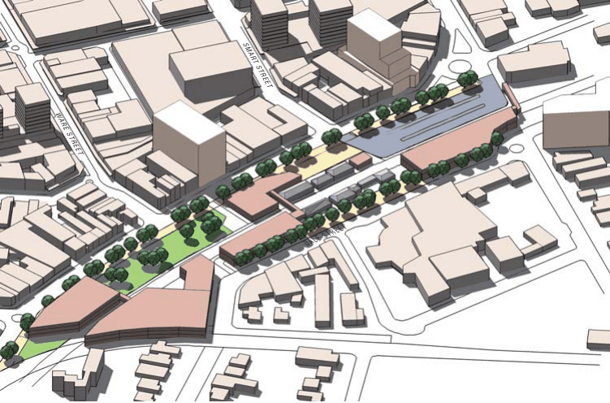

> [Picture on page 29: a picture, saved as a picture (images/fairfield-city-centre-master-plan-page-29-5.gif, 150 dpi).]
> Words printed on the picture (title and legend, copied from the PDF):
> SMART STREET
> WARE STREET
> DALESTREET

#### Aerial view looking to North

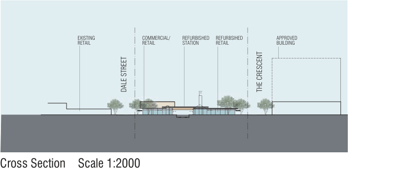

> [Picture on page 29: a map, saved as a picture (images/fairfield-city-centre-master-plan-page-29-7.gif, 150 dpi); the street names and other small labels are on the picture.]

#### Cross Section    Scale 1:2000

#### INDICATIVE FLOOR SPACE SCHEDULE

(shown are approximate gross floor areas)

Site A       Bus interchange

Site A Site B

Site B       Retail                     2350 sqm

Commercial           780 sqm

Site C

Site D

Site C       Existing retail         920 sqm

New retail              1250 sqm

Commercial           410 sqm

Site E

Site D       Parking only

#### Key Plan

Site E       Retail                     570 sqm

Commercial           570 sqm

Total         Retail                     5090 sqm

Commercial           1760 sqm

#### Total

#### 6850 sqm

#### OPEN SPACE

Park

4000 sqm

Northern plaza

1200 sqm

Southern plaza

800 sqm

#### Total

#### 6000 sqm

(existing park is approximately 5000 sqm)

#### PARKING SCHEDULE

Site A       Bus interchange Site B       10 spaces Site C       10 spaces Site D       100 spaces Site E       220 spaces

#### Total 340 spaces
