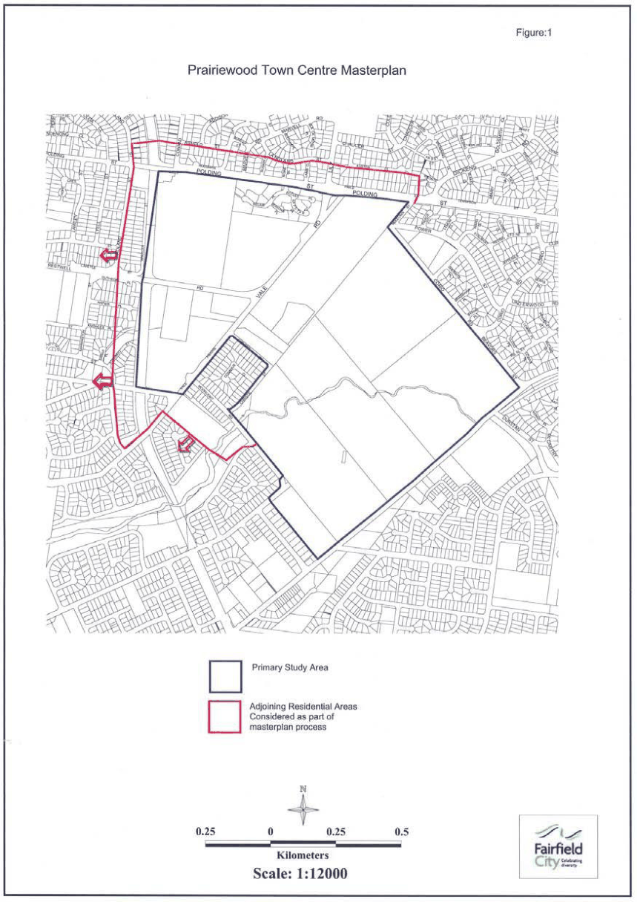
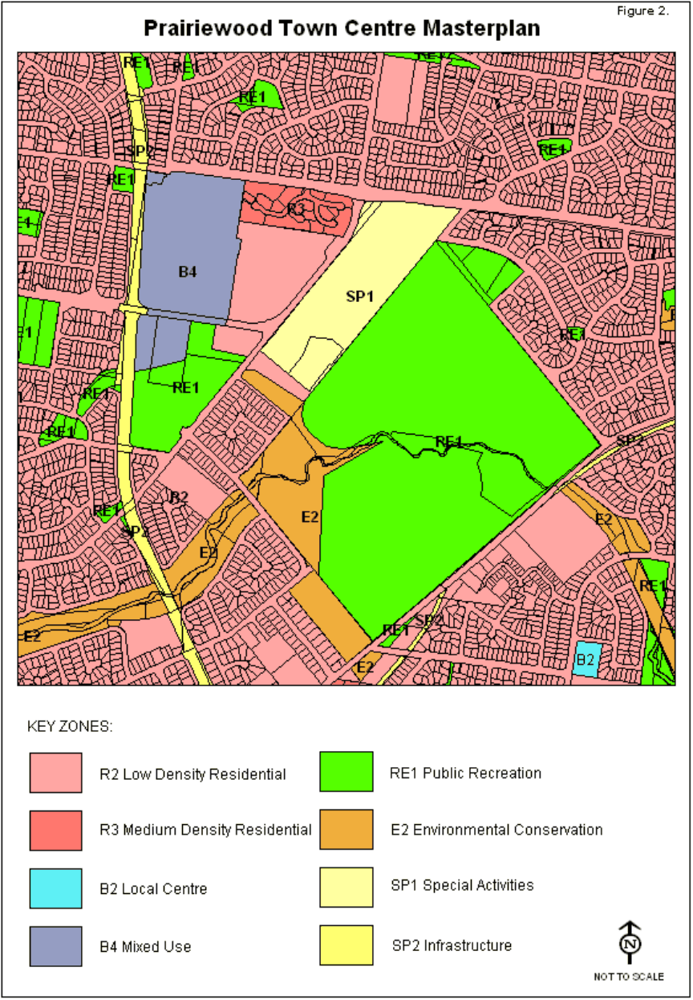

## 1.  Introduction

### 1.1 Vision Statement

Prairiewood Town Centre is located in the Fairfield local government area. It is south of Prospect Reservoir and Wetherill Park, the largest industrial area in Sydney, east of the Western Sydney Regional Park and north of the Bonnyrigg Town Centre.  The area considered as part of this study is shown in Fig 1.

Prairiewood is also serviced by the Tway dedicated bus route and is situated at about the halfway point between the termini to the Tway, Liverpool to the south and Parramatta to the north.

The main access streets to the Town Centre are Polding Street east/west, Smithfield Road (Cumberland Highway) south west/north east, Prairie Vale and Mimosa Roads north/south. Restwell Road, a local road, cuts through the town in an east/west direction.

Prairiewood itself is characterised by its gradually undulating ground with large areas of open space including an 18 hole golf course. A large shopping centre (Stocklands Mall) has been built adjacent to the High School; the Fairfield Hospital and various sporting and community facilities are located in the area. They are not linked and are generally accessed by car.

Prairiewood was not conceived as a Town Centre. The relatively ample availability of space has seen the location of a shopping centre and a number of public facilities and institutions over several decades. Little thought was given to the way these facilities would relate to each other or that one day; these facilities would indeed create a centre. The building of the Tway reinforces Prairiewood‟s status as a centre. The local population will inevitably increase. Measures need to be put in place to accommodate the change that will occur.

The Department of Planning have identified Prairiewood as part of a regional network of centres where substantial growth should occur.

Prairiewood already has many of the elements necessary for a successful town centre. A set of principles developed around how people can live and use the centre will generate guidelines that will transform the Town Centre into a place with its own character and identity.

This Town Centre has the potential to be an integrated town centre that is vibrant and used by all parts of the community to meet a wide range of needs and wants and the identification of a future desired character for Prairiewood is the reason for this preparation of this plan. In this regard the Prairiewood Masterplan aims to provide guidelines that will allow Prairiewood to: develop as a vibrant, multi use town centre have a safe and attractive pedestrian environment have the services and amenity that a town centre needs encourage well designed new residential and commercial areas manage the natural water courses in the area enhance the connections between all existing facilities. employ safety by design principles in the design of any development.

> [Picture on page 5: a picture, saved as a picture (images/prairiewood-master-plan-december-2005-page-5-1.gif, 150 dpi).]

### 1.2 Purpose of the Masterplan

The purpose of the Masterplan is: to provide a clear framework for Council against which future rezoning applications, which are required to enable future redevelopment of existing sites, to be considered. to provide a framework against which any development application, for a use currently permitted by the zoning, will be assessed. to produce a framework for development of the site including building form, public domain, access provisions, Transitway (Tway) land uses and overall Urban Design. to ensure the issues/desires of all the stakeholders are considered so that a viable and equitable town centre is generated. to provide a clear, concise document which can be adopted by the Council and which directs future development. to address all aspects of land use, infrastructure, heritage, access, feasibility and consultation processes in support of the proposed plan. to provide guidance to developers and authorities on the type, scale and form of development acceptable in the town centre. to inform developers and authorities on the nature and form of public domain improvements. to assist the public in understanding the potential future character of the area and to assist them to comment on rezonings and development applications.

### 1.3 Regional Context

The Prairiewood Town Centre must be considered in the context of its role and position with respect to other centres in the region. Parramatta and Liverpool are major regional centres. Fairfield is considered a centre of centres with each of the four sub-regional centres, i.e. Prairiewood, Fairfield, Cabramatta and Bonnyrigg, playing an important role for the Fairfield community and other users/visitors to the Fairfield LGA. Each one of these centres has a function, set of activities and character that sets it apart. Prairiewood will continue to develop its own set of uses and characteristics that sets it apart and gives it a strong identity.

The State Government's Department of Planning and Infrastructure (DP&I) prepared the Metropolitan Strategy for Sydney 2036 which guides development of Sydney and provides guidance to the community and Council's on how Sydney will develop over the next 30 years. The proximity to the Transitway and adjoining Industrial/Employment Land and the mix of local and regional facilities were identified as indicators by both Council and the DP&I of the important role Prairiewood will play as a service/town centre.

The Metropolitan Strategy for Sydney 2036 and the West Central Sub-Regional Strategies outline residential dwelling targets that each Sydney Council is required to meet. Fairfield City has been given a dwelling target of 24,000 dwellings by 2036. As a response, Fairfield City Council has prepared a Residential Development Strategy which identified areas in the eastern half of the City (east of Cumberland Highway) for higher density residential development. A further strategy will be undertaken to determine the opportunities in the western half of the City, including Prairiewood.

The Prairiewood Town Centre is one of a number of town centres along the Tway which has the potential to become a denser, more formalised centre which will attract more residents, shoppers and users of the important institutions and facilities. In this regard DP&I have also prepared a Study of the Transitway corridor from Liverpool to Parramatta. Council Officers were involved in the Steering Group established by DP&I during the preparation of this Study

and consider that this Strategy is consistent with the directions established for the Transitway and Prairiewood during the Steering Group Process. However this study is yet to be released by DP&I and Council may need to review this Masterplan should there be any significant departure from the recommendations of the Transitway Study findings.

The aims of the Prairiewood Town Centre Masterplan in its regional context are: to establish planning principles that are in accord with the state government‟s strategy for western Sydney. to promote the orderly and economic use and development of land within the region.

The Masterplan makes provision for: an integrated mix of housing, employment and cultural activities. the establishment of a community focus for activity. a high quality physical environment which is respectful of the natural landscape qualities of the area. a high degree of non-vehicular movement linking the transport, community facilities, institutions and shops and places of employment. built forms which are respectful of the character of the area and which have excellent amenity and enhance the amenity of the public domain. management of the storm water related issues of the site in the form of a landscaped place of public recreation.

### 1.4 Local Context

The catalyst for this study was the expression of interest by the Calabrian Club to redevelop their site and adjacent Council site at 178 and 184-192 Restwell Road, Prairiewood. This Masterplan was initiated so that Council would have some context within which to consider any rezoning/redevelopment of this site to ensure that any redevelopment considered by Council fit into a broader vision for the entire town centre.

A rezoning proposal to rezone the site to allow mixed use had been with Council for a number of years. On 10 August 2010, Council resolved to make a request to the Department of Planning and Infrastructure (DP&I) to convert the application into a Gateway Planning Proposal under section 55 of the EP&A Act.

As a result, a Planning Proposal to rezone the site was submitted to the Department of Planning and Infrastructure. The site was previously zoned part 6(a) Existing and Proposed Recreation and part 6(b) Private Recreation under the Fairfield LEP 1994. The Planning Proposal was subsequently gazetted on 19 August 2011, which rezoned the site to 3(b) District Business Centre. As part of the comprehensive LEP process, the site was zoned B4 Mixed Use under the Fairfield LEP 2013, which was essentially an equivalent zone.  As part of the planning proposal process, a Site Specific Development Control Plan was prepared and adopted to control the future development of the site. The Prairiewood Town Centre Southern Precinct – Development Control Plan 2013 also came into force on 31 May 2013.

Council owns the remaining open space around the Calabrian site, which contains a community centre, Prairiewood Leisure Centre and the drainage basin. The community centre contains a large space which is leased by community groups for functions etc and also provides some youth facilities and services. The centre offers a range of activities including gym and associated fitness activities and an indoor and outdoor pool. A stage 3 of expansion for the pool has previously been considered by Council and would need to be considered in the context of any expansion to the drainage basin.

Prairiewood Town Centre has continued to establish itself around the Stockland Shopping Centre and state government facilities. The most significant change in the centre has tended to focus around redevelopments/expansions to the shopping centre with some of the Council facilities, i.e. library and adjoining community centre, being rebuilt as part of the most recent redevelopment. The shopping centre is an „internal box‟ shopping centre with shops facing internal pedestrian spaces and car parking provided in the centre of the site and under the building at the southern end of the site. It contains some stand-alone restaurants/service stations at the northern end and a movie theatre adjoining the central car park.

The State Government facilities, the school, hospital and police station have not recently been significantly redeveloped.

The hospital is located between the golf course and Prairie Vale Road. It is an important regional public hospital with complementary private clinics located around it. The hospital has indicated that they may expand into the open space to the north of the existing facility. The pedestrian pathway that exists diagonally across the health department land from north/east to south/west is one of the few established pedestrian links existing in the town centre.

The police station is located south of the hospital land adjacent to the creek tributary that feeds into the golf course. The station is a depot and car park for the highway patrol fleet and does not operate as a normal police station.

The school is a public high school with about 1050 students from years 7 to 12. The school is a vital member of the town centre community. The school is comprised of 2 and 3 storey brick structures that are located along a line that links the Hospital with the Stocklands shopping centre. This link was intended as a public through-way but is currently closed to through pedestrian traffic due to security concerns at the school.

Preliminary discussions indicate there are no significant plans for redevelopment or relocation. Accordingly, it has been assumed that these state government facilities will remain a part of the fabric of the centres in the existing form in the short to medium term.

The spastic centre is a single storey specifically designed building of recent construction with on site car parking. The owners of this site are not expecting to make significant changes to this site in the short to medium term.

Beyond the existing centre the surrounding suburbs were all developed in the 1980's and 90's and are dominated by single dwellings on relatively large blocks. A range of smaller local centres offer local services to residents but Stocklands is the primary service centre for this part of Fairfield.

### 1.5 Reference to Other Plans

The following legislation, planning instruments and local policies and plans apply to development in the town centre: State Environmental Planning Policy No 65 and the associated Residential Flat Design Code referred to in this policy Environmental Planning And Assessment Act 1979 Regulations Fairfield Town Centre Strategic Plan and associated Studies Fairfield City Wide Development Control Plan 2013

Fairfield City Council Direct (Section 94) Development Contributions Plan 2011 Fairfield Residential Development Strategy 2009 The Building Code of Australia (BCA) Disability Discrimination Act BASIX Index (prepared by the Sustainability Unit of the Department of Infrastructure Planning and Natural Resources) Urban Capability Assessment of Fairfield City (November 2002) Fairfield Stormwater Drainage Policy (September 2002) Council's Urban Area On Site Detention Policy 1997 Crime Prevention Through Environmental Design (CPTED) Fairfield Bike Plan 1995 Prairiewood Town Centre Southern Precinct – Development Control Plan 2013

### 1.6 Statutory Framework

Fairfield LEP 2013 is the principal planning instrument-controlling development within the study area. The LEP is a statutory document prepared in accordance with the Environmental Planning and Assessment Act, 1979.

This LEP is the primary document for planning but is backed up by a number of supplementary documents such as Development Control Plans, which provide more detailed controls, relating to specific forms of development. The Prairiewood Precinct Study Area comprises 7 separate land use zonings (shown in Fig 2), being:

B4 Mixed Use – Potential Major Centre (establishment of business centre retail, commercial, specialist cultural, tourist, entertainment, major food, clothing, small items and professional services) – Stocklands Shopping Centre and Calabrian Club Site.

R3 Medium Density Residential – (multi dwelling housing and residential dwellings) – to the north eastern corner of the shopping precinct.

R2 Low Density Residential – (single residential dwellings) – All other areas of the suburbs within the study area.

SP1 Special Activities – Make provisions for community and public authority use and for purposes ordinarily incidental or subsidiary to those uses.

SP2 Infrastructure – Arterial Road and Arterial Road Widening (identifying existing arterial roads and land required for proposed roads) – the main roads within the study area.

RE1 Public Recreation – (providing open space for recreation needs) – The Fairfield City Golf Course, Prairiewood Leisure Centre and other smaller parks.

E2 Environmental Conservation – Environmentally significant land, predominately along riparian (creek) corridors and significant vegetation.

> [Picture on page 10: a picture, saved as a picture (images/prairiewood-master-plan-december-2005-page-10-1.gif, 150 dpi).]

The residential land areas surrounding the shopping centre are controlled by the Fairfield City Wide DCP 2013. The LEP also contains a number of specific clauses relevant to the Prairiewood Precinct.

Fairfield City Wide DCP 2013 came into force on 31 May 2013 and applies to Fairfield City where sites are not covered by a Town Centre DCP. The key chapters that apply to the land within the Prairiewood Masterplan Precinct are: Chapter 2 – Requirements for Development Application Submission Chapter 3 – Environmental Management and Constraints Chapter 5A – Single Dwellings Chapter 5B – Secondary Dwellings (Granny Flats) Chapter 6A – Multi Dwelling Housing – Townhouse and Villa Chapter 6B – Multi Dwelling Housing – Dual Occupancy Chapter 10 – Miscellaneous Development Chapter 11 – Flood Risk Management Chapter 12 – Car parking, Vehicle and Access Management Chapter 13 – Childcare Centres Chapter 14 – Subdivision Appendix A Definitions Appendix B Notifications Appendix C Advice for Designing Advertising Signs Appendix E Waste Not Policy to Manage Demolition and Construction Waste Appendix F Landscape Planning

The DCP contains a large amount of detailed information concerning all aspects of development planning within the Prairiewood Masterplan Precinct, along with a Section 94 development contributions plan.

Further, BASIX requirements will need to be included in all residential applications to council.

### 1.7 Objectives for the Prairiewood Town Centre

The main objectives for the Prairiewood Town Centre are to create an environment with a high amenity for both the public domain and for development. When the Town Centre Masterplan is realised, Prairiewood will be known for its services and facilities conveniently linked via an accessible pedestrian and cycle network. Equally the town centre will remain a convenient place to shop and an ideal place to work and live.

The following key actions are seen as imperative for the transformation of Prairiewood into a successful town centre: Enhance and extend the pedestrian/cycle network into a major alternative for movement around the site, encouraging use of the public transport infrastructure. Key linkages that need to be formalised early include; the north south link from the Polding Street entrance to Stocklands down to the Leisure Centre and swimming pool south of the retention basin, the east/west link from the Hospital to the Tway station on the west side of the shopping centre. Establish a finer grain vehicular network by building local streets for access to new development south of Restwell Road that will allow car park entries and create clear demarcation of the public and private realms. Create a system of public open spaces including both a town square and the transformation of the existing water retention basin into a more useable park. The

requirement of a water retention basin provides an opportunity to create a soft landscape heart to the Town Centre that will be readily accessible from all parts of the Town Centre but it must also perform the water quality functions and it will in all likelihood also accommodate ponds and other measures to achieve environmental water quality objectives. Encourage active uses on the streets. Most of the development in the town centre will be required to provide space at ground level that accommodates active uses such as restaurants and community facilities. Control the scale and form of development to maximise the development potential of the sites whilst ensuring that the amenity of the public realm is maintained and that a characteristic scale and type of buildings is established by applying the principles of SEPP 65 and the design recommendations of the Residential Flat Design Code. Ensure that a broad range of a mix of housing type to meet all types of household forms and incomes are provided for as part of any housing development.

### 1.8 Process and Consultation

The preparation of the Masterplan has been undertaken through an extensive and broad based process of consultation with principle stakeholders and the community.

Fairfield City Council prepared questionnaires and interviewed people in various locations as well as conducting two rounds of meetings with all the landholders and users.  Survey interviews were held at Stocklands, the Leisure Centre, Library, Hospital, and at the Saturday markets. Users of the School and the Spastic Centre returned surveys completed at home. Council also conducted workshop focus group sessions with the School and Spastic Centre.

Council surveyed 555 people and found the following: Results showed that 52% of the users came from Prairiewood and the surrounding suburbs, 28% from the Fairfield LGA, 14% from neighbouring Councils and 6% from further afield.

Method of Transport to Prairiewood;

The survey also showed that cars were the preferred mode of transport for people using the

area.  This is quite apparent in that 83% of respondents stated they had travelled by car to the location, compared with only 7% who walked. (Private car 445, Walk 39, Bus 14, Carpooling 12, Tway 7, Cycle 1.) 305 of those surveyed said they would visit more than one facility on the one day. Of those, 192 would drive between facilities and 113 would walk. The survey shows a low level of public transport use but a high level of pedestrian movement once at Prairiewood, despite a low grade pedestrian environment.

Below is a summary of responses from the surveys

#### What do you like about Prairiewood?

Almost half of the people surveyed said they enjoyed the convenient location of Prairiewood as well as the services that it offers. Also high on the list was a liking for the open space, quiet atmosphere, the people, the diversity of the area, cleanliness and safety.

#### What don't you like about Prairiewood?

Respondents listed parking as the thing they liked least about Prairiewood, followed by traffic. Other areas of most concern were crime, safety, roads and public transport, as well as congregating youths and a lack of organised activities for them. Other recurring concerns were related to the desire for more services and the improvement of parks, including more seating.  A small number also listed accessibility and a lack of identity for the area as a problem.

#### What do you think could be improved in Prairiewood?

A large number of responders (20%) said they would like to see the open space areas in Prairiewood improved, as presently there is nothing to attract people to use these spaces.  Other things which people would like to see improved include: car parking - it was thought that there currently isn't enough more organised leisure activities more services more shops safety public transport including the Tway the Leisure Centre footpaths and roads cleanliness

#### Stakeholder Consultations

Consultation sessions were conducted as a group and individually with people representing the Hospital, Dept of Housing, Stocklands, Prairiewood High School, the Spastic Centre, the Calabria Club and the Leisure Centre.  Below is a brief summary.

An increase in residential density was generally supported as this would increase the number of people using services such as the School and Leisure Centre and will also support the local businesses which presently struggle to attract patronage after hours.  A combination of housing was particularly supported as this would provide a better mix of people in the community.

Stocklands advised that they intended to keep the at grade car park in the short-term and that they envisaged the centre would expand sometime in the near to medium future and that this will see the overall capacity of the site increase. At that stage, basement car parking would be considered.

The Spastic Centre's concerns were mainly access related (both vehicular and pedestrian), e.g. disabled access into shopping centre from external sites.

Prairiewood High School would like to promote its sporting, language and agricultural programs in the future as well as increase its number of students. They also emphasised that the ovals play an important part in the school and pointed out that they wouldn't like to see overshadowing as a result of medium density.

The Calabrian Club were supportive of the process and the Masterplan to date and are willing to work with Council in the future to achieve a desired outcome.

The Leisure Centre's future plans are to include other leisure activities such as basketball.

The Hospital indicated that any future development on their site would be health related professional rooms.

The Department of Housing had no immediate plans for the small estate. It is about 20 years old and still has at least 10 years of economic life. As a small estate there aren't the tenancy management problems nor social issues that are a factor in redeveloping the larger estates.
