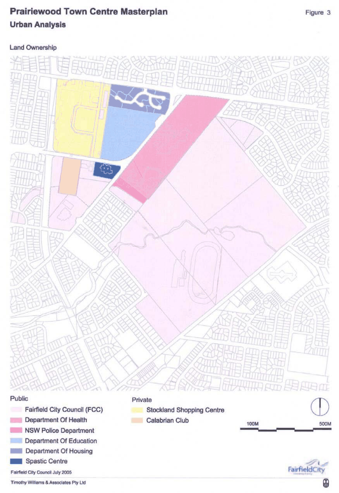
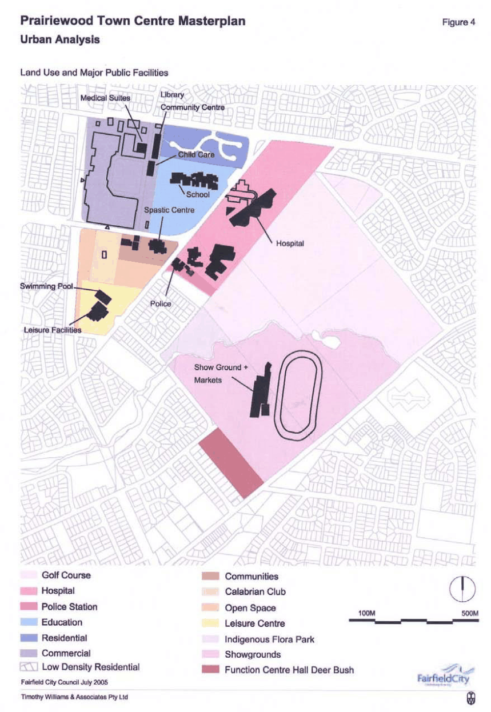
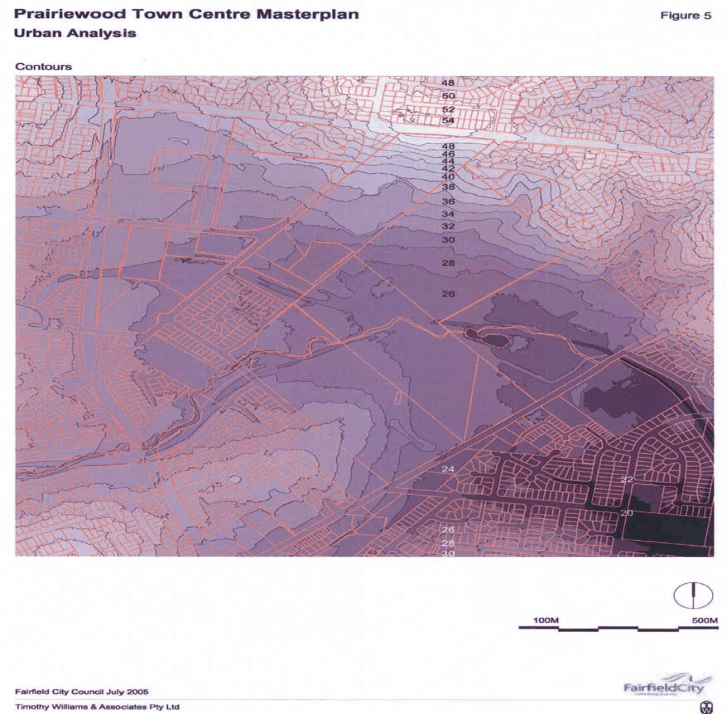
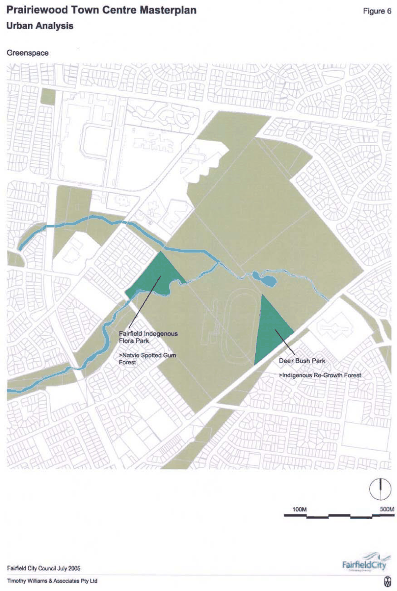
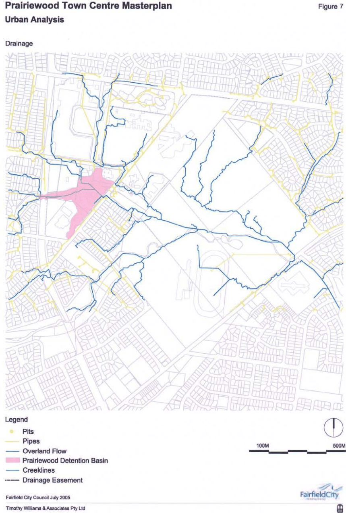
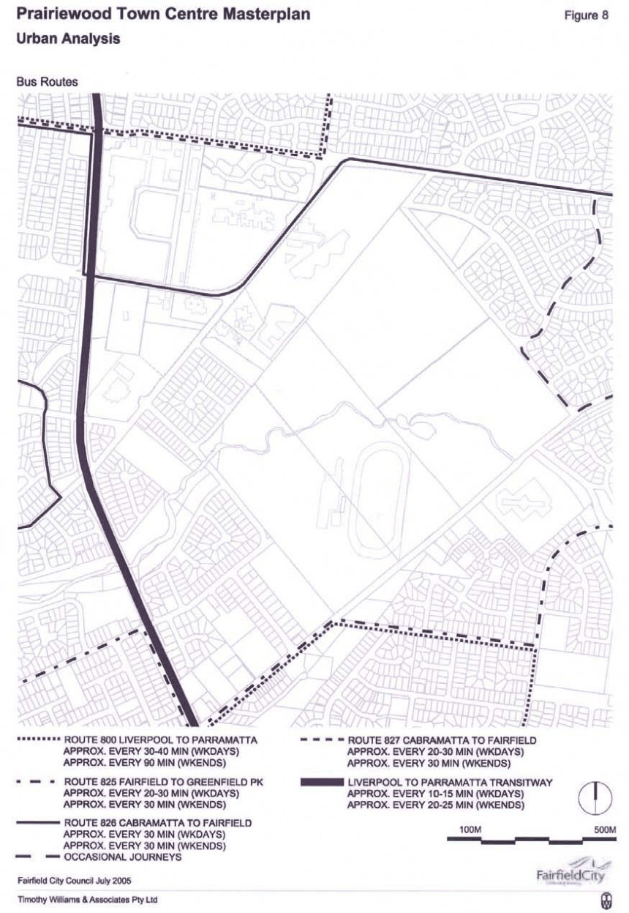
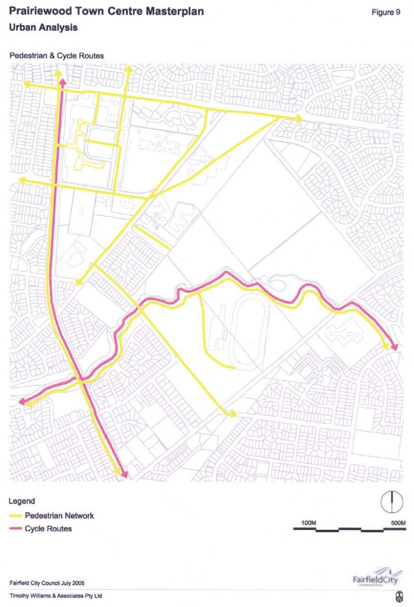
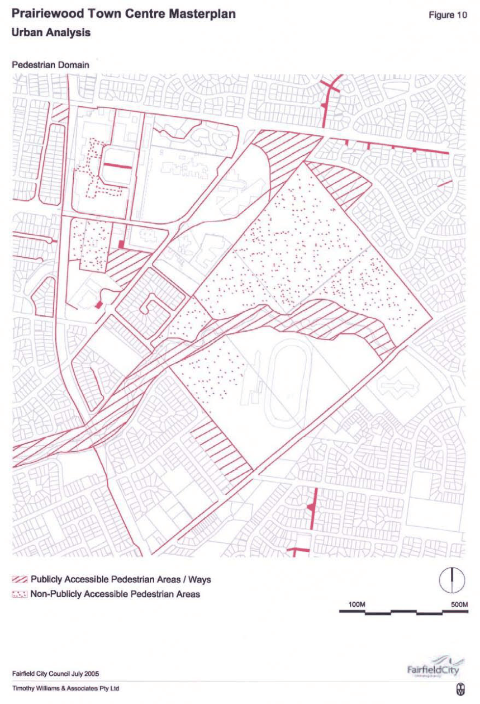
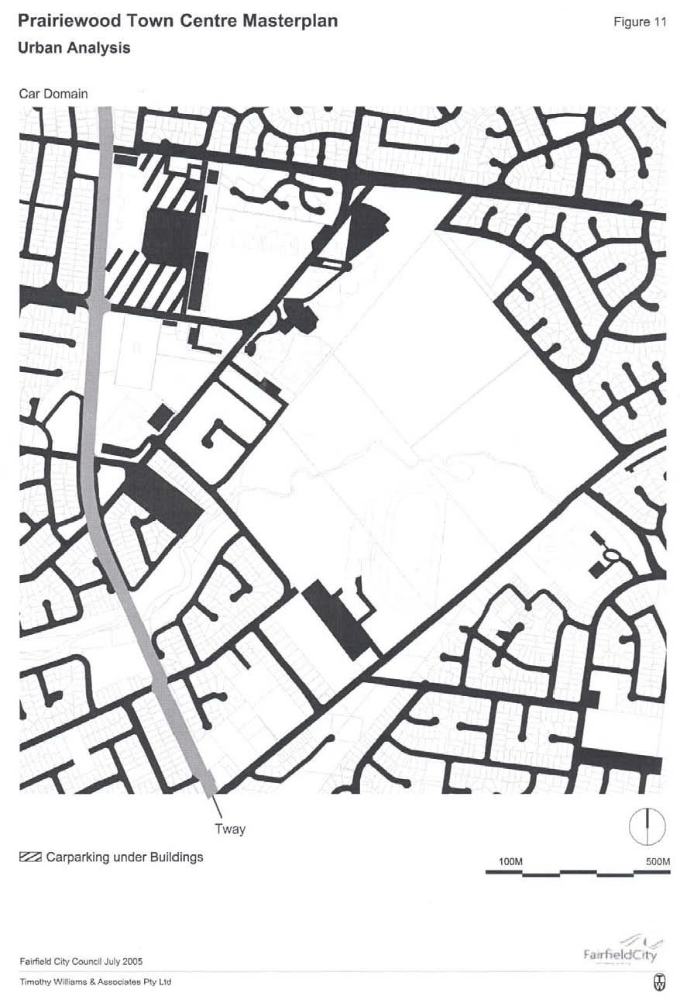
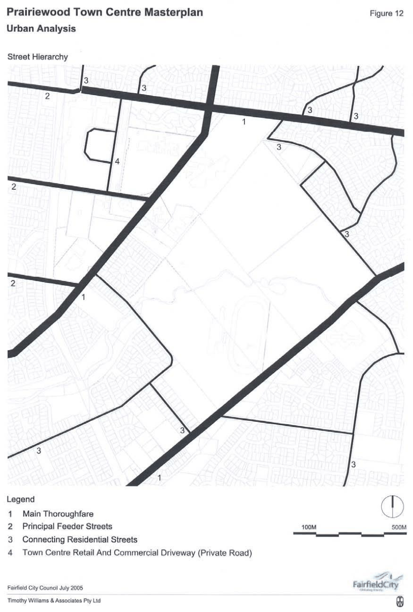

## 2.  Prairiewood Town Centre Site – Planning and Urban Analysis

### 2.1 Site Description

The site, which is the subject of this Masterplan, is situated 5 kilometres west of the Fairfield Town Centre, 4 kilometres south of Prospect Reservoir and 7 kilometres north of Liverpool.

The site comprises of large public landholdings and a privately owned shopping centre and a community sports club.

The site is bounded by the Transitway (Tway) to the east with bus stops at Stocklands and at Prairie Vale Road. The south eastern side of the site is bound by Smithfield Road which becomes the Cumberland Highway at the northern end of the site. The north of the site is bound by Polding Street which is the main access street from the Fairfield Town Centre.

### 2.2 Land Ownership

The ownership of the Masterplan site is shown in Fig. 3, the land use and the major public facilities in Fig. 4.

#### Land Ownership Table

| Golf Course (Council) | 343,708.56 M² | 30 % |
|---|---|---|
| Showgrounds (Council) | 291,038.20 M² | 25 % |
| Hospital (DOH) | 130,773.80 M² | 11 % |
| Commercial (Stocklands) | 117,788.30 M² | 10 % |
| Education (DET) | 66,887.30 M² | 6 % |
| Residential ( Public Housing) | 33,494.00 M² | 3 % |
| Leisure Centre (Council) | 32,297.55 M² | 3 % |
| Open Space ( Council) | 29,738.94 M² | 3 % |
| Function Centre Hall Deer Bush | 28,070.45 M² | 2 % |
| Indigenous Flora Park (Council) | 25,313.32 M² | 2 % |
| Community facilities (Council) | 20,006.11 M² | 2 % |
| Calabrian Club | 19,979.26 M² | 2 % |
| Police Station (State) | 9,625.71 M² 1,148,721.50 M² | 1 % 100 % |

The site of the Prairiewood Town Centre is comprised of a number of large land holdings, most of which are in public ownership they include land owned by Fairfield City Council such as the Golf Course to the east which is adjacent to the trotting track and Showground. Also

owned by Council is land in the south western sector of the site where a leisure facility is located and the drainage basin along the water course.

Other major land owners include the Department of Education and Communities (DE&C) who own the Prairiewood High School Site.

The Housing NSW owns the majority of the land occupied by housing to the north of the School. The NSW Ministry of Health control a large section of the site between the School and the Golf Course.  The Fairfield Hospital is a major building feature in the area.

Other major land owners include the Department of Education and Communities (DE&C) who own the Prairiewood High School site.

Stocklands Shopping Centre occupies the north western sector of the site and is the focus of the majority of activity in the area. A property on Restwell Road opposite Stocklands Shopping Centre is owned by the Calabrian Club and the land on the corner of Prairie Vale Road is owned by the NSW Cerebral Palsy Alliance.

The Tway is owned by Transport for NSW.

> [Picture on page 16: a picture, saved as a picture (images/prairiewood-master-plan-december-2005-page-16-1.gif, 150 dpi).]

> [Picture on page 17: a picture, saved as a picture (images/prairiewood-master-plan-december-2005-page-17-1.gif, 150 dpi).]

### 2.3 Topography and Landscape

The topography of the site is shown in Fig. 5.

The site slopes down from the north west to the south east from RL 50 to RL 25. The landscape‟s dominant feature is the creek system with the Orphan School Creek flowing from west to east through the Golf Course and Showground. A tributary that flows into the creek in the Golf Course flows parallel to and south of Restwell Road. The pleasantly undulating nature of the site is typical of Cumberland Plain country.

Some of the land form has been significantly altered by building works such as Stocklands, where the land has been levelled and drainage patterns altered as discussed below. The area occupied by the School has also been altered with the land being benched into three sections to accommodate sports fields and the school building. The roads have also altered the landscape. Prairie Vale Road has been built up above the level of the natural landscape, impacting on the drainage system.

The site currently has a large percentage of open space as indicated in Fig 6. The Golf Course, Showground, school sports ground and tributary flood plain are open space with some substantial stands of trees in parts. There is little original flora with the exception of a reserve along the Orphan School Creek and remnant Cumberland Plains Woodland east of the Showground and at Deerbush Park in the south of the site.

> [Picture on page 18: a picture, saved as a picture (images/prairiewood-master-plan-december-2005-page-18-19.gif, 150 dpi).]

> [Picture on page 19: a picture, saved as a picture (images/prairiewood-master-plan-december-2005-page-19-1.gif, 150 dpi).]

### 2.4 Drainage

The drainage pattern on the site is described in Fig 7.

#### Existing drainage

The existing drainage pattern on the site is indicated in Fig 7.  The figure shows that there is a major trunk drainage facility that runs through the shopping centre.  The trunk drainage system flows into a tributary of Orphan School Creek.  This tributary and Orphan School flow through the site.  The tributary flows along Christie Street and into Orphan School Creek. Orphan School Creek is a tributary of Prospect Creek, which flows into the Georges River. The Prairiewood Detention basin is also located within the site and is upstream of Prairie Vale Road.  This basin helps control flooding from the tributary of Orphan School Creek.

#### Constraints that need to be considered

Mainstream Flooding: - The current flood mapping does not indicate that there is any flood liable land along Orphan School Creek.  The current mapping has only considered floods up to the 100-year average recurrence interval (ARI).   However, floods bigger than this can occur including the Probable Maximum Flood (PMF).

The flood mapping for Orphan School Creek is presently under review and when complete will indicate the resulting floodplains of all floods including the probable maximum flood (PMF).  The mapping will result in indicating the low, medium and high-risk areas of the floodplain.   Development of these areas can be done according to the guidelines indicated in Chapter 11 Flood Risk Management of the Fairfield City Wide Development Control Plan 2013.

Overland Flow: - As Fig 7 indicates, there are overland flow paths that go through the site. Currently, only Phase 1 of this study is complete.  This phase mapped all of the low flow areas in the Prospect Creek catchment.  Detailed flood mapping of these flow paths will eventually be done similar to that for mainstream flooding.   These maps will also indicate the low, medium and high-risk areas of the floodplain up to the PMF.

Prairiewood Detention Basin: - While the detention basin provides some flood mitigation benefits during storm events, the basin starts to overtop during the 20year ARI event.  There is significant overtopping during the 100-year ARI event and the discharge overtopping the crest flows across the Prairie Vale Road towards the properties on the downstream side of Moonlight Road and Restwell Road.  The basin storage capacity will need to be doubled to prevent overtopping of the basin in the critical 100-year ARI event.

> [Picture on page 21: a picture, saved as a picture (images/prairiewood-master-plan-december-2005-page-21-1.gif, 150 dpi).]

### 2.5 Public Transport The Tway

The major feature of Prairiewood‟s public transport is the dedicated public bus route or Tway, which traverses in a north/south direction. The Tway links Prairiewood to Parramatta in the north and Liverpool in the south.

Anecdotal evidence and the survey work done by Council indicate the Transitway is operating well as a commuter service but is less effective at other times of the day. The Transitway Study to be released by DP&I is likely to conclude that land uses along the Tway should ensure public transport should be used instead of private vehicles at all times of the day to capitalise on this major piece of public transport infrastructure. To achieve this outcome there must be appropriate redevelopment along the Tway route and in particular in Prairiewood where other services and facilities are already available

Council Surveys have shown that less than 1% of shoppers at Stocklands use the Tway despite the bus stop adjacent to the centre boasting a lift and bridge to cross the T-way. T-way patronage figures from 2004 and 2005 indicate that average weekly figures increased from 29,200 to 35,500 passengers per week respectively.

This Masterplan aims to address some ways to increase patronage of the bus service in the short and long term.

#### Other services

A regional bus route from Wetherill Park to Bankstown as identified in the Unsworth Report will be a part of the public transport network for Prairiewood.

Other bus routes service the Prairiewood Town Centre area with services of varying frequencies. These are on the whole run by private bus companies. The routes and their frequencies are illustrated on Fig. 8.

### 2.6 Pedestrian and Cycleway Network

Fairfield City‟s Bike Plan is an expanding network of commuting and recreational bike paths and recognised routes through the LGA. Prairiewood is connected along the Tway, Polding Street and Smithfield Road and also along the Orphan School Creek corridor. The Masterplan encourages the use of these bike paths and aims to supplement them with additional paths and connections.

The design of all of Prairiewood‟s Streets should accommodate pedestrians and cyclists as well as vehicles so that the network of pathways is safe and efficient.

Figs. 9 and 10 show the town centre‟s existing pedestrian network. The town‟s main facilities and services are poorly connected if at all by accessible footpaths. It is critical that a town centre be above all, a pedestrian town centre. The life on the street is what largely engenders a sense of place and of community. Prairiewood is blessed with significant institutions and facilities. The Masterplan addresses the pedestrian connections between these facilities and offers an alternative to the car culture that exists today.

The survey shows a low level of public transport use but a high level of pedestrian movement once at Prairiewood, despite a low grade pedestrian environment.

> [Picture on page 23: a picture, saved as a picture (images/prairiewood-master-plan-december-2005-page-23-3.gif, 150 dpi).]

> [Picture on page 24: a picture, saved as a picture (images/prairiewood-master-plan-december-2005-page-24-1.gif, 150 dpi).]

> [Picture on page 25: a picture, saved as a picture (images/prairiewood-master-plan-december-2005-page-25-1.gif, 150 dpi).]

### 2.7 Private Vehicles and Car Parking

(Figs. 11 and 12)

It should be recognised that the major attractor to the town centre at the moment is Stocklands Shopping Centre, and that the vast majority of patrons are in private vehicles. Current shopping and life-style trends suggest that this situation will not change. Adequate parking for shoppers is seen as critical to the management of the shopping centre. They are concerned that the increased demand for parking resulting from proposed development will affect their current point of difference which includes ample parking.

The Masterplan acknowledges the existing patterns of use with respect to parking. It seeks to strike a balance between the continuing reliance on the private vehicle for weekly grocery shopping and the need to integrate non private vehicle modes of movement through the site as part of a creation of a vibrant town centre.

The main access road to the Stocklands Shopping Centre is via the privately owned road which links Polding and Restwell Roads. The design and operation of this road results in some delays and congestion in peak periods. The Masterplan suggests that this road be upgraded or made into a public thoroughfare and increased in size if there is to be significant redevelopment of the Stocklands site.

#### Potential location for commuter car parking

As the centre develops, there will be an increasing demand on car parking. The needs of the business and commuter communities will need to be addressed as part of the development of all sites. Recently issues have arisen around commuters who are accessing the Tway stop at Prairiewood, parking vehicles in local streets around the centre. As the Tway patronage increases, this issue will potentially escalate and may also be a problem for existing owners/operators. The Hospital has controlled parking and the School has recently moved to limit parking on its site. This is another issue that will need to be addressed in any redevelopment of the town centre, as failure to address this in a strategic manner will mean that Council and landowners will be forced to respond in a reactive way if the problem escalates.

> [Picture on page 27: a picture, saved as a picture (images/prairiewood-master-plan-december-2005-page-27-1.gif, 150 dpi).]

> [Picture on page 28: a picture, saved as a picture (images/prairiewood-master-plan-december-2005-page-28-1.gif, 150 dpi).]

### 2.8 Land Use and Facilities

Section 1.5 discussed the existing zoning framework, which includes a mix of zones including a business zone, lower density residential zones, open space and special use community facility zones.

#### Living Centres

Current land-use planning policy direction, as indicated in background documents distributed as part of the Metropolitan Strategy, promote the integration of land use and transport around 'living centres".

Living centres are centres with high quality environments that contain a mix of activities in close proximity so people can travel, preferably by public transport, via bike or on foot, to obtain a wide range of employment, retail, recreation and other needs and wants in a safe and sustainable manner. They are vibrant and active centres accessible by all parts of the community.

The introduction of residential development, in a careful manner that minimises land use conflicts is one element of a living city. Generally the introduction of some residential activity means there are people in the centre at all times of the day so the centre does not die outside of normal business hours.

#### Retail Uses

The existing retail offer in Prairiewood is as extensive as any other centre in Fairfield LGA. The 2005 Retail Centres Study prepared for Council by Leyshon Consulting Pty Ltd indicates that even with assumptions about some residential growth around the major centres there will still be a relatively stagnant population in Fairfield LGA in the next ten years. Without significant population growth across the entire catchment there will be little demand to increase retail floor areas for the existing range of goods in any of the town centres in the next ten years. Leyshon goes on to suggest that this does not mean that centres should not be permitted to redevelop at all because this would result in the stagnation of the town centres relative to competitors outside the LGA and a potential loss in market share. The recommendation is that investment should be promoted in town centres for retail redevelopments where: new retail uses are proposed which effectively would assist in retaining escape expenditure which is flowing out of Fairfield to other areas. retail development will act as a catalyst for the renewal / redevelopment / refurbishment of an existing centre. new retail formats cannot be accommodated within existing floorspace. new retail development is appropriate in terms of achieving desired urban design outcomes such as creating "active street frontages".

In the Prairiewood context, this Masterplan does not envisage significant increase in total retail floor space or the area zoned to permit residential development. There may be cases where activities that promote a night time economy or which achieve an urban design outcome in Prairiewood may be considered favourably by Council. Proposals that seek increases in retail floor space but do not achieve any of the other objectives listed above will not be supported.

The existing retail centres study looks at a 10 year time frame and beyond that further review of the retail environment at that time should be undertaken. At that time expansions of retail floor space might be considered in the context of the finding of any new study.

#### Employment Uses

The existing town centre does not offer significant office / non-retail based employment/business opportunities. The existing town centre does not contain any office buildings which are traditionally located in a town centre. In terms of non-retail employment opportunities, the centre sits on the edge of (and services) the largest employment/industrial zone in western Sydney (Smithfield / Wetherill Park) which to date has taken care of employment demand leaving Prairiewood with a more retail/services based focus. In order to create a vibrant town centre the introduction of office activities would be a positive contribution to the mix of the town centre. However, this must be considered in the context of Council's wider policy on employment generation and office based activity.

In response to falling employment density levels in Smithfield/Wetherill Park, (i.e. the same amount of land is generating smaller levels of employment), and concerns that local businesses are travelling outside Fairfield to access the office based services they need to operate, Council has resolved to review existing employment zones.

The Fairfield City Employment Lands Strategy was prepared and adopted in February 2008. The strategy identified that with regards to future office/technology based uses in the industrial areas, „the demand for another business park within the region in the short to medium term was weak‟. Accordingly, the Fairfield LEP 2011 does not identify any expansion of the industrial zones to allow more business/technology based uses in the Smithfield/Wetherill Park areas.

#### Community Uses

In relation to community, recreational, cultural and other facilities, Prairiewood has a wide range of these facilities at the moment. The inclusion of any additional community facilities in Prairiewood is supported, as it would further contribute to the range of activities available to make Prairiewood a "living centre".

The issue of outdoor recreation facilities has arisen in the consultation. The urban design analysis also concludes that Prairiewood does not currently have any formal community spaces such as a park or town square, which can be a community focus or the location for community events etc. There is a large amount of open space i.e. drainage basin, Golf Course or Showground, but these spaces are either under-utilised or used for specific events and a park and civic space would contribute to the development of a co-ordinated town centre.
