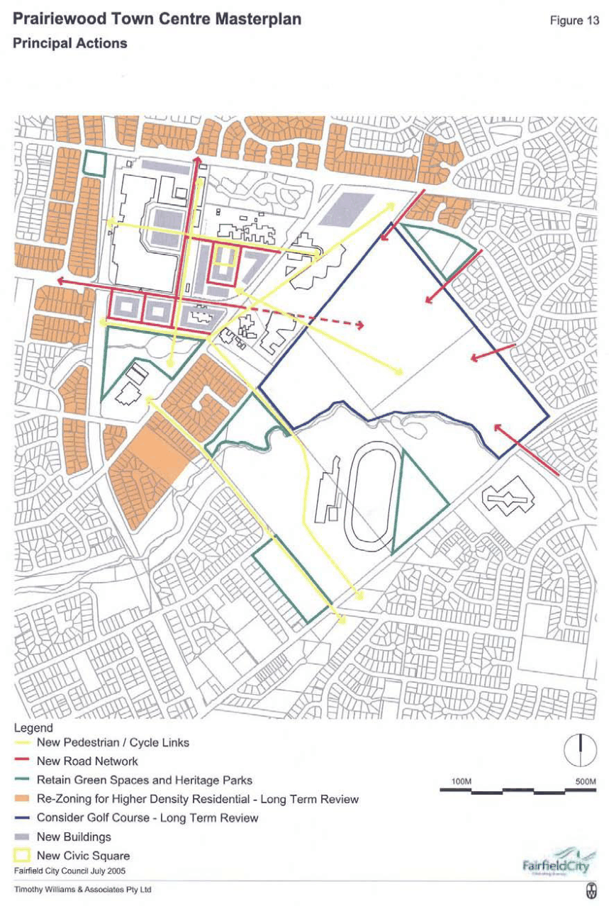

## 3.  Prairiewood Masterplan – Urban Structure

### 3.1 The Masterplan

After reviewing all of the consultation material described in Section 1 and the conclusions of the Planning and Urban Design Analysis in Section 2 the Masterplan indicated in Fig 13 has been prepared.

The analysis seeks to set a framework that addresses the four key issues: Council must continue to develop a movement system comprising of pedestrian and bicycle links, and the road network. Support services for this network such as parking and bicycle facilities that meet the needs of existing and future users and promote efficient use of the public transport infrastructure should also be provided. Council must continue to develop a strong public domain comprising a series of public places and streets that meet the needs of existing community and future users of the centre and are of a high quality in terms of safety and useability. In considering the design of the building, the implementation of design principles that promote public safety and good environmental performance. Council's decisions on future design outcomes need to recognise that buildings contribute the quality of the movement system and public domain, as well as the amenity of future users and residents. Council must continue to monitor the mix of activities in the town centre to promote a vibrant centre that meets the needs of the community.

It is via the implementation of the Masterplan provided in Fig 13 that these objectives may be achieved so that Prairiewood can continue to develop as a Living Centre.

### 3.2 Implementation of the Plan

The Prairiewood Town Centre Masterplan is presented in the following three sections (Section 4-6) corresponding with the three likely phases of development in the town centre. Additional detail on how development must proceed in each Phase and the issues Council should consider is provided.

Discussions and consultation has taken place with each of the stakeholders and landowners so that their long-term plans have been taken into consideration. It should be noted that no undertakings have been made by Council or by the relevant landowners at the time of writing the Masterplan.

Phase 1 was identified as the first phase because the Calabrian Club indicated a desire to redevelop in the short term. The Housing NSW land is in Phase 2 because Housing NSW indicated that replacement of existing housing stock in this area was not an immediate priority given the other work the Housing NSW is doing at Bonnyrigg and in other locations. However this is not a definitive timetable for development and development proposals located in Phase 2 area could be considered by Council prior to any development in Phase

1\. The important issue is that the urban design and planning objectives for the area are properly addressed by the development proposal regardless of its timing.

> [Picture on page 32: a picture, saved as a picture (images/prairiewood-master-plan-december-2005-page-32-1.gif, 150 dpi).]
