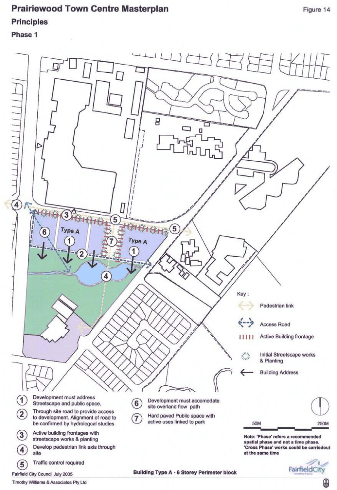
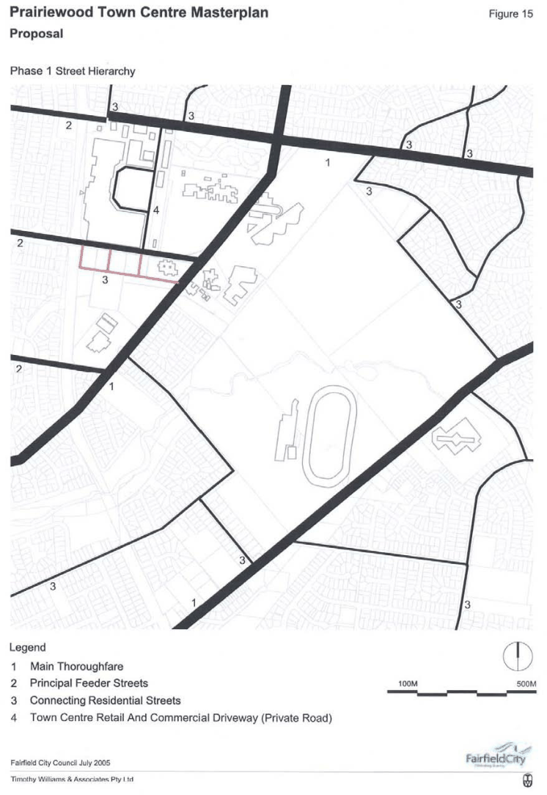
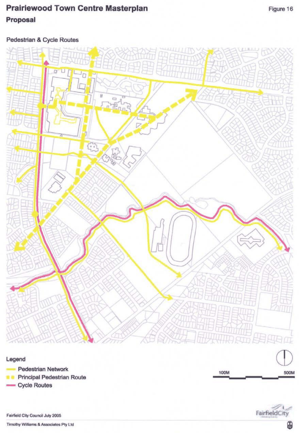
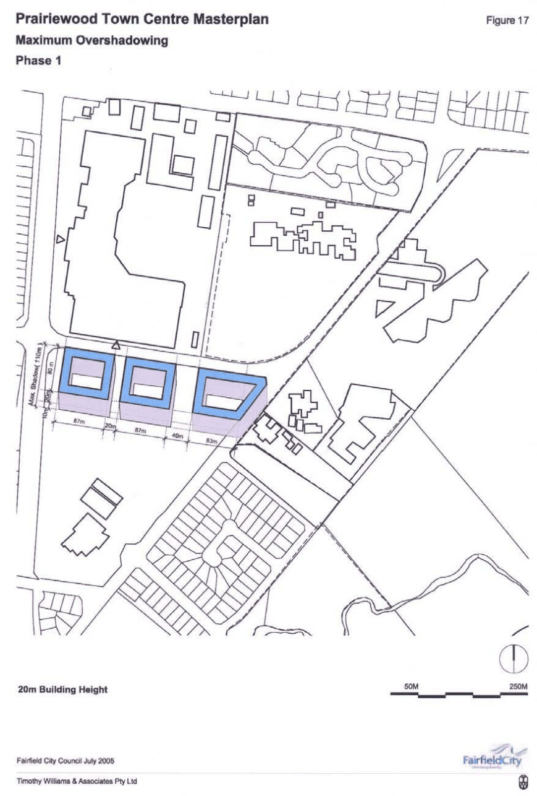

#### 4. Design Objectives Phase 1

### 4.1 General

Phase one consists of lands that belong to Council, the Calabrian Club and the NSW Cerebral Palsy Alliance. The site is bounded by Restwell Road to the north, The Tway to the west, Prairie Vale Road to the east and the flood zone green space and Leisure Centre to the south. The coloured area in Fig.14 shows Phase 1.

### 4.2 Land Use Context

A range of existing and additional uses should be accommodated in the centre including retailing, community assets, residential and commercial. The area covered by Phase 1 will be a transition zone incorporating community facilities and open space and will be transition to the nearby residential. Accordingly residential and community uses are seen as the dominant activities, but other activities that contribute to the vibrancy of the town centre and service the needs of the community will be considered.

The Phase 1 Masterplan site has four distinct land use interfaces. The site contains the NSW Cerebral Palsy Alliance on the north/east corner, the swimming pool and Leisure Centre in the southern sector, community facilities and the Calabrian Football Club on the north/west corner. The centre of the site is occupied by the detention basin flood zone and is largely unused.

The following range of uses is considered to be consistent with the objectives of the Masterplan and the objectives for Phase 1. If any uses other than those identified below are proposed, the applicant will need to satisfy Council that the land uses are consistent with the objectives of the Masterplan and the objectives of Phase 1:

Community Uses – This site contains community uses (Council facilities including Basketball court and the Spastic Centre) the continued operation of the existing uses is important. These facilities should be located adjacent to the North south Pedestrian Path way proposed in Phase one. Of particular note are the basketball court and the community hall adjacent, which provides a vital and unique gathering place for the youth of the area. These well-run youth facilities are important to a healthy community.

Residential Uses - This area is considered to be appropriate for residential activity that will contribute to a future living city. It will be close to the open space and there are opportunities for views to the open area contributing to residential amenity. It will act as a transition between the more intensive retail activity to the north and softer open space and residential activities to the south and south-west. Consideration should be given to locating the residential away from potential conflicts (i.e. community facilities and restraints etc) and ideally the western part of this site would be a transition to existing residential activity to the west of the Tway.

A mix of a mix of housing type to meet all types of household forms and incomes should be provided as part of any development. Residential developments should reflect the community‟s broad range of household mix and family structures.

Retail Uses - As indicated in Section 2 the provision of retail floor space will only be permitted where it can be demonstrated that it achieves one of the objectives identified in Section 2.8. In this case it is expected that a small amount of retail space might be provided along the street Restwell Road street frontage to seek to activate this road.

Other Uses - The Calabrian Club have discussed, during the consultation and Planning Proposal process, the possibility of developing a Club premises and associated restaurant precinct. These uses are considered appropriate for this part of the town centre. They may contribute to the vibrancy of the area outside traditional retail business hours. However, as discussed above, the design and location should have regard to the residential amenity of nearby residential uses.

> [Picture on page 35: a picture, saved as a picture (images/prairiewood-master-plan-december-2005-page-35-1.gif, 150 dpi).]

#### Objectives

To locate community, club and non-residential activities close to the pedestrian linkages and open space so that there is a relationship that encourages an intensity of activity appropriate to its location. To create a landscaped park which provides a green/water space focus for the Town Centre. To establish Restwell Road as an active street by locating ensuring active frontages are provided at street level to generate high levels of human activity. To incorporate uses that are available to the community at all times of the day. To provide clear and uninterrupted pedestrian movement to the Tway. To provide opportunities for medium to high density housing with a very high level of amenity and with minimal land-use conflicts.

#### Provisions

The detailed flood study and associated drainage basin design required in Section 4.7 will determine the land required for the drainage function and that which would be available for other land uses. All Council facilities should front directly onto a public street or the pedestrian link. Non residential uses must be of a type and intensity which are good neighbours to residences. Retail activity is encouraged along the Restwell Road frontage. Below ground car parking should not detract from ground level uses. Ground level spaces overlooking the park which are not community activities should be active frontages (i.e. club or residential) and shall not be blank facades with no interaction from the street.

### 4.3 Public Domain Context

The Masterplan in section 3 introduces the intention to provide a formal town square and a less formal softer landscaped informal open space/recreation area. Phase 1 provides the opportunity to address the informal open recreation space in a manner that also addresses objectives related to drainage and improving the pedestrian network in the centre.

Phase 1 of the Prairiewood Masterplan site is located five minutes walking distance from the Tway station and five minutes from the entry to Stocklands to the north. The site is also roughly equidistant between Fairfield Hospital and the swimming pool and Leisure Centre. Fairfield Golf Club and the Showground are 15 minutes walk to the west. Accordingly this area in Phase 1 is considered appropriate for the park relative to all the other facilities.

The suitability of the location of the central landscape area and the proposed mixed use development is based on: its location within the overall Prairiewood Masterplan area. the necessity of providing improved water retention and run off management in the flood zone. its relationship to major institutions and community facilities.

#### Objectives

To provide a park as a central open space for recreation in the Prairiewood Town Centre.

To provide a park that caters for families, youth and young children. To provide pedestrian connections through and around the site linking major public facilities and institutions. To ensure that public and private spaces are clearly defined. To enhance the public domain including appropriately designed streetscapes. To ensure that building form will protect and enhance the public domain.

#### Provisions

The central landscape open space must be designed to address the water retention and water quality needs as described in Section 4.7. The drainage basin design should ensure that there is an adequate transition between the park and adjoining land uses. The transitions must be accessible to all members of the community and ideally will be a combination of walls, slopes and terraces that are suited to the proposed use of that part of the park. The landscape area must achieve a demonstrable improvement in water quality to the creek system. The landscape area must be crossed from Restwell Road to the Leisure Centre as shown on Fig. 14. The park area must contain some safe play areas for youth and young children The streets and pathways are to be designed to ensure a high level of amenity for residents and users of the town centre and there shall be sufficient differentiation between public and private areas. Within the open space and/or adjoining the pedestrian pathway, an effective community space with an urban character with hard paving generally and appropriate public furniture including seating, lighting and signage should be provided and it should be capable of accommodating public meetings, informal drama and outdoor dining etc. This space should have appropriate deciduous tree planting for shade. The Landscape area should be generally of a soft landscape character with grass shrubs and tree planting. The park should provide for a range of pedestrian pathways and types of spaces in which to relax or recreate. The northern edge of the park must be bound by a pedestrian path and road way.

### 4.4 Access and Movement Context Vehicular traffic (Fig. 15)

Restwell and Prairie Vale Roads are the two feeder streets to the Phase 1 Masterplan area. Restwell Road connects the residential areas to the west of the site across the Tway and provides access to one of the two main entrances into Stocklands Shopping complex. The “T” intersection from Restwell Road into the private road of the shopping complex is already congested at peak times.

Prairie Vale Road provides the main north/south access to the site along its eastern boundary.

All vehicular access to the site will be via Restwell and Prairie Vale Roads. A new road system is to be built to service the developable areas.  A road along the edge of the open space will be required to maximise the access along the edge of the park but the remainder of the road network in phase 1 can be at the discretion of the designers subject to the

objectives below being achieved. An indicative street pattern is shown in Fig 15 but alternative street alignments will be considered on their merits. This indicative road layout has been modelled by Council. The model is based on some assumptions about adjoining development. This modelling indicates that the existing network can cope subject to some road widening and other modifications. However this is a theoretical model prepared to check feasibility and ultimately, any development in Phase 1 will need to be supported by a detailed traffic study which models the development proposed and details the traffic management measures required to permit the development to proceed with minimal disruption to the local road network.

> [Picture on page 38: a picture, saved as a picture (images/prairiewood-master-plan-december-2005-page-38-10.gif, 150 dpi).]

#### Public Transport (Fig. 8)

Public Transport to the area is currently provided by government buses along the Tway with stops adjacent to Stocklands and south of the sports and Leisure Centre. This service is supplemented by private bus services along Restwell and Prairie Vale Roads.

#### Pedestrians and cyclists

The required pedestrian links through the Phase 1 area are shown in Fig 16. These pathways are to be clear and dominant with well defined entries from the public street.

Pedestrian and cycle movement is presently confined to the Tway which has a dedicated footpath lane. The pedestrian network is substantially unformed throughout the site. Some desire lines are in evidence in the form of ant tracks. Most journeys to destinations within Prairiewood are currently made by private vehicle.

A comprehensive pedestrian and cycle network is to be provided. Including connections between public facilities and easy access to transport points.

> [Picture on page 39: a picture, saved as a picture (images/prairiewood-master-plan-december-2005-page-39-14.gif, 150 dpi).]

#### Parking

Provision for residential and visitor parking is to be provided within the site. It is important to Stocklands that their car park is not used as a general public car park for the area.

There is little on street parking available. The Calabrian Club with its associated activities will need to provide adequate parking and consider options for dual use commuter car parking if practicable. Discussions with the Club have included the potential for dual use of any club/restaurant parking spaces so that they could be used for commuter parking purposes outside of the traditional evening peak. Any proposal for this arrangement will need to be justified via a formalised traffic study prepared by a recognised traffic consultant.

It is possible that commuters will look for parking in close proximity to the Tway in the future.

#### Objectives

To give priority to walking, cycling and public transport as the preferred means of movement. To ensure the traffic generation resulting from the development does not result in unsatisfactory performance of the local or regional road network. To minimise points of conflict between vehicles and people. To provide vehicular traffic free public spaces. To optimise public accessibility and link the site with the Town Centre‟s pedestrian and cycle network. To provide a pedestrian environment which is safe and attractive and can be accessed by persons with impaired mobility. To provide sufficient space for all pedestrian and cycle corridors to ensure free and easy movement. To improve pedestrian amenity along Restwell Road. To minimise driveway conflicts with pedestrian uses. To provide adequate parking for residential and business uses. To balance residential and other parking needs on the site and minimise the need for on-street parking whilst addressing the commuter parking demand and the desire to promote public transport use. To provide clear access and signage to public transport points.

#### Provisions

A Traffic assessment must be provided with any proposal, to identify the impacts of any proposal on the local and regional road network. This report must also provide an assessment of the efficiency of the proposed road network for Phase 1. A pedestrian pathway (including a bridge over any ponds) at least 3 m wide must be provided across the Landscaped area. All new streets must be designed to have accessible footpaths. There is to be no direct vehicular access, including loading and unloading bays, to Restwell Road.  All vehicular access should be via the new road network provided for this precinct. A footpath of at least 3 m is to be provided along the southern side of Restwell Road. Pedestrian corridors should generally be at least 3m wide. Pedestrian spaces must be designed to permit easy and convenient movement for persons with impaired mobility, including access to the Tway. Pedestrian spaces and cycleways must be adequately lit for safety. Pedestrian pathways should be located in areas of maximum natural surveillance.

Points where pedestrian and traffic corridors cross should be designed to minimise potential danger and emphasise the need for caution. All car parking must be provided on site and in accordance with the requirements of Chapter 12 – Car Parking, Vehicle and Access Management.

### 4.5 Urban and Built Form Context

In Phase 1, the building area which can be developed will be determined by the drainage constraints as some land will be required for the drainage functions described in Section 4.7.

The existing development in the vicinity of the town centre is limited to the 1 to 2 storey residential dwellings outside the Masterplan area and to stand alone and isolated institutional buildings such as the Hospital, sports facility and School with the Stocklands Shopping Centre being by far and away the largest single structure in the area. Phase 1 will establish a new block and street pattern for the town centre which will be in contrast with the low density residential areas around the town centre and be suitable for the establishment of medium to high density residential and commercial uses.

Street alignments should be reinforced and established to create well defined streetscapes and conscious view corridors to the park and to major facilities. This is the predominant urban form proposed for the Masterplan area.

It is intended that all residential buildings in the Town Centre Masterplan area be designed as medium to high density apartment buildings. The new building form will be based on a perimeter block form that defines property boundaries and streets. In Phase 1 the building form will allow for retail /commercial or community uses as well as residential activity but all non-residential uses should be located at or close to ground level. Fig 17 shows the maximum heights and overshadowing in Phase 1.

#### Objectives

To generate a form of development that is of a scale to create the density and activity appropriate to this part of the town centre and to ensure the built form is part of the transition to the adjoining residential zones and in character with the desired future character of the area. To establish a street block form that responds to the existing street pattern and built form. To create a view corridor across the landscaped area looking south from the existing Stocklands entrance from Restwell Road. To provide a linked network of open spaces. To express the entrances to streets. To define and enclose public spaces including streets with built form of appropriate scale. To provide a scale of development along street frontages that provides protection from the elements. To control overshadowing of public spaces. To signal the public nature of streets and squares. To clearly distinguish between public and private realms. To ensure issues of privacy and amenity are dealt with particularly at ground level.

#### Provisions

The built form should define the street edge. Any development will need to be designed in accordance with the recommendations of the Flood Study and Chapter 11 – Flood Risk Management. Building height should not exceed 20 m (6 Storeys) from existing ground level. Buildings must align with boundaries of the open space or to the site boundaries on street frontages. Residential buildings are to have clearly defined entry points from the street or public spaces. Penetrations above maximum heights for lift overruns and the like must be less that 3 m and must not be visible from a point 20 m away from the façade of the building. Comply with the SEPP 65 Design Quality Principles and meet the design quality standards as set out in the Residential Flat Design Code.

> [Picture on page 43: a picture, saved as a picture (images/prairiewood-master-plan-december-2005-page-43-1.gif, 150 dpi).]

### 4.6 Ecologically Sustainable Development Context

Buildings and landscape elements in the Prairiewood Town Centre will be designed in a manner that minimise the environmental impact of the development both during the construction and operation phase.

The State Government has implemented a policy in relation to energy and water use. The system referred to as BASIX requires building designers to ensure the building makes maximum energy and water savings. The building designer will be required ultimately to provide Council with a BASIX Certificate to demonstrate compliance and consideration of the following relevant issues during the planning and design stages.  It will make the task of obtaining the certificate easier to achieve.

Many of the measures that contribute to better environmental performance are also related to amenity, for example, the availability of natural breezes minimise energy costs of cooling and provide for more fresh air within units.

#### Objectives

To locate buildings in a manner which allows moderating winds to penetrate public open spaces and provide shelter from unpleasant winds. To provide major open spaces with a limited number of shaded areas. To limit overshadowing of major open spaces. To incorporate energy efficient principles into the design of buildings. To implement ecologically sustainable development.

#### Provisions

Any development proposal will ultimately be required to submit a BASIX Certificate. In relation to other aspects of environmental performance, Council will utilise the objectives and best practice guidelines contained in the Residential Flat Design Code to assess whether the environmental performance aspects of any development are reasonable. The proximity of the stormwater basin offers opportunities for innovative approaches to water reuse and management, both for Council's open space and potentially for adjoining buildings in Phase 1, using Water Sensitive Urban Design Principles. A sustainable approach to landscaping and management/maintenance of the open space and streets which are to remain in Council's ownership or management, are to take into consideration sustainable Water Sensitive Urban Design Principles.

### 4.7 Infrastructure Context Drainage Infrastructure

There can be no development or any creation of sustainable open space without the drainage infrastructure for the town centre being resolved. This issue is critical as the drainage system and the flood zone in the centre of the town centre is the major physical characteristic of the site. Overland flow paths and water management will inform all major planning and design decisions on the site. The respect of the natural flow patterns will help

to define the town centre‟s new character.  The drainage constraints are discussed in greater detail in Section 2.4 – Drainage.

Council's Drainage Engineers have undertaken some preliminary modelling which indicates a basin design involving excavation or mounds/barriers, (more than likely a combination of both these measures), to increase the capacity of the basin, will be required before the development potential of properties in Phase 1 can be established. The modelling indicates this is possible but a more detailed design process needs to be undertaken to determine technical and financial feasibility.

The basin will need to address the drainage problems but will also form a part of the park. Accordingly, the design along the edge of the basin will need to consider the future use of the land as a park.  Suitable slopes, mounds, walls or terraces will need to be provided to maximise use of the space and ensure it can be safely used.

#### Other Infrastructure

In relation to other infrastructure, the Council as part of the consultation on this plan will seek to consult with the relevant service providers to ensure there is adequate provision or capacity in relation to the provision of: Stormwater Water supply Sewer Power (gas and electricity) Telecommunications

While preliminary consultation will be undertaken at this stage it is mandatory under Section 57 of the environmental Planning and Assessment Act 1979 that further consultation be undertaken during the rezoning phase.

#### Objectives

Ensure that essential infrastructure and services are available before any development commences on site

#### Provisions

A detailed drainage and flood analysis will need to be undertaken by a suitably qualified Engineer as part of any redevelopment proposal. The study will need to demonstrate how the flood management, overland flow path and water quality issues are going to be managed in any redevelopment of the site. Any basin, drainage works and associated development will need to be designed in accordance with the requirements of the Flood Study and Council's Chapter 11 – Flood Risk Management of the Fairfield City Wide DCP. Edge treatments need to be designed to allow for safe public access and egress.  For example: o slopes need to be designed with safe grades for water bodies (i.e. maximum 1:8) o terraces must have regular and accessible steps and ramps Adequate water supply must be provided to the site and connection made to surrounding services. Connection must be made to the existing sewer servicing the site. A specifically designed storm water management system must be provided on site which complies with all relevant standards and with Council's stormwater plan for the area. Gas reticulation must be provided to the site.

Electricity connection must be made to the site.
