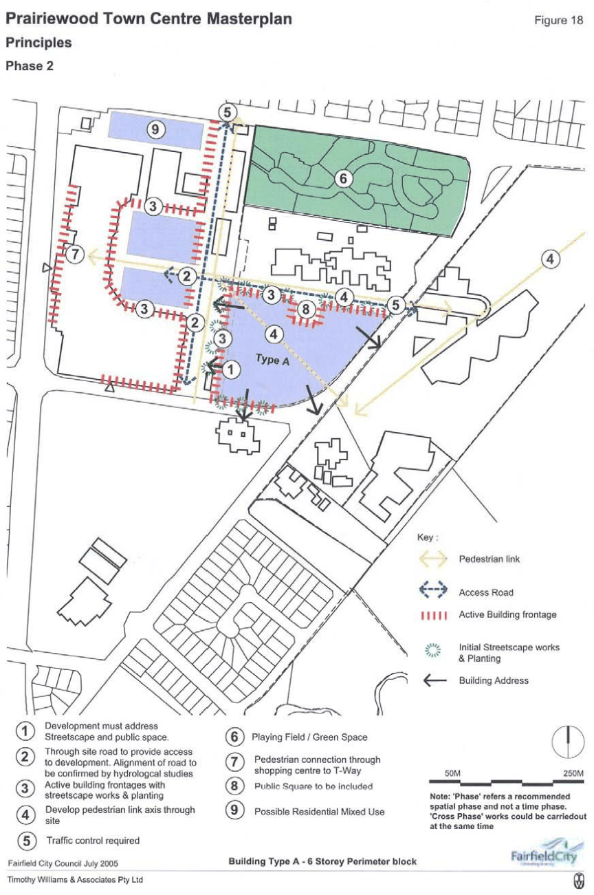

### 5. Design Objectives Phase 2

(Fig. 18)

### 5.1 General

Phase 2 of the Masterplan is located on the lands owned by the Department of Education and Communities (DE&C) and by the NSW Housing and the Stocklands Shopping Centre. See Fig 18. The Masterplan provides a vision for the redevelopment of the NSW Housing and DE&C lands. Neither the NSW Housing nor the DE&C are under any obligation to redevelop their lands. The Masterplan, whilst developed in consultation with both departments, has not been adopted as a preferred plan by either party.

The Phase 2 area is bound by Polding Street to the north, Restwell Road to the south, Prairie Vale Road to the east and the Transit-way to the west.

Phase two should be seen as the heart of the new Prairiewood Town Centre. It is located in the centre of the Masterplan area and many of the town centre‟s facilities and institutions will be linked across the site.

There are a number of elements of the overall Masterplan that Council will seek to implement during this phase that are important in linking the town centre together and improving the amenity of the centre for future residents and users.

The important aspects are introducing a suitable mix of activity, strengthening of pedestrian linkages, establishment of a long term viable road pattern and creation of a good quality open space.

#### Stocklands

Stocklands will seek to redevelop in accordance with their own requirements. Previously under the Fairfield LEP 1994, any redevelopment for purposes currently permitted in the existing Business 3(b) zone could proceed without a rezoning, but the introduction of residential development on the site would have required at a minimum, amendment to the objectives of this zone which did not mention residential development. However, the B4 Mixed Use zoning used for the centre under Fairfield LEP 2013 allows for a mix of commercial, retail and shop top housing uses, thus removing the requirement for a rezoning to allow shop top housing on the site.

As there is no DCP for this site, any development applications for the Stocklands site must be assessed against the principles outlined in this plan as well as any rezoning proposals to ensure any redevelopment is consistent with Council's future Masterplan for the centre.

#### Prairiewood High School

The High School site, and in particular the sporting fields on this site, are in the future heart of the town centre. These sporting fields are completely surrounded by community facilities and the retail core and have the potential to become the hub around which the rest of the

town centre can operate. Opening up this site to active community use is critical if Prairiewood is to be a more integrated vibrant town centre.

The existing arrangement, with the school fenced off with 2m high fence, makes pedestrian journeys around the town centre unnecessarily long (Example: people who are using the Transitway to get to the hospital must get through Stocklands and then must walk around the southern end of the school site to get to the hospital). The existing arrangement also minimises the level of natural surveillance on the streets in the middle of the town centre.

In the short term a review of the schools management arrangements in relation to access, safety and vandalism could allow for a rationalisation of the access to the sporting fields so that they could be opened up thereby improving links in the centre to the benefit of the wider community. However this may prove difficult with regard to the school's duty of care.

In the longer term, the redevelopment access to the sporting fields and agricultural plots for future retail, commercial, community and residential uses would make this a focal point for the town centre. This would also be the ideal location for a town square for Prairiewood in the longer term.

It should be noted that the current sporting field and agricultural plot is 34,300m² and the NSW Housing land to the north of the school is 40,516m² and is of a proportion that will allow efficient layout of sporting fields.

However, the development of the current sporting fields as the town centre hub does not mean that the school must be moved away or that it should lose access to sporting facilities. Retaining the school in the town centre makes sense from an integrated transport/ land-use viewpoint as it maintains this traffic generating activity close to a public transport node. Retention of this school in this location would be preferred to the relocation of this activity to an area with poorer public transport service. It is also an important community facility and community hub that should remain in a central position.

Council Officers have identified a long term opportunity for the school to be retained in the town centre with the same number of sports fields and other facilities while still permitting a town centre core to be established on the existing playing field land.

The NSW Housing has indicated that they would be unlikely to be investing in the estate immediately north of the school in the next ten years. However when the time does come for the Department to invest in these buildings, they could do a land swap with the school and swap the land containing the estate for the sporting fields. The housing on the estate could be demolished for replacement sporting fields and facilities and the existing sporting fields could be redeveloped for the range of uses discussed above including housing. The NSW Housing could maintain or increase its stock of dwellings in the area, while achieving a mix of tenure and ownership patterns in line with their current policy.

In this case there is no loss in facilities to the school and no loss in social housing.  There is a big benefit to the community in having the town centre hub area developed in an appropriate manner with a de-concentration of social housing stock.  The sale of the rights to the retail and commercial floor space could help pay for the redevelopment costs to minimise the level of government investment.

If at some point in the long term future the Department of Education & Communities were to close or relocate the high school (please note the Department have not given any impression formally or informally that they are intending to do this) the use of the site for a

mix of uses to create a vibrant town centre with a town square would be the optimal outcome for the town centre.

> [Picture on page 48: a picture, saved as a picture (images/prairiewood-master-plan-december-2005-page-48-3.gif, 150 dpi).]

### 5.2 Public Spaces

The public spaces in Phase 2 are intended to allow a permeability of the town centre site so that the desire lines between the town centre‟s various facilities can be made readily accessible, especially on foot or by bicycle.

A major urban space should be provided in the heart of the town centre.  The ideal location is where the existing sporting fields are located. The Masterplan in Section 3 shows a proposed east/west collector road. The urban space should be located along this road in a location that helps link the retail core of Stocklands with the remainder of the centre and any redevelopment of the School site.

### 5.3 Urban Pattern

It is imperative that the permeability through the Phase 2 Masterplan area be achieved. It will be necessary to dedicate a public roads network within the site which integrates with Phase 1 and with the surrounding suburbs.

A perimeter block form of building is generally the best way to achieve this and to clearly define the public and private domains; however the exact layout will need to be designed when the mix of uses is established.

### 5.4 Drainage

Careful consideration will need to be given to the overland flow paths through the Phase 2

area. Although the drainage issues are not as critical as in the Phase 1 area, the change from a completely soft landscape area to a percentage of hard surfaces will impact on the drainage patterns.  Run off from Phase 2 should be kept to a minimum and must not detrimentally impact on the drainage system.

### 5.5 Uses

The current uses on the Phase 2 site are to remain, but as this is the heart of the town centre, a mix of uses that will contribute to an active, vibrant and sustainable centre are encouraged, subject to the following considerations.

The Stocklands site will remain the retail core of the town centre. Any proposals to increase the floor space in the next ten years will need to address the finding of Council's Retail Centres Study (discussed in detail in section 2.8).

Beyond the next ten years, the growth potential for retail will need to be reassessed, but the following two principles identified in the Leyshon Report regarding additional floor space, should still be considered. In assessing proposals for development Council should consider:

Whether the retail development is located and designed so as to act as a catalyst for the renewal/redevelopment/refurbishment of an existing centre in accordance with this Masterplan, or alternatively, whether permitting the retail development will hamper the redevelopment of other parts of the town centre in accordance with this Masterplan. Whether the location and design of new retail development is appropriate in terms of achieving urban design outcomes set out in this Masterplan.

The introduction of residential activities, (which will require a rezoning), is supported subject to a high level of residential amenity being achieved for future residents, and subject to the provision of a mix of housing type to meet all types of household forms and incomes. It is likely that a high proportion of affordable housing will be included as the land may the subject of a land swap with the NSW Housing who will require the relocation of existing housing stock in the centre.

Commercial activity should be considered for this phase, but Council should consider commercial and employment generating developments in the context of Council's Employment Lands, particularly the adjoining Wetherill Park Employment Area.

The existing range of community and government facilities should be retained, as they will continue to add to the vibrancy and effectiveness of the town centre. At the time of redevelopment of land in this phase, consideration will also need to be given to the parking arrangements in and around the town centre and the feasibility of providing some commuter car parking facilities to service the Transitway stop.

### 5.6 Movement Public transport Pedestrian/Bicycle Movement

The Masterplan shows a number of pedestrian links. Linkages to Phase 1 and across the site east/west from the Hospital to the Transitway are critical in ensuring the future centre is integrated and accessible for all parts of the community. The establishment of these links is critical to the sustainable development of the centre.

The pedestrian connections to the Tway should be improved. Natural desire lines across the Town centre area need to be acknowledged and their accessibility and safety improved.

These links should be safe, well lit, active and accessible to all parts of the community at all times. Stocklands have raised concerns during preliminary consultation regarding provision of 24hr access through their site to the Transitway station. It is acknowledged that this may be an issue in the short term given the existing building. In the short term, Council and Stocklands could begin negotiations with the Bus Transport providers to determine whether an "after hours route", where buses leave the Transitway and go through the centre, might be established to ensure patrons are dropped on in a more appropriate location at night. This may be feasible as the hours when Stocklands are closed, and no access is available, is generally outside peak hour services. At these times there is potentially more flexibility in timetabling and routing of services.

#### Vehicular Movement

If development is to occur in Phase 2, there will need to be a road system established within Phase 2 to manage the increased level of vehicular movement around the centre of the

town. The Masterplan shows the location of a proposed collector road running through the School site which could be used to service any future development of the existing School land providing another link to Prairie Vale Road from the centre of this Phase 2 area.

The existing Stocklands access points from Restwell Road in the south and Polding Street in the north, effectively form an access road north/south through the Phase 2 area. At this

stage this is not a dedicated road. It is part of the Stocklands site.  This north/south access link is important for Stocklands. Depending on the extent of future development, there may need to be consideration given to improving the effectiveness of this link via design measures or dedicating some land to create a north south road through the site.

This indicative layout, with a road through the school site and improved access through Stocklands has been modelled by Council, based on some assumptions about adjoining development. This modelling indicates that the proposed network will be able to accommodate expected traffic levels subject to some road widening and other improvements. However, this is a theoretical model prepared to check feasibility and ultimately any development in Phase 2 will need to be supported by a detailed traffic study which models the development proposed and details the traffic management measures required to permit the development to proceed with minimal disruption to the local road network.

### 5.7 Built Form

Given that there is no certainty over the timing, form and uses in this phase of the development, it is difficult to be prescriptive about the ultimate built form and design of the buildings. However, some principles, which shall guide Council's decision making on design and built form issues, are detailed below.

In terms of the scale of the development, Phase 2 contains the future core of the town centre and the scale of development traditionally is higher and denser in the core with a transition to a lower height and density as you move further away from the core. The design of buildings should seek to ensure that public streets and public spaces/parks receive good solar access. The design and scale should take into account views and ensure the public domain areas are not dominated by the adjoining building masses. Buildings that let in light, provide interesting views and are not excessive in scale compared to the human using the public domain, is the character that Council shall seek to achieve for the core of Prairiewood Town Centre.

#### Safer by Design

Council should ensure that any new development provides an appropriate relationship between the building and the public domain. This is particularly necessary if Council is to establish a street and public space network that is safe and useable for existing residents. Design of the buildings in accordance with the CPTED Principles, which are principles, established to promote safety and minimise crime via the design process is essential.

#### Active Frontages

One particular principle/issue described in the CPTED Principles and which was discussed during the consultation was the principle of active frontages to the street. This was discussed in relation to Stocklands who indicated that while they were supportive of activating streets, did not agree that this should result in them providing active frontages to all streets and the nature of their business and servicing needs made this impractical. The existing Stocklands building does not present an active frontage to Restwell Road.

It is acknowledged that in the short term it would be difficult for Stocklands to make changes to their site, which would activate Restwell Road, without a significant redevelopment. This

request would not be feasible or practical given the investment they only recently put into establishing the existing building.

However, in the longer term if Stocklands are making long term strategic decisions about their site, it is important that the site begin to develop a relationship with other sites so that it becomes integrated with the future developing centre. This will also have potential benefits for Stocklands. In this regard, longer term development should seek to provide an active frontage to Restwell Road and to any development on the existing and adjoining sporting field site (Refer to Fig 18) as this will be the future public core of the town centre. This would leave the majority of the frontage of the Stocklands site for other service activities necessary for the centre's operation. It will be a much more human and attractive town centre in the future if the frontages in this core area respond to one another rather than just presenting blank facades. In this regard, Council Officers should work with Stocklands to formulate site specific plans for the Stocklands Site.

The environmental performance of the future development is also critical. Any development in Phase 2 should be assessed against the objective identified in Section 4.6 for Phase 1 of this Masterplan to ensure a consistent approach to the assessment of the environmental performance of the development across the entire town centre.
