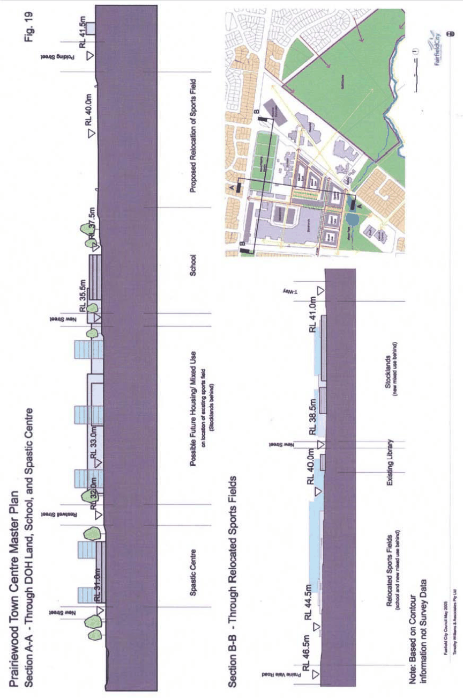

### 6 Design Objectives Phase 3

(Fig.19)

### 6.1 Longer Term Considerations

A long-term vision for the Prairiewood Town Centre.

Phase 3 raises questions about the future direction of the Prairiewood Town Centre.  As the first two phases are developed and the town centre grows, applications for the rezoning of open spaces such as the golf course and of the current low-density housing around the town centre may need to be considered. Again, the time frames are long term and it is difficult to provide definitive planning controls but the following planning objectives should be considered and any proposals considered in the short to medium term should be considered in the context of the following issues.

#### Transition Areas

These areas in some locations are the transition zone between the core of the centre and the adjoining single residence suburbs. As indicated in Section 5 the core is traditionally the most densely developed with higher built form and this density gradually decreases as you move away from the core. The Phase 3 sites should be developed with buildings that relate to the height of the adjoining development, both within the core and the adjoining development, outside Phase 3.

#### Linkages

Phase 3 is important in relation to the linkages required to maintain a successful town centre and the linkages with adjoining residential areas which make the centre more useable and sustainable.

It is important that vehicular links between the existing centre and the arterial road network are appropriate. Prairiewood is not located on any arterial route and accordingly the links to the Horsley Drive to the north and Cowpastures Road to the east are important if Prairiewood is to grow and place increasing pressure on these links.

Unless a significant mode shift occurs to public transport, Council will need to consider upgrading links to The Horsley Drive such as Lily Street and potentially discussing whether a share arrangement of the Transitway land is feasible.

In addition to vehicular links, consideration must also be given to pedestrian linkages. Where these linkages reach the edge of Phase 1 and 2 areas, it is important that they are extended in the Phase 3 areas and into the residential zones beyond. The full range of pedestrian linkages proposed are shown in Fig 16.

> [Picture on page 54: a picture, saved as a picture (images/prairiewood-master-plan-december-2005-page-54-1.gif, 150 dpi).]

#### Take advantage of the Tway

The Tway represents a major piece of public infrastructure that has the capacity to carry significant numbers of commuters to the employment bases in Wetherill Park, Parramatta and Liverpool. It is common sense to allow denser residential development around the Tway stations. The development of density around the Transitway Station will involve the introduction of a new housing form to Prairiewood, which is currently almost entirely single dwellings on larger allotments. A recent proposal involving redevelopment of a scrap yard into a residential development comprising town houses identified concerns from the adjoining residents. Experience in other areas indicates that the process of introducing multi-unit housing in traditional suburbs needs to be carefully managed.

In the case of Prairiewood, it is recommended that the new housing form be established in the town centre before it is extended to the existing single dwelling areas on the edge of the town centre. This would allow for the introduction of units style development in a less threatening manner, and would over a period of time, allow residents to experience the impacts of this form of development.

Ultimately however, this Masterplan suggests that Council should rezone residential land on the edge of the town centre for apartment and/or town house development.

#### Design Outcomes

The design objectives related to environmental performance or ESD and the Safer By Design Principles discussed above are assessment criteria that should also be applied to development in Phase 3.

#### Golf Course

This Masterplan does not recommend the removal of the Golf Course in the medium to short term (within next 0 – 15 years). However, if the Prairiewood Town Centre develops in the manner envisaged in this plan, Council will ultimately be faced with the question of the long term future of the Golf Course.

If the town centre does not develop, the threat to the Golf Course will be minimal, but should the centre develop into a larger centre, Council will ultimately need to make an assessment of what use will provide best value to the community. Land on the edge of an expanded vibrant and successful town centre could potentially be more valuably used for other uses.

The relocation of the School to this site, if there is significant demand for growth in the centre of the town centre, would be one option that retains the range of community uses in the centre while facilitating growth in the centre.  If alternative educational facilities such as University or TAFE campus were to locate in the area, it would be another wonderful opportunity to add a vibrant use to the town centre, thereby complementing the existing facilities and reinforcing Prairiewood as a place to live, to work, to play and to learn.

The alternative uses in the preceding paragraph are speculative as there is no definitive way to determine how successful the town centre will be and its ultimate growth potential. However, strategically the issue remains that golf courses are not traditionally located on the edge of significant town centres and there may be pressures to put it to other uses. Only alternative uses that contribute to the on-going vitality or sustainability of the town centre and Transitway services should be considered.

#### Showground

This Masterplan does not recommend the removal of the showground in the short to medium term (within the next 15 years.) however as with the golf course, if the Prairiewood Town Centre develops as envisaged, in this Masterplan, Council will need to consider the long term future of the Showground.

The Showground is currently used for a variety of different activities including weekly markets and for trotting training. Some ethnic groups use the area for festive occasions.

The Council recognises the need for sporting facilities in the LGA. Sporting fields and venues for tournaments are constantly sought after. It is intended that the showground‟s uses be intensified and enhanced as the town centre grows with the possible addition of tennis courts or other facilities for which there is a demonstrated need.

A suggestion has been made to enhance the current facilities so that they can accommodate a wide range of sporting and community activities. A multi-use sport and recreation centre is appropriate in this area and does not represent a change of use. The showground has ample parking and the addition of a sports venue would complement the other facilities to be found in the Town Centre.
