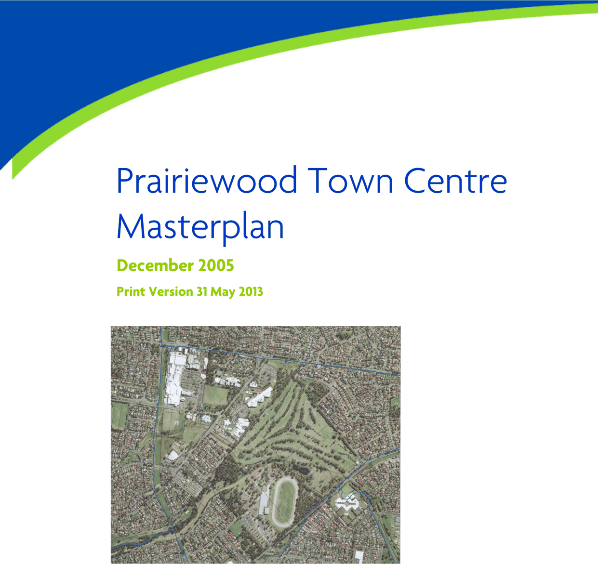

# Fairfield City Wide Development Control Plan 2024 - Prairiewood Master Plan (December 2005)

> This chapter is split into 6 section file(s), one per numbered heading, in the order they appear in the PDF.

Source PDF: [prairiewood_master_plan_december_2005___2013_version_1___pdf.pdf](https://planfortomorrow.sharepoint.com/sites/Planfortomorrow/Shared%20Documents/00%20NSW-Planning-Resources/dcp/fairfield-city-wide-development-control-plan-2024/supporting-guides/prairiewood-master-plan-december-2005/prairiewood_master_plan_december_2005___2013_version_1___pdf.pdf)

> [Picture on page 1: a picture, saved as a picture (images/prairiewood-master-plan-december-2005-page-1-1.gif, 150 dpi).]
> Words printed on the picture (title and legend, copied from the PDF):
> 2013 Version 1

2013 Version 1

This document was prepared for Fairfield City Council by: Tim Williams Architect & Associates Pty Ltd Suite 65, 61 Marlborough Street, Surry Hills, NSW 2010 Australia

Tim Williams

In collaboration with:

Fairfield City Council - City Outcomes Department PO Box 21 Fairfield, NSW, 1860 Lesley Unsworth Robert Cologna Daniel Smith Syd Lee Josephine Roccisano

The Prairiewood Town Centre Masterplan was adopted by Council‟s Outcomes Committee on 6 December 2005.

| Amendment No. | File Reference | Purpose | Adopted by Council | Effective From |
|---|---|---|---|---|
| Original Version | qA137669 | Original Masterplan | 6 December 2005 | 6 December 2005 |
| Amendment No. 1 | 12/09980 | Revised document to ensure consistency with Fairfield LEP 2013 | 13 November 2012 | 31 May 2013 |

### Contents

1\. Introduction

### 1.1 Vision Statement

### 1.2 Purpose of the Masterplan

### 1.3 Regional Context

### 1.4 Local Context

### 1.5 Reference to Other Plans

### 1.6 Statutory Framework

### 1.7 Objectives for the Prairiewood Town Centre

### 1.8 Process and Consultation

2\. Prairiewood Town Centre Site – Planning and Urban Analysis

### 2.1 Site Description

### 2.2 Land Ownership

### 2.3 Topography and Landscape

### 2.4 Drainage

### 2.5 Public Transport

### 2.6 Pedestrian and Cycleway Network

### 2.7 Private Vehicles and Car Parking

### 2.8 Land Use and Facilities

3\. Prairiewood Masterplan – Urban Structure

### 3.1 The Masterplan

### 3.2 Implementation of the Plan

4\. Design Objectives Phase 1

### 4.1 General

### 4.2 Land Use

### 4.3 Public Domain

### 4.4 Access and Movement

### 4.5 Urban and Built Form

### 4.6 Ecologically Sustainable Development

### 4.7 Infrastructure

5\. Design Objectives Phase 2

### 5.1 General

### 5.2 Public Spaces

### 5.3 Urban Pattern

### 5.4 Drainage

### 5.5 Uses

### 5.6 Movement

### 5.7 Built Form

6\. Design Objectives Phase 3

### 6.1 Longer Term Considerations

<!-- sections -->
## Sections

1. [1 Introduction](01-introduction.md)
2. [2 Prairiewood Town Centre Site – Planning and Urban Analysis](02-prairiewood-town-centre-site-planning.md)
3. [3 Prairiewood Masterplan – Urban Structure](03-prairiewood-masterplan-urban-structure.md)
4. [4 Design Objectives Phase 1](04-design-objectives-phase-1.md)
5. [5 Design Objectives Phase 2](05-design-objectives-phase-2.md)
6. [6 Design Objectives Phase 3](06-design-objectives-phase-3.md)
