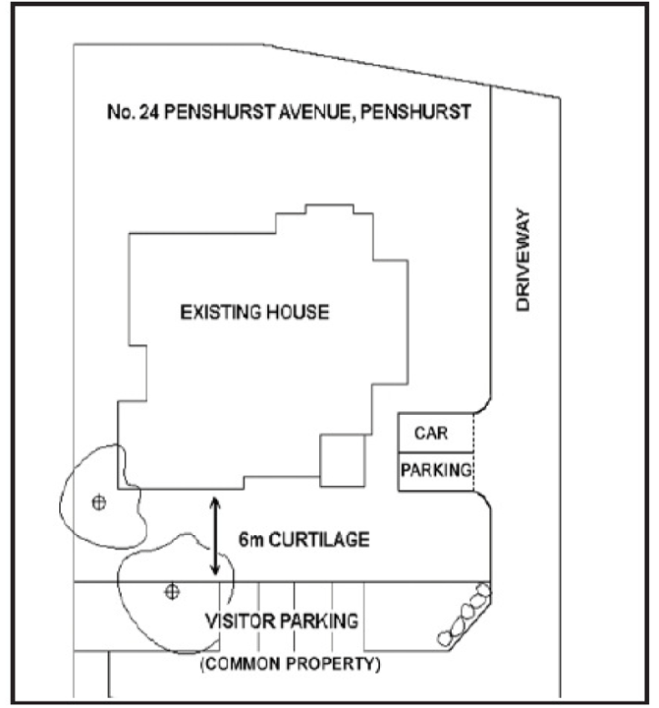

### 2.2 Heritage Items – Site Specific Requirements

#### 2.2.1 No. 24 (Lot 2, DP 320644) Penshurst Avenue, Penshurst

Note: The subject site is identified in Clause 10 of Schedule 1 of the Georges River LEP 2021.

#### Objective

(a) Ensure development of the site responds to the heritage item and respects the streetscape qualities of the Penshurst Heritage Conservation area.

#### Controls

1\. Where the site is redeveloped in accordance with Clause 10 of Schedule 1, development on the site is to comply with the requirements of Figure 1 below.

> [Picture on page 5: a picture, saved as a picture (images/appendix-01-appendices-page-5-11.gif, 150 dpi).]

Figure 1 No. 24 Penshurst Avenue, Penshurst

2\. Development of the site must provide an appropriate building scale and external appearance complementary to the existing dwelling and general character of the Heritage Conservation Area.

3\. Any application for redevelopment of the site in accordance with Clause 10 of Schedule 1 must be accompanied by a heritage management document and heritage conservation management plan prepared by an appropriately qualified professional.
