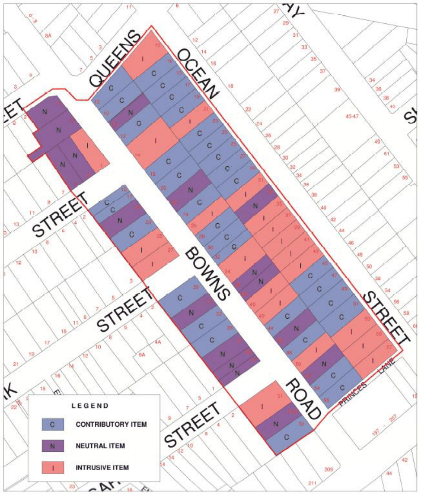
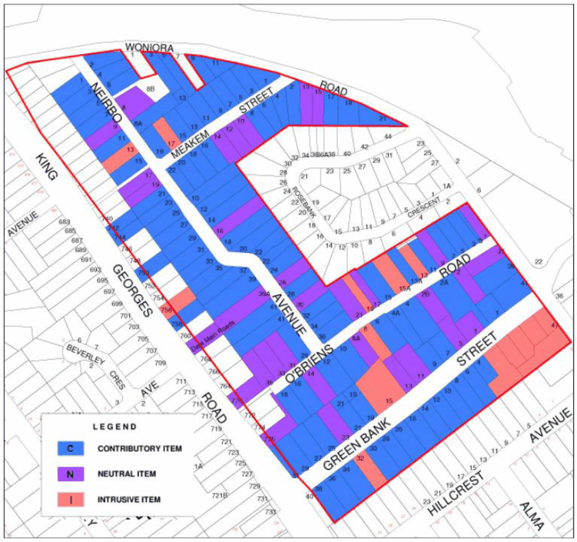
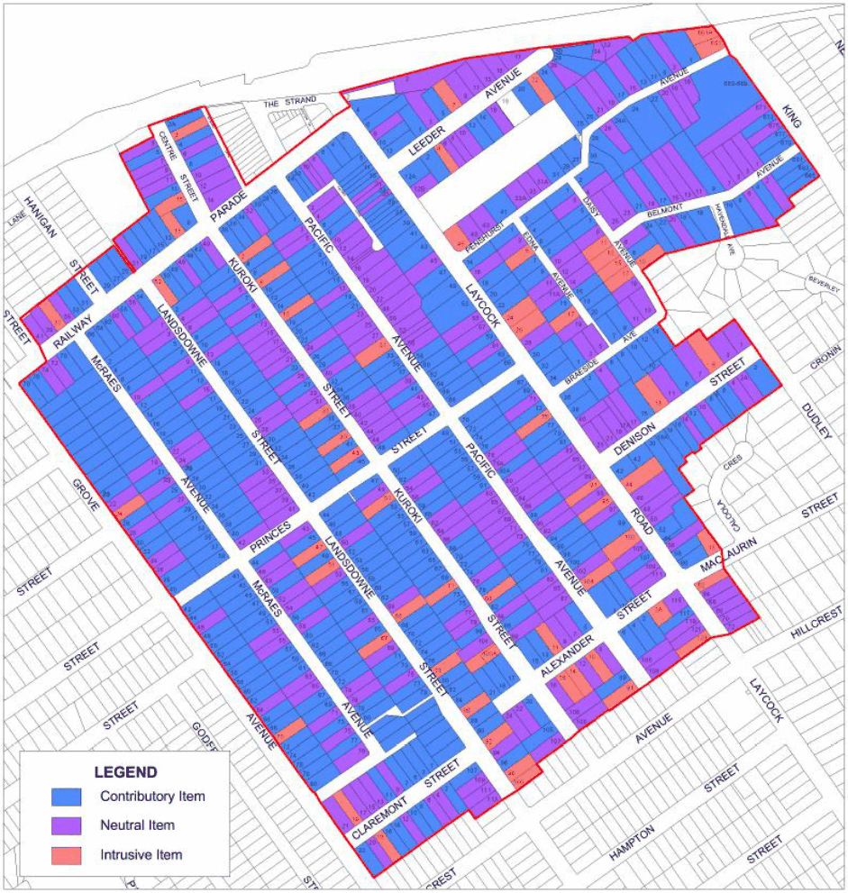

### 2.3 Heritage Conservation Areas

While the individual buildings that comprise a Heritage Conservation Area may not have sufficient significance to be listed as heritage items, collectively they are considered to possess a value worth retaining, having consistent streetscapes, landscapes and building characteristics. Buildings within a Heritage Conservation Area usually contribute to the quality of the area; however some individual buildings might not be worth retaining. Accordingly, buildings are nominated as Contributory, Neutral or Intrusive items, thus identifying those which reinforce heritage significance and should be conserved as well as buildings that could be replaced by new development that is more sympathetic to the values of the Heritage Conservation Area. Council has prepared Heritage Conservation Area Assessment Guidelines for the Penshurst, O’Brien’s Estate and Kogarah South Heritage Conservation Areas which provide information for owners intending to develop their properties. These guidelines are included in Appendix 3.

Applicants are strongly advised to contact Council prior to preparing any plans for new development in a Heritage Conservation Area so as to ensure that what is being proposed is consistent with the requirements within the specific Heritage Conservation Area. To discuss your proposal contact Council’s Customer Service Centre directly.

The three (3) Heritage Conservation Areas within the LGA are identified as follows:

> [Picture on page 7: a picture, saved as a picture (images/appendix-01-appendices-page-7-1.gif, 150 dpi).]

Figure 2 Kogarah South Heritage Conservation Area

> [Picture on page 8: a picture, saved as a picture (images/appendix-01-appendices-page-8-1.gif, 150 dpi).]

Figure 3 O’Brien’s Heritage Conservation Area

> [Picture on page 9: a picture, saved as a picture (images/appendix-01-appendices-page-9-1.gif, 150 dpi).]

Figure 4 Penshurst Heritage Conservation Area

#### Objectives

(a) To provide guidelines and controls which seek to protect the significant character of Georges River Council’s Heritage Conservation Areas and which encourage design which responds appropriately to the streetscape character.

(b) New development and/or alterations and additions in Heritage Conservation Areas must respect the architectural character and complement and enhance the significance of conservation areas and their settings.

(c) Existing dwellings in the Heritage Conservation Areas are to be retained.

(d) New dwellings in Heritage Conservation Areas must respect the architectural character and complement and enhance the significance of conservation areas and their settings.

#### Controls

1\. Any development in the Heritage Conservation Areas is to address and respond to the requirements of the relevant Heritage Conservation Area Guidelines contained in Appendices 2 and 3.

2\. New development must demonstrate how it respects the heritage values of the Heritage Conservation Area (as detailed in the Heritage Conservation Area guidelines).

3\. Council may require the submission of a heritage management document that assesses the extent to which the carrying out of the proposed development would affect the heritage significance of the Heritage Conservation Area [Clause 5.10(5) of the Georges River  LEP 2021].

4\. Demolition of dwellings in the Heritage Conservation Areas identified as Contributory or Neutral will generally not be supported, unless a structural assessment has been undertaken by a suitably qualified professional and a report is submitted to Council confirming that the building is structurally unsound.

5\. An owner may commission the preparation of a structural report and submit this to Council, however if Council is not satisfied that the report conclusively and adequately proves that the dwelling is unsound, Council may commission the preparation of a second report by an independent structural engineer. The cost of this report is to be borne by the owner.

6\. Alternatively, an owner may elect to have the initial structural assessment undertaken by a Council appointed engineer. A formal process of exchange of letters of agreement between Council and an owner has been developed. A quote would be sought by Council and written commitment by the owner to pay the fee would be obtained prior to the assessment being undertaken.

7\. Council will only consider a replacement dwelling in a Heritage Conservation Area when it has been established, and Council is satisfied, that the existing dwelling is structurally unsound.

8\. Concept drawings for a replacement dwelling are to be submitted to Council prior to the lodgement of a Development Application.

9\. Council will only accept a joint application which includes the demolition of the existing dwelling and the construction of a replacement dwelling in a Heritage Conservation Area.
