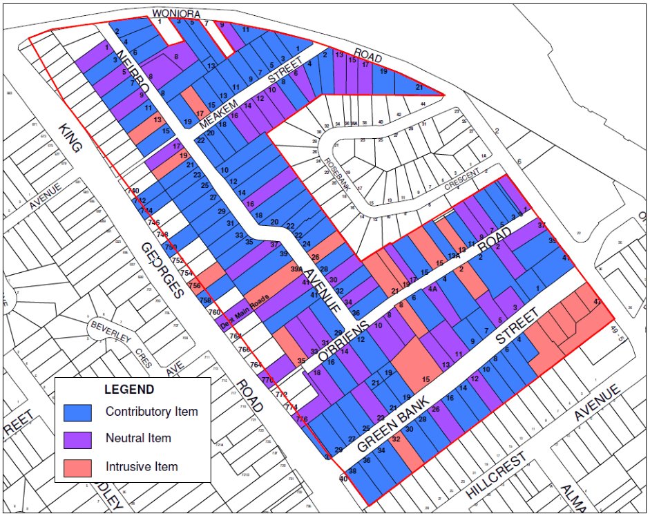

### 1.2 Where Do These Guidelines Apply?

These Guidelines will be taken into consideration for any proposed works within the area nominated on the following map. This will include any works undertaken within the public domain including road works, street planting, paving, fences, lighting and signage. Generally any works that will impact on the setting and external appearance of a building, including front fencing, driveway access and parking arrangements will require Council’s consideration. Advice on landscaping or internal works can be provided by Council if requested.

> [Picture on page 53: a picture, saved as a picture (images/appendix-01-appendices-page-53-12.gif, 150 dpi).]

Figure 9 Map of O’Brien’s Estate Heritage Conservation Area
