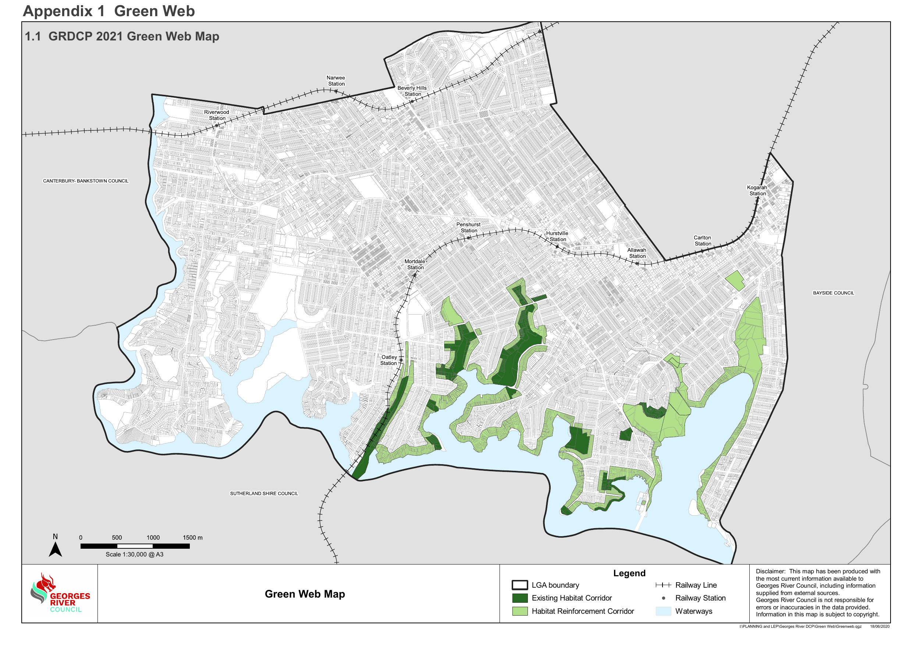

# Georges River Development Control Plan 2021 - Appendix 1 Appendices

> This chapter is split into 96 section file(s), one per numbered heading, in the order they appear in the PDF.

Source PDF: [Amd-6-GRDCP-Appendices-NEW.pdf](Amd-6-GRDCP-Appendices-NEW.pdf)

> [Picture on page 1, not reproduced as text; see the original PDF.]
> Words on this picture, read by OCR (may contain errors): Appendices

> The PDF's contents list (page numbers of the printed document) is not repeated here - see Sections below.

> [Picture of page 3: Appendix 1 Appendices - a detailed map drawn with 54,320 lines, saved as a picture (images/appendix-01-appendices-page-3.gif, 150 dpi); the street names and other labels are on the picture.]

> Words printed on the picture (title and legend, copied from the PDF):
> Appendix 1 Green Web
> 1.1 GRDCP 2021 Green Web Map

<!-- sections -->
## Sections

1. [2.1 Introduction](01-2-1-introduction.md)
2. [2.2.1 No. 24 (Lot 2, DP 320644) Penshurst Avenue, Penshurst](02-2-2-1-no-24-lot-2-dp-320644-penshurst-avenue.md)
3. [2.2.2 Nos. 211-219 Rocky Point Road, Ramsgate](03-2-2-2-nos-211-219-rocky-point-road-ramsgate.md)
4. [2.3 Heritage Conservation Areas](04-2-3-heritage-conservation-areas.md)
5. [1.0 Purpose of Guidelines](05-1-0-purpose-of-guidelines.md)
6. [1.1 Relationship with Other Council Plans](06-1-1-relationship-with-other-council-plans.md)
7. [1.2 Where do These Guidelines Apply?](07-1-2-where-do-these-guidelines-apply.md)
8. [1.3 Why is this a Heritage Conservation Area?](08-1-3-why-is-this-a-heritage-conservation-area.md)
9. [1.4 Are all Buildings Treated the Same?](09-1-4-are-all-buildings-treated-the-same.md)
10. [1.4.1 Contributory Items](10-1-4-1-contributory-items.md)
11. [1.4.2 Neutral Items](11-1-4-2-neutral-items.md)
12. [1.4.3 Intrusive Items](12-1-4-3-intrusive-items.md)
13. [1.5 What Category is my Building?](13-1-5-what-category-is-my-building.md)
14. [1.6 What Characteristics Need to be Conserved?](14-1-6-what-characteristics-need-to-be.md)
15. [1.7 Guideline Statements](15-1-7-guideline-statements.md)
16. [1.7.1 Character](16-1-7-1-character.md)
17. [1.7.2 Scale](17-1-7-2-scale.md)
18. [1.7.3 Form](18-1-7-3-form.md)
19. [1.7.4 Siting](19-1-7-4-siting.md)
20. [1.7.5 Materials, Colours & Detailing](20-1-7-5-materials-colours-and-detailing.md)
21. [1.7.6 Subdivision and Lot Consolidation](21-1-7-6-subdivision-and-lot-consolidation.md)
22. [1.0 Purpose of Guidelines](22-1-0-purpose-of-guidelines.md)
23. [1.1 Relationship with Other Council Plans](23-1-1-relationship-with-other-council-plans.md)
24. [1.2 Where Do These Guidelines Apply?](24-1-2-where-do-these-guidelines-apply.md)
25. [1.3 Why is this a Conservation Area?](25-1-3-why-is-this-a-conservation-area.md)
26. [1.4 Are All Buildings Treated the Same?](26-1-4-are-all-buildings-treated-the-same.md)
27. [1.4.1 Contributory Items](27-1-4-1-contributory-items.md)
28. [1.4.2 Neutral Items](28-1-4-2-neutral-items.md)
29. [1.4.3 Intrusive Items](29-1-4-3-intrusive-items.md)
30. [1.5 What Category is My Building?](30-1-5-what-category-is-my-building.md)
31. [1.6 What Characteristics Need to be Conserved?](31-1-6-what-characteristics-need-to-be.md)
32. [1.7 Guideline Statements](32-1-7-guideline-statements.md)
33. [1.7.1 Character](33-1-7-1-character.md)
34. [1.7.2 Scale](34-1-7-2-scale.md)
35. [1.7.3 Form](35-1-7-3-form.md)
36. [1.7.4 Siting](36-1-7-4-siting.md)
37. [1.7.5 Materials, colours and detailing](37-1-7-5-materials-colours-and-detailing.md)
38. [1.7.6 Subdivision and Lot Consolidation](38-1-7-6-subdivision-and-lot-consolidation.md)
39. [1.0 Purpose of Guidelines](39-1-0-purpose-of-guidelines.md)
40. [1.1 Relationship with Other Council Plans](40-1-1-relationship-with-other-council-plans.md)
41. [1.2 Where Do These Guidelines Apply?](41-1-2-where-do-these-guidelines-apply.md)
42. [1.3 Why is this a Conservation Area?](42-1-3-why-is-this-a-conservation-area.md)
43. [1.4 Are All Buildings Treated the Same?](43-1-4-are-all-buildings-treated-the-same.md)
44. [1.4.1 Contributory Items](44-1-4-1-contributory-items.md)
45. [1.4.2 Neutral Items](45-1-4-2-neutral-items.md)
46. [1.4.3 Intrusive Items](46-1-4-3-intrusive-items.md)
47. [1.5 What Category is My Building?](47-1-5-what-category-is-my-building.md)
48. [1.6 What Characteristics Need to Be Conserved?](48-1-6-what-characteristics-need-to-be.md)
49. [1.7 Guidelines Statement](49-1-7-guidelines-statement.md)
50. [1.7.1 Character](50-1-7-1-character.md)
51. [1.7.2 Scale](51-1-7-2-scale.md)
52. [1.7.3 Form](52-1-7-3-form.md)
53. [1.7.4 Siting](53-1-7-4-siting.md)
54. [1.7.5 Materials, colours and detailing](54-1-7-5-materials-colours-and-detailing.md)
55. [1.7.6 Subdivision and Lot Consolidation](55-1-7-6-subdivision-and-lot-consolidation.md)
56. [4.1.1 Definitions and Meaning](56-4-1-1-definitions-and-meaning.md)
57. [4.1.2 Land to which this section applies](57-4-1-2-land-to-which-this-section-applies.md)
58. [4.1.3 Purpose](58-4-1-3-purpose.md)
59. [4.1.4 Objectives](59-4-1-4-objectives.md)
60. [4.1.5 Waste Management Plan](60-4-1-5-waste-management-plan.md)
61. [4.2.1 Waste Management Plan Requirements](61-4-2-1-waste-management-plan-requirements.md)
62. [4.2.2 Post-Consent Requirements](62-4-2-2-post-consent-requirements.md)
63. [4.3 On-going Waste Management](63-4-3-on-going-waste-management.md)
64. [4.3.1 Waste Management Plan Requirements](64-4-3-1-waste-management-plan-requirements.md)
65. [4.3.2 Waste, Recycling and Organic Storage Areas](65-4-3-2-waste-recycling-and-organic-storage.md)
66. [4.3.3 General Bin and Management Requirements](66-4-3-3-general-bin-and-management-requirements.md)
67. [4.3.4 Storage for Bulky Waste Materials](67-4-3-4-storage-for-bulky-waste-materials.md)
68. [4.3.5 Composting and Wormeries](68-4-3-5-composting-and-wormeries.md)
69. [4.3.6 Collection points](69-4-3-6-collection-points.md)
70. [4.3.6.1 Onsite Collection](70-4-3-6-1-onsite-collection.md)
71. [4.3.6.2 Kerbside Collection](71-4-3-6-2-kerbside-collection.md)
72. [4.3.7 Onsite Waste Management](72-4-3-7-onsite-waste-management.md)
73. [4.4 On-going Waste Management Specifics per Development Type](73-4-4-on-going-waste-management-specifics-per.md)
74. [4.4.1 Multi-Unit Dwellings (e.g. residential flat buildings, multi dwelling housing, shop top housing)](74-4-4-1-multi-unit-dwellings-e-g-residential.md)
75. [4.4.1.1 Bin and Bulky Waste Storage](75-4-4-1-1-bin-and-bulky-waste-storage.md)
76. [4.4.1.2 Collection Access - General](76-4-4-1-2-collection-access-general.md)
77. [4.4.1.2 Waste disposal systems and Chutes](77-4-4-1-2-waste-disposal-systems-and-chutes.md)
78. [4.4.1.4 Waste handling and compaction equipment](78-4-4-1-4-waste-handling-and-compaction-equipment.md)
79. [4.4.2 Single Unit Dwellings](79-4-4-2-single-unit-dwellings.md)
80. [4.4.2.1 Bin and Bulky Waste Storage](80-4-4-2-1-bin-and-bulky-waste-storage.md)
81. [4.4.2.1 Collection Access](81-4-4-2-1-collection-access.md)
82. [4.4.3 Non-Residential Developments](82-4-4-3-non-residential-developments.md)
83. [4.4.3.1 Bin and Bulky Waste Storage](83-4-4-3-1-bin-and-bulky-waste-storage.md)
84. [4.4.3.2 Collection Access](84-4-4-3-2-collection-access.md)
85. [4.4.3.1 Office(s)](85-4-4-3-1-office-s.md)
86. [4.4.3.2 Retail](86-4-4-3-2-retail.md)
87. [4.4.3.3 Food Retailers and Wholesalers](87-4-4-3-3-food-retailers-and-wholesalers.md)
88. [4.4.3.4 Pubs, Clubs and Hotels](88-4-4-3-4-pubs-clubs-and-hotels.md)
89. [4.4.3.5 Health Care Facilities](89-4-4-3-5-health-care-facilities.md)
90. [4.4.4 Special Events](90-4-4-4-special-events.md)
91. [4.4.4.1 General Requirements](91-4-4-4-1-general-requirements.md)
92. [3 – Ongoing Use of Premises](92-3-ongoing-use-of-premises.md)
93. [Appendix 5 State and Regional Road](93-appendix-5-state-and-regional-road.md)
94. [Appendix 6 Building Heights and Indicative](94-appendix-6-building-heights-and-indicative.md)
95. [Appendix 7 The Kemp’s Estate](95-appendix-7-the-kemp-s-estate.md)
96. [Appendix 8 Exempt Works for Trees](96-appendix-8-exempt-works-for-trees.md)
