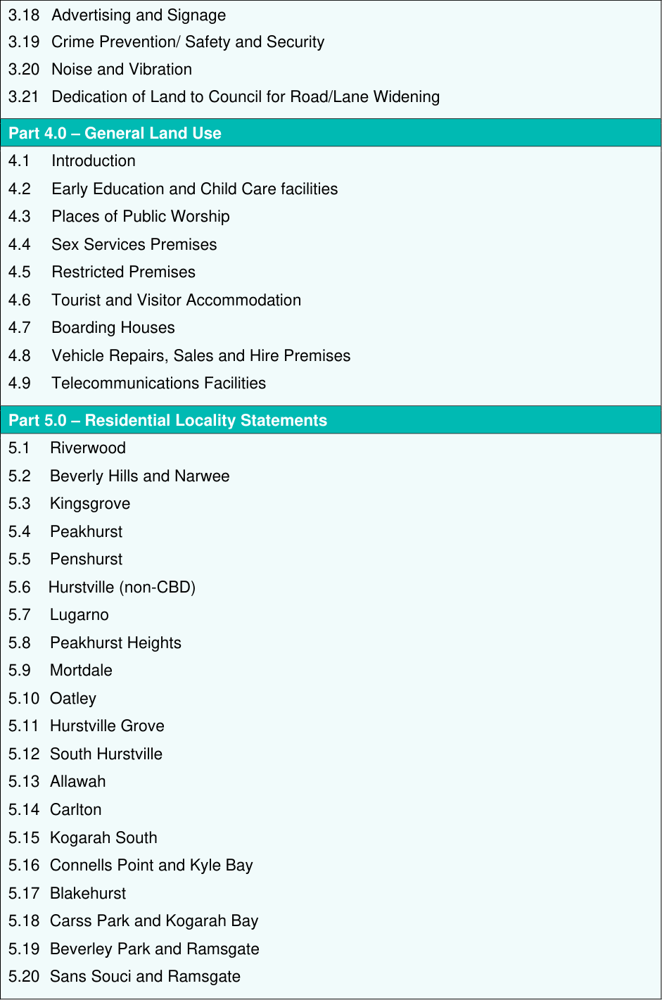

#### Part 3.0 – General Planning Considerations

### 3.1 Introduction

### 3.2 Biodiversity

### 3.3 Landscaping

### 3.4 Bushfire Prone Land

### 3.5 Earthworks

### 3.6 Contaminated Land

### 3.7 Heritage

### 3.8 Views Impacts

### 3.9 Coastal Hazards and Risks

### 3.10 Water Management

### 3.11 Ecologically Sustainable Development

### 3.12 Waste Management

### 3.13 Parking Access and Transport

### 3.14 Utilities

### 3.15 Public Domain

### 3.16 Subdivision

### 3.17 Universal/Accessible design

> [Picture on page 9: a picture, saved as a picture (images/part-01-introduction-and-administration-page-9-1.gif, 150 dpi).]
