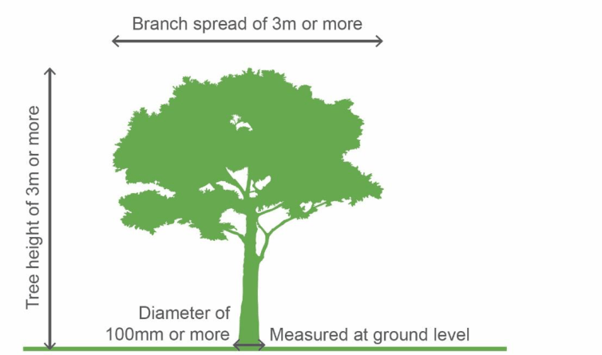

### 3.2 Biodiversity

#### 3.2.1 Trees & Vegetation

#### Objectives

a) Ensure the protection of existing trees which contribute to the visual amenity and environment of the LGA.

b) Protect trees within and adjacent to all development sites.

c) Maximise healthy tree canopy coverage across the LGA, so as to maximise reduction in the urban heat island effect.

d) Identify responsibilities and requirements with respect to the protection, retention and replacement of trees.

e) Provide processes which enable and facilitate citizen compliance with these provisions.

f) Ensure all applications for tree removal and pruning are assessed on the basis of the best practice tree management principles.

#### Controls

1\. Development is to comply with the provisions of the State Environmental Planning Policy (Biodiversity and Conservation) 2021.

2\. Development is to comply with the provisions of the Biodiversity Conservation Act 2016 and the Biodiversity Regulation 2017.

3\. All works are to comply with Council’s Tree Management Policy.

4\. For the purpose of this section, a tree is defined as vegetation having a:

• Height of 3 metres or more, or

• Diameter of 100mm or more when measured at ground level, or

• Branch spread of 3 metres or more.

See Figure 1 below for visual reference of what is defined as a tree.

> [Picture on page 5: a picture, saved as a picture (images/part-03-general-planning-considerations-page-5-1.gif, 150 dpi).]

Figure 1: Definition of a tree

Works that Require Approval – Trees on Private Land

5\. Under the provisions of Chapter 2 Vegetation in non-rural areas of the State Environmental Planning Policy (Biodiversity and Conservation) 2021, Council approval is required for works to any part of a tree, above or below ground.

6\. Trees defined by Control 4 above are declared as requiring approval, with the exception of Exempt Works as specified by Appendix 8 of this DCP. Exempt works are to be carried out in accordance with the requirements of Council’s Tree Management Policy.

7\. Approval is granted through either the issuing of a tree permit or a development consent as part of a development application. The following tree works on private land require approval from Council:

• Removal of dying and dead trees. Note: in incidences where a tree is suspected to have been vandalised, enforcement investigation will be undertaken by Council.

• Removal of hazardous trees where remedial pruning/treatment will not eliminate the hazard.

• Pruning of the live canopy of a tree.

• Selective pruning to remove branches in conflict with existing or proposed built structures, where all engineering alternatives have been considered and not feasible.

• Root pruning.

• Installation of root barriers.

• Removal of tree(s) in conflict with built structures, where all engineering and practicable management alternatives have been considered and not feasible.

• Removal of tree(s) for construction or extension of buildings where there is no feasible alternative that will allow for the retention of the tree(s).

8\. Approval through a Tree Permit is required for the following works:

i) Pruning or removal of a tree, including trees which are:

(a) Located on a private property,

(b) Listed on the Significant Tree Register and located on a private property,

(c) Located within a Heritage Conversation Area under the Georges River Local Environmental Plan 2021,

ii) Pruning only of a tree located within a listed State Heritage Item, Heritage Item or Interim Heritage Order under the Georges River Local Environmental Plan 2021,

iii) Tree works that are beyond the development standards specified by the State Environmental Planning Policy (Exempt and Complying Development Codes) 2008. Note: Details on the information required to be submitted with a tree permit application to Council is outlined on Council’s website.

9\. Approval through a Development Application is required for the following works:

i) Removal of a tree located within a listed State Heritage Item, Heritage Item or Interim Heritage Order under the Georges River Local Environmental Plan 2021,

ii) Tree works on any site containing a threatened ecological community (TEC), or classified as being part of a vulnerable threatened or endangered ecological community, or has the potential to provide habitat for native fauna under the Biodiversity Conservation Act 2016,

iii) Tree works that accompany proposed development activity on a property.

iv) Tree works that do not comply with State Environmental Planning Policy (Exempt and Complying Development Codes) 2008.

Note: Details on the information required to be submitted with a development application to Council is outlined in the DA Guide on Council’s website.

Development and Trees

10\. In planning the design of a development, consideration must be given to existing trees on the subject site and on the adjoining land, including:

i) Designs to minimise or avoid potential conflict between trees and structures – on site and on any neighbouring property,

ii) Existing trees are retained and incorporated as part of the design within an enforceable Tree Protection Zone (TPZ) of 12 x trunk diameter (DBH) when measured at 1.4 metres from ground level,

iii) Driveways must be suitably distanced from existing street trees,

iv) Awnings must be suitably distanced to reduce conflicts with canopy trees and future tree plantings,

v) Stormwater suitably distanced from trees and not within the deep soil zone area to allow for potential tree planting,

vi) Vitality and stability of the tree(s) in the long term,

vii) Sufficient landscape area and deep soil planting areas to allow for planting of replacement trees if an existing tree is proposed to be removed,

viii) Protection of the tree during the demolition and construction phases,

ix) Building construction methods that will minimise the impact on trees and their root systems, and

x) Trees identified to be retained on the site and on adjoining land are to be protected in accordance with AS4970 Protection of trees on development sites.

11\. Where works are proposed within 5m of the trunk of the tree or within the TPZ, whichever is greater, of an existing tree, an Arboriculture Impact Assessment Report must be prepared and submitted as part of the development application in accordance with Council’s DA Guide.

Works that Require Approval – Trees on Public Land

12\. Any work to a tree on public land (e.g. street trees) requires prior approval from Council. Refer to Council’s Tree Management Policy for further information.

13\. Where the proposed development activity on a property involves works to a public tree (e.g. pruning or removal), the proposed works to the public tree must be included within the subject development application.

14\. Any proposed development works within 5m of a public tree must include tree protection in accordance with AS4970 Protection of trees on development sites as part of the subject development application.

15\. Some works to trees on public land may be carried out as Exempt Works by public authorities and authorised persons in accordance with Appendix 8 of this DCP and the requirements of Council’s Tree Management Policy.

#### 3.2.2 Green Web

#### Introduction

The Green Web seeks to conserve and enhance Georges River’s bushland and biodiversity by identifying and appropriately managing key areas of bushland habitat and establishing and maintaining interconnecting linkages and corridors.

The Green Web is mapped to include:

• Habitat Corridor

• Habitat Reinforcement Corridor

The objectives and controls in this chapter will affect the siting of development on parcels of land; determine what vegetation is retained and how the proposed landscape elements are integrated with new development.

#### Objectives

a) Prevent direct loss of habitat in and adjoining Green Web areas and enhance long term sustainability.

b) Prevent fragmentation of bushland.

c) Enhance biodiversity and ensure ecological resilience through greater connectivity of bushland areas.

d) Improve the function of riparian zones and foreshores to provide linkages and corridors between areas of habitat.

e) Minimise weed invasion and spread within Green Web areas.

f) Revegetate habitat or corridors to compensate for detrimental impacts accruing from the development of land.

g) Enhance vegetation corridors in urban areas.

h) Re-establish corridors in urban areas.

#### Controls

All Green Web Areas

1\. Green Web areas are those areas mapped on the maps contained within Appendix 1.

2\. Green Web areas are to be landscaped with species indigenous to the Georges River Council area, listed in Council’s Backyard Biodiversity Guide on Council’s website and Council’s Tree Management Policy (and its Appendix 1 – Tree Planting). Trees and landscaping should be provided in a form and configuration that maintains and enhances the core habitat and vegetated linkages.

3\. Development should contribute to the maintenance of local habitats and connectivity between bushland remnants.

4\. Development should seek to retain unique environmental features of the site including:

i. Rock outcrops;

ii. Wetlands and the like;

iii. Watercourses, drainage lines and riparian land;

iv. Groups of significant trees and vegetation; and

v. Mature trees with hollows and other fauna habitat features on the site.

5\. Bushfire asset protection zones must not be in identified area of key habitat and corridors, except in the case of development or redevelopment of single dwellings and secondary dwellings on existing lots or alterations and additions to existing dwellings.

6\. Development should ensure that off-site impacts into adjoining bushland are minimised, such as weed invasion, increased runoff and stormwater pollutants.

Controls for Green Web Habitat Corridor Areas

7\. Development should maintain habitats in a size and configuration that ensures their ongoing viability and sustainability.

8\. Development should ensure connectivity between bushland remnants. To achieve this, corridors should be of a scale commensurate with the habitats they connect.

Controls for Green Web Habitat Reinforcement Corridor Areas

9\. Development should, through its siting, design and landscape treatment, maximise habitat values and minimise disruption to connectivity through:

i. Allocating one boundary of the site to planting of indigenous vegetation of a mix of canopy species (over 3m height at maturity) and understorey species (less than 3m height at maturity, or

ii. Retention and revegetation of remnant bushland elements.

10\. The required treatment will depend upon the scale of the bushland remnants linked by the land or the quality of the remnants to be retained on site. Note: No Green Web mapping was previously undertaken for the former Hurstville LGA. As such additional mapping will be required for the entire Georges River LGA.
