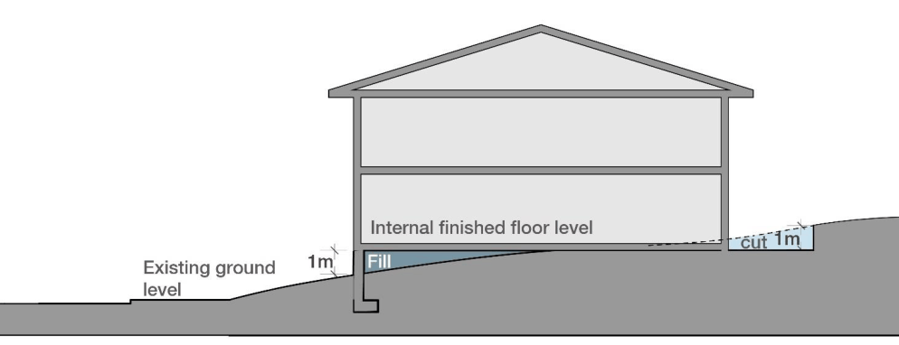

### 3.5 Earthworks

#### 3.5.1 Excavation (including cut and fill)

#### Objectives

a) Ensure that the natural topography and landform is maintained, and the amount of excavation is minimised.

b) Minimise the visual impact of new development, particularly when viewed from the public domain.

c) Minimise earthworks to maintain the existing landform and protect the integrity and stability of geological elements in the vicinity of the site.

d) Minimise impacts on surrounding vegetation and provide increased opportunities for tree retention, including trees on neighbouring properties.

e) Ensure earthworks do not detrimentally impact on stormwater flows or flood conditions on adjacent land.

#### Controls

1\. Natural ground level should be maintained within 900mm of a side and rear boundary.

2\. Cut and fill should not alter natural or existing ground levels by more than 1m (see Figure 1).

3\. Habitable rooms (not including bathrooms, laundries and storerooms) are to be located above existing ground level.

4\. Rock outcrops, overhangs, boulders, sandstone platforms or sandstone retaining walls are not to be removed or covered.

5\. Development is to be located so that clearing of vegetation is avoided.

6\. Cut and fill within a tree protection zone (TPZ) of a tree on the development site or adjoining land, must be undertaken in accordance with Australian Standard AS 4970 (Protection of trees on development sites).

7\. Soil depth around buildings should be capable of sustaining trees as well as shrubs and smaller scale gardens.

8\. Earthworks are not to increase or concentrate overland stormwater flow or aggravating existing flood conditions, on adjacent land.

9\. Fill material must be virgin excavated natural material (VENM) or fill that meets all of the conditions of a recourse recovery order issued by the NSW Environmental Protection Authority (EPA).

10\. For sites identified as flood affected, any cut and fill works, included in the development are to comply with the requirements of Council’s Stormwater Management Policy, specifically Chapter 6 – Flooding and Overland Flow.

> [Picture on page 13: a picture, saved as a picture (images/part-03-general-planning-considerations-page-13-7.gif, 150 dpi).]

Figure 1: Maximum Cut and Fill

#### 3.5.2 Construction Management / Erosion and Sediment Control

#### Objectives

a) Protect the environmental quality of waterways.

b) Reduce erosion hazard and prevent soil, building material and pollutants leaving the site and entering waterways.

c) Prevent reduction in the hydraulic capacity of drainage systems.

d) Enable the community to reuse, repair, recycle or dispose of waste at safe, clean and easily accessible facilities.

#### Controls

1\. Development must minimise any soil loss from the site to reduce impacts of sedimentation on waterways through the use of the following:

• Sediment fencing

• Water diversion

• Single entry / exit points

• Filtration materials such as straw bales and turf strips

Refer to NSW Guidelines for Erosion and Sediment Control on Building Sites for further guidance.

2\. Development that involves site disturbance is to provide an erosion and sediment control plan which details the proposed method of soil management and its implementation. Such details are to be in accordance with The Blue Book – Managing Urban Stormwater: Soils & Construction by Landcom.

3\. Development is to minimise site disturbance, including impacts on vegetation and significant trees and the need for cut and fill.

4\. Construction works within a tree protection zone (TPZ) of a tree on the development site or adjoining land, must be undertaken in accordance with AS 4970 (Protection of trees on development sites).

5\. Development which has high potential risk to groundwater must submit a geotechnical report to address how possible impacts on groundwater are minimised.

6\. Work must not be carried out in a public road or footpath unless a permit has been granted by Council (or other relevant roads authority) under s.138 of the Roads Act 1993, and / or s.68 of the Local Government Act 1993. These are separate approvals to development consent or a Complying Development Certificate. Consult with Council to determine if a permit is required.
