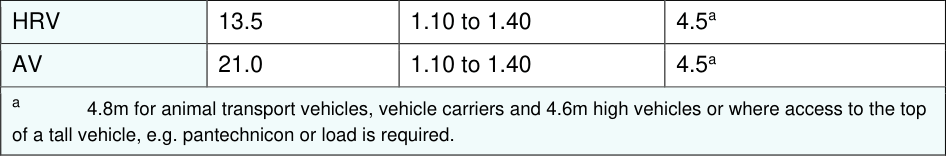

### 3.13 Parking Access and Transport

#### Objectives

a) Minimise traffic congestion and ensure adequate traffic safety and management.

b) Ensure an adequate environmental quality of parking areas (including both safety and amenity).

c) Provide adequate car parking for building users and visitors, depending on building use and proximity to public transport.

#### Controls

Parking Rates

1\. The car parking rate for development types are outlined in Table 1 – Parking Requirements. In the event of a discrepancy between the parking rates specified in this Part of the DCP and any another, the specific requirements identified within the detailed controls for a locality/area shall prevail.

2\. Development types not listed in Table 1 would be subject to a merit assessment based on the provisions set out in the Roads and Traffic Authority – Guide to Traffic Generating Developments. Council may require a detailed Traffic & Parking Study to be prepared for major development types or types of development not listed in the Guide.

3\. It should be noted that the parking spaces required by this DCP are minimum numbers. Some uses, due to the nature of their operation, may warrant additional parking spaces and these may be required by Council.

4\. Where a development is unable to provide the number of off street parking spaces required under Table 1, some of the required parking may be provided in the form of a contribution to public parking provision where required under an applicable Section 7.11 Plan.

5\. In calculating the total number of car parking spaces required for a development type, the total should be rounded up to the nearest whole number (i.e. 0.5 or greater).

| Land Use Types | Parking Rate (Minimum) |
|---|---|
| Residential Accommodation |  |
| Attached Dwelling | • 1 space per 1 and 2 beds • 2 spaces per 3 beds or more • 1 visitor space per 4 dwellings or part thereof for developments of 4 dwellings or more |

| Land Use Types | Parking Rate (Minimum) |
|---|---|
| Boarding House | • Refer to the car parking rates for boarding houses in State Environmental Planning Policy (Housing) 2021. • Clause 29(2) of the SEPP states: A consent authority must not refuse consent to development to which this Division applies of any of the following grounds – (e) parking If– (i) in the case of development carried out by or on behalf of a social housing provider in an accessible area – at least 0.2 parking spaces are provided for each boarding room, and (ii) in the case of development carried out by or on behalf of a social housing provider not in an accessible area – at least 0.4 parking spaces are provided for each boarding room, and (iia) in the case of development not carried out by or on behalf of a social housing provider – at least 0.5 parking spaces are provided for each boarding room, and (iii) in the case of any development – not more than 1 parking space is provided for each person employed in connection with the development and who is resident on site. |
| Dual Occupancy | • 1 garage space and 1 driveway space per dwelling |
| Dwelling House | • 1 space per 1 and 2 beds • 2 spaces per 3 beds or more |
| Group Homes | • Refer to the car parking rates for boarding houses in State Environmental Planning Policy (Housing) 2021 |
| Hostels | • Identify car parking demand through a Transport and Parking Assessment Study based on a survey of similar developments |
| Secondary Dwellings | • N/A for secondary dwellings • NB: Car parking rate for principal dwelling is to be achieved |
| Manor Houses | • 1 space per dwelling |
| Multi-dwelling housing | • 1 space per dwelling |

| Land Use Types | Parking Rate (Minimum) |
|---|---|
| (terraces) | • 1 visitor space per 5 units or part thereof and 1 designated car wash bay which may also be a visitor space |
| Multi-dwelling housing (excluding terraces) | • 1.5 spaces per dwelling • 1 visitor space per 5 units or part thereof and 1 designated car wash bay which may also be a visitor space |
| Residential flat building | • 1 space per 1 and 2 beds • 2 spaces per 3 beds or more • 1 visitor space per 5 units or part thereof and 1 designated car wash bay which may also be a visitor space |
| Semi-detached dwelling | • 1 space per 1 and 2 beds • 2 spaces per 3 beds or more |
| Seniors housing – self- contained dwellings | • 1.5 spaces per dwelling. • 1 visitor space per 5 units or part thereof and 1 designated car wash bay which may also be a visitor space |
| Seniors housing – residential care facility / respite day care centre | • 1 space per 10 beds • 1 space per 2 employees • 1 designated ambulance space |
| Shop-top housing / mixed use development (residential component) | • 1 space per 1 and 2 beds • 2 spaces per 3 beds or more • 1 visitor space per 5 units or part thereof and 1 designated car wash bay which may also be a visitor space |
| Home Based Land Uses |  |
| Home Based Child Care | • 1 space per employee • 1 space per child intake capacity |
| Home Business | • 1 space per employee not resident at the site |
| Home Industry | • 1 space per employee not resident at the site |
| Specific Commercial / Retail – Non-residential accommodation development within Hurstville and Kogarah Strategic Centres |  |
| Business and Office | • 1 space per 60m2 (GFA) |
| Retail Premises (Shops) | • 1 space per 60m2 (GFA) |
| Restaurant or Cafés | • 1 space per 40m2 (GFA) |
| Medical Centre | • 1 space per 50m2 (GFA) • NB: Transport and Parking Assessment Study |

| Land Use Types | Parking Rate (Minimum) required |
|---|---|
| Specific Commercial / Retail – Non-residential accommodation development outside the Hurstville and Kogarah Strategic Centres |  |
| Business and Commercial | • ≤800m walking distance of Railway station - 1 space per 60m2 (GFA) • ≥800m walking distance of Railway station - 1 space per 40m2 (GFA) |
| Retail Premises (Shops) | • ≤800m walking distance of Railway station - 1 space per 60m2 (GFA) • ≥800m walking distance of Railway station - 1 space per 40m2 (GFA) |
| Restaurant or Cafés | • ≤800m walking distance of Railway station - 1 space per 40m2 (GFA) • ≥800m walking distance of Railway station - 1 space per 30m2 (GFA) |
| Medical Centre | • ≤800m walking distance of Railway station - 1 space per 40m2 (GFA) • ≥800m walking distance of Railway station - 1 space per 30m2 (GFA) • NB: Transport and Parking Assessment Study required |
| All Other Commercial / Retail Land uses |  |
| Retail Premises (Car Tyre Retail Outlet) | • 3 spaces per 100m2 (GFA) or 3 spaces per work bay (whichever is greater) |
| Retail Premises (Garden Centres, Hardware and building supplies, Landscaping material supplies, Specialised retail premises) | • 1 space per 50m2 (GLFA), or • Identify car parking demand through a Transport and Parking Assessment Study based on a survey of similar developments |
| Retail Premises - supermarket | • 1 space per 20m (GLFA), or • Identify car parking demand through a Transport and Parking Assessment Study based on a survey of similar developments |
| Retail Premises (Take away food and drink premises) | Developments with no on-site seating or drive- through: • 1 space per 100m2 (GFA) Developments with no-site seating but no drive- through: • ≤800m walking distance of Railway station - 1 |

| Land Use Types | Parking Rate (Minimum) space per 40m2 (GFA) • ≥800m walking distance of Railway station - 1 space per 30m2 (GFA) Developments with on-site seating and drive-through: • 1 space per 2 seats (internal), or • 1 space per 3 seats (internal & external) (whichever is the greater) |
|---|---|
| Service stations – convenience store | • 6 spaces per work bay (NB: stacked parking acceptable) • 1 space per 30m2 of convenience store (GFA) |
| Vehicle sales or hire premises | • 1.5 spaces per 200m2 of site area, • 6 spaces per work bay (NB: stacked parking acceptable), • 1 space per 25m2 of sales area (GFA) • NB: Customer / visitor parking spaces must be readily accessible from the principal road frontage and appropriately signposted and marked. These spaces must not be used for the display of vehicles or other merchandise or for the loading/unloading of vehicles onto or from car floats or trucks. |
| Tourist and Visitor Accommodation |  |
| Backpackers’ accommodation | • 1 space per manager • 1 space per two employees • 1 space for a mini-bus |
| Bed and Breakfast accommodation | • 1 space for resident owner or manager; plus • 1 space per guest room |
| Hotel or motel accommodation and serviced apartments | • 1 space per 5 bedrooms / unit of accommodation plus the requirements of any associated restaurant/ function room, etc. • Provision to be made for off street accommodation of buses and taxis. |
| Industrial |  |
| Warehouse or distribution centre | • 1 space per 100m2 |
| Freight Transport facilities | • Identify car parking demand through a Transport and Parking Assessment Study based on a survey of similar developments |

| Land Use Types | Parking Rate (Minimum) |
|---|---|
| Industrial training facilities | • Identify car parking demand through a Transport and Parking Assessment Study based on a survey of similar developments |
| Light Industrial | • 1 space per 300m2 (Warehouse component) • 1 space per 100m2 (Factory / Manufacturing component) • 1 space per 40m2 (Office component) |
| Vehicle body repair workshop and vehicle repair station | • 6 spaces per work bay (stacked parking acceptable) |
| Educational Establishment |  |
| Primary School | • 1 space per 100m2 (GFA) • Primary educational establishments are to have a drop off and pick up parking facilities for cars and buses in addition to the DCP parking requirements. |
| Secondary School | • 2 spaces per classroom • 1 space per 10 students over 17 years • Secondary educational establishments are to have a drop off and pick up parking facilities for cars and buses in addition to the DCP parking requirements |
| Recreation |  |
| Recreation Facilities (indoor) | • Squash / cricket / netball / soccer courts – 3 spaces per court • Bowling Alley – 3 spaces per lane • Gymnasium – 4.5 (min) to 7.5 (preferred) spaces per 100m2 (GFA) • Others - Identify car parking demand through a Transport and Parking Assessment Study based on a survey of similar developments. |
| Recreation Facilities (outdoor) | • Lawn Bowls club – 30 spaces for first green plus 15 spaces per additional green or 1 space per 18.5m2 (whichever is greater) • Tennis courts – 3 spaces per court • Golf course – 1 space per hole, plus 1 space per 2 staff, plus 1 space per 5m2 GFA (clubhouse) • Others - Identify car parking demand through a Transport and Parking Assessment Study based on a survey of similar developments. |
| Recreation Facilities (major) | • Identify car parking demand through a Transport |

| Land Use Types | Parking Rate (Minimum) and Parking Assessment Study based on a survey of similar developments. |
|---|---|
| Other land uses |  |
| Centre-based Child Care Facility | • 1 space per 2 staff plus: - Centres with 20 to 39 Children – 1 space per 4 children - Centres with 40 to 69 Children – 1 space per 5 children - Centres with 70-100 children – 1 space per 6 children. • Transport and Parking Assessment Study required |
| Community Facilities; information and education facilities; public administration building | • Identify car parking demand through a Transport and Parking Assessment Study based on a survey of similar developments |
| Entertainment facility | • 1 space per 10m2 or 1 space per 6 seats (whichever is greater) |
| Function Centre (Catering and Reception Centre) | • 1 space per 10m2 (dining area) • 1 space per 2 employees |
| Funeral Chapels, Funeral Homes | • 1 space per 10 seats or 1 space per 10m2 (GFA) (whichever is greater) |
| Health Consulting Rooms | • 1 space per practitioner • 1 space per consulting room |
| Hospital | • Identify car parking demand through a Transport and Parking Assessment Study based on a survey of similar developments |
| Passenger Transport Facilities, Transport Depots | • Identify car parking demand through a Transport and Parking Assessment Study |
| Place of Public Worship | • 1 space per 10 seats or 1 space per 10m2 GFA (whichever is greater) Note: • Some places of public worship operate with no seating arrangement and as such the use of the word “seat” relates to patronage level (e.g. prayer mats) • Transport and Parking Assessment Study required |
| Pubs (Food and drink | • 1 space per 50m2 |

| Land Use Types | Parking Rate (Minimum) |
|---|---|
| premises) |  |
| Restricted Premises | • 1 space per 50m2 (excluding drive-in liquor stores) • 1 space per 50m2 and queuing space for 3 vehicles for drive-in liquor stores |
| Registered clubs (excluding residential) and nightclubs | • Identify car parking demand through a Transport and Parking Assessment Study based on a survey of similar developments |
| Sex Services Premises | • 1 space per 25m² (GFA) |
| Small Bar | • Identify car parking demand through a Transport and Parking Assessment Study based on a survey of similar developments |
| Veterinary Hospitals | • 1 space per practitioner • 1 space per consulting room |

Table 1: Off-street Car Parking requirements

Parking Credits

6\. A parking credit is available when developing a site already occupied by a building. Provided the development retains the structure of the existing building, the proposed development will be exempted from the parking requirements for the existing floor space.

7\. Where the development is for the change of use of an existing building and the new use requires more parking than the old use, the credit is for the original use, even though the floor space may not be increasing. For example, converting a warehouse with no parking into a shop, with no increase in floor space would still be required to provide extra parking but this will be for the shop requirement minus the warehouse requirement.

Bicycle Parking

8\. All Commercial, Place of Public Worship, Residential flat building and Shop-top housing development is to provide on-site bicycle parking as outlined in Table 2 – Bicycle Parking Requirements.

| Land use | Bicycle Parking rate (minimum) |
|---|---|
| Commercial development including commercial component of a mixed use development | • 1 space per 5 car parking spaces |
| Places of Public Worship | • 1 space per 5 car parking spaces |
| Residential flat building | • 1 space per 3 dwellings plus 1 space per 10 |

|  | dwellings (visitors) |
|---|---|
| Shop-top housing / mixed use development (residential component) | • 1 space per 3 dwellings plus 1 space per 10 dwellings (visitors) |

Table 2: Bicycle Parking requirements

9\. In calculating the total number of bicycle spaces required for a development type, the total should be rounded up to the nearest whole number (i.e. 0.5 or greater).

10\. Bicycle parking facilities are to be designed in accordance with Australian Standard

AS2890.3 (Parking Facilities – Part 3 Bicycle Parking Facilities).

End of Trip Facilities

11\. For non-residential uses, the following facilities for bike parking are to be provided at the following rates:

i. 1 personal locker for each bike parking space;

ii. 1 shower and change cubicle for up to 10 bike parking spaces;

iii. 2 shower and change cubicles for 11 to 20 or more bike parking spaces are provided;

iv. 2 additional showers and cubicles for each additional 20 bike parking spaces or part thereof;

v. Showers and change facilities may be provided in the form of shower and change cubicles in a unisex area in both female and male change rooms; and

vi. Locker, change room and shower facilities are to be located close to the bike parking area, entry and exit points and within an area of security camera surveillance where there are such building security systems.

Design and Layout of Car Parking Areas

12\. Internal car park layouts, space dimensions, ramp grades, access driveways, internal circulation aisles and service vehicle areas shall be designed in accordance with the requirements set out in AS 2890.1 (2004) and AS 2890.2 (2002) for off street parking and commercial vehicles.

13\. Design vehicular access in accordance with the current Australian Standard for ‘off-street parking (Part 1) ‘and ‘off-street carparking for commercial vehicles (Part 2)’.

14\. For mixed use development, residential off-street parking facilities shall be separated from the other uses and security roller doors shall be installed to provide security to residents.

Basement Parking

15\. Basement car parking is preferable in commercial and residential flat buildings.

16\. Basement car parking is to be located within the building footprint.

17\. All basement parking areas are to have security doors.

18\. Include natural ventilation to basement and semi basement car parking.

19\. Integrate ventilation design into the façade of the building, or parking structure, treating it with appropriate features such as louvres, well designed grilles, planting or other landscaping elements.

At Grade Parking

20\. Car parking areas may be designed as ground level parking provided that the design results in building frontages level with the street.

21\. Parking areas are to include:

i. Planting beds fronting a street or public place are to have a minimum width of 1 metre, unless otherwise specified elsewhere in this DCP.

ii. Shade trees are to be provided in open parking areas at the ratio of 1 shade tree for every 6 spaces.

iii. Plants to avoid are those which have a short life, drop branches, gum or fruit or those which interfere with underground pipes.

22\. Parking areas are to incorporate a 150mm concrete kerb or edge treatment to reduce the likelihood of vehicles damaging adjoining landscaped areas. The use of bollards should also be considered.

Parking for People with a Disability

23\. Parking complies with AS 1428 Design for access and mobility and AS/NZS 2890.6.

24\. All off-street parking facilities shall allocate accessible parking spaces for people with disabilities at the rate in accordance with Section 3.17 – Universal/ Accessible Design of this DCP.

25\. Accessible parking spaces shall be located close to an accessible lift, ramp or building entrance and be provided with an accessible path of travel.

26\. Accessible parking spaces shall be indicated by a permanent sign as specified in AS 1428.1.

27\. For residential development, accessible car parking spaces are to be allocated to adaptable unit, or as visitor parking.

Car Washing Area

28\. A designated car washing area (which may also be a designated visitor car space) is required residential developments of four or more dwellings.

29\. Car wash bays which collect waste water must be covered and discharge the water to the sewer in accordance with the requirements of Sydney Water.

Pedestrian

30\. Design parking to ensure pedestrian safety.

31\. Pedestrian entrances and exits shall be separated from vehicular access paths.

Access

32\. Design driveways to minimise visual impact on the street and maximise pedestrian safety.

33\. Ensure that all vehicles, including vehicles using loading bays, can enter and leave the site in a forward direction.

34\. Avoid locating accessways to driveways adjacent to the doors or windows of habitable rooms.

Materials

35\. All driveways are to be finished in plain concrete.

36\. In streets which have brick paved surfaces, driveways are constructed to Council’s Engineering Specification including a concrete base with matching brick paving surface.

37\. Large areas of at grade carparking are to be constructed of concrete or a light coloured material to minimise heat load. Tree planting within the carparking will be required to provide shade.

Tandem, stacked and mechanical parking areas

Mechanical parking installations means mechanical car stackers, car lifts and turntables.

Stacked parking means sharing a parking space vertically through use of a mechanical car stacker.

Tandem parking means two or more vehicles sharing a parking space at the same level configured nose to tail.

38\. Where development includes a mechanical parking installation, such as car stackers, turntables, car lifts or another automated parking system, the development application is to include a Parking and Access Report including queuing analysis.

39\. Access to mechanical parking installations is to be in accordance with the relevant Australian Standards.

40\. Tandem or stacked parking will only be permitted where:

i. Each tandem or stacked parking arrangement is limited to a maximum of two spaces;

ii. The maximum parking limit for spaces is not exceeded;

iii. They are not used for service vehicle parking;

iv. The spaces are attached to the same strata title in residential buildings and small commercial or retail developments;

v. In residential buildings and serviced apartments, they are used for tenant parking only;

vi. In commercial or retail development, they are used for staff parking only; and

vii. The manoeuvring of and queuing for stacked vehicles are able to occur wholly within the premises, without obstructing the entry or egress of other vehicles.

41\. Mechanical parking installations will be considered for developments involving the adaptive re-use of existing buildings where site or building constraints prevent standard parking arrangements and no inconvenience arises from their use.

42\. Mechanical parking installations, tandem or stacked parking are not to be used for visitor parking or parking for car share schemes.

43\. The minimum length of a tandem space is to be 10.8m.

44\. Car lifts will only be considered where it can be demonstrated that a basement ramp is not feasible/achievable.

45\. Where a car lift is required, car lifts are to be provided at a minimum rate of 1 lift per 25 spaces or part thereof.

Note: Queuing analysis must be completed in accordance with Australian Standard

AS2890.1 and Ausroads “Guide to Traffic Management”. The assessment is to establish whether the mechanical lift requires queuing to be accommodated on the property noting that queuing of vehicles on public roads will not be supported.

Car share

46\. Parking car share spaces are encouraged for:

i. Any residential development containing more than 25 residential units, or

ii. Any employment generating development with a floor space of 5,000m2, and

iii. Is located within 800 metre radial catchment of a railway station, or within a transit node entre that is serviced by a strategic bus corridor.

47\. A car share parking proposal is to be supported by a parking study.

48\. Council may consider car share spaces in lieu of some resident parking, subject to evidence of an appropriate arrangement with a car share scheme provider.

49\. Clearly marked plans identifying the location of all car share parking spaces must be submitted with the development application.

50\. All car share parking spaces are to be:

i. Publicly accessible 24 hours a day seven days a week;

ii. Located together;

iii. Located near and with access from a public road and integrated with the streetscape through appropriate landscaping where the space is external; and

iv. Clearly designated by signs as being for car share scheme use.

51\. Car share parking spaces located on private land are to be retained as common property by the Owners Corporation of the site and not to be sold or leased to an individual owner or occupier at any time.

Loading Requirements

52\. Planning and design layout of loading and manoeuvring areas should be provided in accordance with AS2890.2 and:

i. Preferably be located to the side or rear of buildings;

ii. Screened from view from local and main roads; and

iii. Located so that vehicles stand wholly within the dedicated loading/unloading area and do not obstruct the car parking on the subject property or public road, footway, laneway or service road.

53\. Loading bay facilities are to be provided at the following rates:

| Retail | Floor area >100m2 to 500m2 – 1 bay required Floor area > 500m2 to 1500m2 – 2 bays required |
|---|---|
| Commercial | Floor area 1000m2 to 5000m2 – 1 bay required Floor area > 5000m2 to 10000m2 – 2 bays required |

Table 3: Loading bay parking requirements

54\. The design of loading bay facilities are to be in accordance with Australian Standard

AS2890.2 and Table 4 below.

| Vehicle Class | Bay length m Min. | Platform height m | Vertical Clearance m Min. |
|---|---|---|---|
| SRV | 7.4 | 0.75 to 0.90 | 3.5 |
| MRV | 9.8 | 0.95 to 1.10 | 4.5a |

> [Picture on page 40: a picture, saved as a picture (images/part-03-general-planning-considerations-page-40-1.gif, 150 dpi).]
> Words printed on the picture (title and legend, copied from the PDF):
> a 4.8m for animal transport vehicles, vehicle carriers and 4.6m high vehicles or where access to the top
> of a tall vehicle, e.g. pantechnicon or load is required.

| HRV | 13.5 | 1.10 to 1.40 | 4.5a |
|---|---|---|---|
| AV | 21.0 | 1.10 to 1.40 | 4.5a |

Table 4: Service bay dimensions
