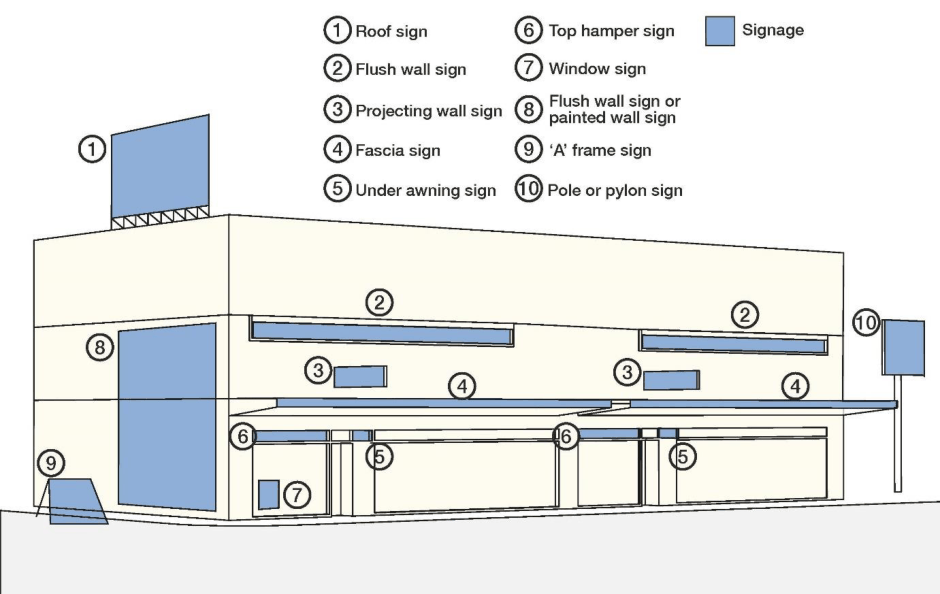

### 3.18 Advertising and Signage

#### Objectives

a) Ensure signage is compatible with the character of the locality and protects the amenity of the area.

b) Promote signage that complements the scale, size and architecture of the building or structure on which it is displayed.

c) Ensure signage does not compromise pedestrian, cyclist or motorist safety.

#### Controls

1\. Signs should be designed and located to:

i. Relate to the use of the premises.

ii. Be consistent with best practice guidelines.

iii. Be integrated with the architecture of the supporting building, not obscure significant architectural features and maintain the dominance of the architecture.

iv. Be limited in number to avoid cluttering, distraction and unnecessary repetition.

v. Not cover mechanical ventilation inlets or outlets.

vi. Not comprise a roof sign.

vii. Not comprise an above awning sign.

viii. Not comprise a flag pole sign.

ix. Not compromise road or pedestrian safety including cyclists.

x. Be a minimum of 2.6 metres above any footpath where the sign is not flush with the wall.

xi. Be at least 600mm from a kerb or roadway edge where the sign is over a public road.

2\. Signs must be securely fastened to the structure or building to which they are attached and must comply with the applicable requirements of the BCA and relevant Australian Standards.

3\. In addition to the above, illumination of signage should:

i. Be integrated with the design of the sign.

ii. Not cause light spillage into nearby residential properties.

iii. Not use complex displays, moving signs, flashing lights or the like that hold driver’s attention beyond ‘glance appreciation’, and

iv. Be fitted with an automatic timing device, controlling the illumination hours.

4\. In residential zones, signage should not be illuminated.

5\. All commercial advertising should comply with SEPP No.64-Advertising and Signage.

Business Identification Signs

6\. Business identification signs (refer to Figure 2 below) should:

i. Identify the significant owners, tenants and uses of buildings.

ii. Consolidate signs for multiple tenancies.

iii. Be displayed in English, but may include a translation in another language not larger than the English message.

iv. Not incorporate advertising of products and services that are not directly related to the approved use of the premises.

v. Comply with the general controls and the relevant prescriptive measures in Table 7.

> [Picture on page 48: a picture, saved as a picture (images/part-03-general-planning-considerations-page-48-14.gif, 150 dpi).]

Figure 2: Signage Type as marked in blue

| Signage Type | General Requirements |
|---|---|
| Above awning | Not supported. |

| Signage Type | General Requirements |
|---|---|
| Awning fascia | a. Should not project above or below the fascia b. Should not be illuminated |
| Under Awning | a. Should be erected below the awning fascia, horizontally to the ground and at right angles to the building b. Should not exceed 0.4m in width c. Should not exceed a vertical height of 0.5m d. Should be located 2m from the side property boundary, and not closer than 3m to another under awning sign |
| Flush wall | Must comply with all of the following controls, otherwise prohibited: a. Only one sign per building elevation; b. Must not have an area greater than: i. 10% of the elevation, if the elevation is >200m2 ii. 20m2 if the elevation is greater than 100m2 but <200m2 iii. 20% of the elevation for elevations of <100m2. c. Must not project above or beyond the wall to which it is attached; d. Must not extend over a window or other opening, or architectural feature; e. Must not be located on a building wall if there is an existing building or business identification sign on the building elevation. |
| Painted Wall | a. Size and shape must relate to the architectural features of the building; b. Not permitted on unpainted masonry on heritage items or buildings in conservation areas. c. Painted wall signs to be painted at least once every three years, or at the Council’s discretion. |
| Vertical projecting wall | Must comply with all of the following controls, otherwise prohibited: a. One per premises; b. Maximum height of 3.1m above ground level, or below the first floor windowsill level where there is no awning; c. Maximum area of 2m2; and d. Erected at right angles to the building. |
| Pole or pylon | Must comply with all of the following controls, otherwise prohibited: a. Must not project over footpath or roadway; b. Maximum area of 8m2; c. Maximum height 7.5m to the top of sign, above natural ground level; |

| Signage Type | General Requirements d. Where more than one pole or pylon sign is provided, they must have the same setback and be of uniform design and spacing; e. Message must relate to use of the premises; and f. The requirements of SEPP 64 should also be consulted. |
|---|---|
| Roof or Sky Sign | Refer to State Environmental Planning Policy (Industry and Employment) 2021, otherwise not supported. |
| A-frame, sandwich and board signs | a. Where site constraints make it difficult to provide a fixed sign, a moveable sign may be supported. b. Sign must be portable, free standing, stable, windproof and of high quality. c. Signs must be between 0.75m -1.1.m in height and a maximum width of 0.65m. d. Should be located to maintain an unencumbered pedestrian thoroughfare of 2 metres where located on a public footpath. e. Maximum of one sign per street fronted premises unless combined frontage exceeds 11m. f. Signs must only be displayed during approved trading hours and are to be removed at the close of business. g. All signs must display a current Approved Sign/Stand sticker (under development). h. Signs are not to be placed within 3 metres of a street corner or an arcade. i. Signs must not be fixed to the footway, poles or infrastructure. |
| Moving sign/video sign/electronic message board | Well-designed “moving image” signs may be acceptable in special circumstances where there is no nuisance to traffic or pedestrians and where it can be considered as a “landmark” sign. |
| Temporary Community Banner | Refer to SEPP (Exempt and Complying Development Codes) 2008. |
| Billboard (free standing) | Refer to SEPP 64. |
| Business Directory Board | Only one per premise. |

Table 7: Signage Requirements

Signs on Parked Vehicles

7\. Advertising signs on parked vehicles (cars, trucks, motorcycles, trailers etc.) are prohibited where the vehicle is unregistered or the principal purpose of the vehicle is for advertising purposes.

Large Developments

8\. Advertising signs for large commercial type developments and those that contain multiple tenancies should be the subject of a co-ordinated approach to the design and siting of signs.

New Developments

9\. For new buildings, the location, type and total number of advertising signs should be considered at the development application stage so that they can be integrated into the design of buildings. This information is to be included as part of any development application for a new building.

Specific Criteria for the Light Industrial Zone

10\. The total advertising area on each site is not to exceed 0.5m2 per linear metre of road frontage for premises with a single road frontage and 0.25m2 per linear metre for premises with two street frontages.

11\. Multiple occupancy buildings or sites may be identified at the entrance by freestanding directory boards within the front setback, identifying the names and activities of occupants.

12\. Signs displayed on units in multiple occupancies should be of a uniform shape, size and general presentation. No more than one identification sign and number is permitted for each approved unit or occupancy.

13\. No sign is permitted to stand higher than the roof line of the building to which it is affixed.

14\. The content of any advertising sign must relate to the premises on which the sign is erected or the activities carried out within the premises, except in the case of a Billboard Sign where it can be demonstrated that general advertising will have no detrimental impact on nearby residential areas or pedestrians, or cause a distraction to motorists.
