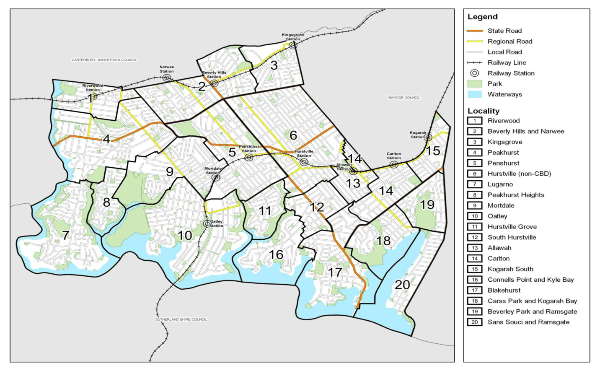

## Part 5 Residential Locality Statements

### Contents

| Introduction ........................................................................................................................................ 2 |  |
|---|---|
| 5.1 | Riverwood Locality Statement ............................................................................................ 4 |
| 5.2 | Beverly Hills – Narwee Locality Statement ...................................................................... 8 |
| 5.3 | Kingsgrove Locality Statement ......................................................................................... 11 |
| 5.4 | Peakhurst Locality Statement ........................................................................................... 13 |
| 5.5 | Penshurst............................................................................................................................. 16 |
| 5.5.1 Penshurst North Locality Statement ........................................................................ 16 |  |
| 5.5.2 Penshurst South Locality Statement ....................................................................... 18 |  |
| 5.6 | Hurstville (non-CBD) Locality Statement ........................................................................ 20 |
| 5.7 | Lugarno Locality Statement .............................................................................................. 23 |
| 5.8 | Peakhurst Heights Locality Statement ............................................................................ 26 |
| 5.9 | Mortdale Locality Statement ............................................................................................. 28 |
| 5.10 | Oatley ................................................................................................................................... 34 |
| 5.10.1 Oatley East Locality Statement ................................................................................ 34 |  |
| 5.10.2 Oatley West Locality Statement ............................................................................... 37 |  |
| 5.11 | Hurstville Grove Locality Statement ................................................................................ 40 |
| 5.12 | South Hurstville Locality Statement ................................................................................. 43 |
| 5.13 | Allawah Locality Statement ............................................................................................... 45 |
| 5.14 | Carlton .................................................................................................................................. 47 |
| 5.14.1 Carlton North Locality Statement ............................................................................. 47 |  |
| 5.14.2 Carlton South Locality Statement ............................................................................ 49 |  |
| 5.15 | Kogarah South Locality Statement .................................................................................. 52 |
| 5.16 | Connells Point and Kyle Bay Locality Statement .......................................................... 55 |
| 5.17 | Blakehurst Locality Statement .......................................................................................... 57 |
| 5.18 | Carss Park and Kogarah Bay Locality Statement ......................................................... 59 |
| 5.19 | Beverley Park and Ramsgate Locality Statement ......................................................... 62 |
| 5.20 | Sans Souci and Ramsgate Locality Statement ............................................................. 65 |

### Introduction

This part contains the locality statements for development within all residential areas of Georges River, except for Hurstville City Centre. The statements are locality specific and identify the unique qualities that make up the local character of each area and provide future desired character guidelines.

The localities are generally based on suburb boundaries and character and include location, built form, setting, subdivision pattern, heritage and streetscape. The statements build on the existing character of the neighbourhood and important elements that contribute to the existing character. These statements aim to reinforce and enhance the character of each locality.

Development is required to consider the future character statement for the locality, in addition to the requirements within other parts of this DCP.

> [Picture on page 4: a picture, saved as a picture (images/part-05-residential-locality-statements-page-4-1.gif, 150 dpi).]

Figure 1: Map of Residential Localities
