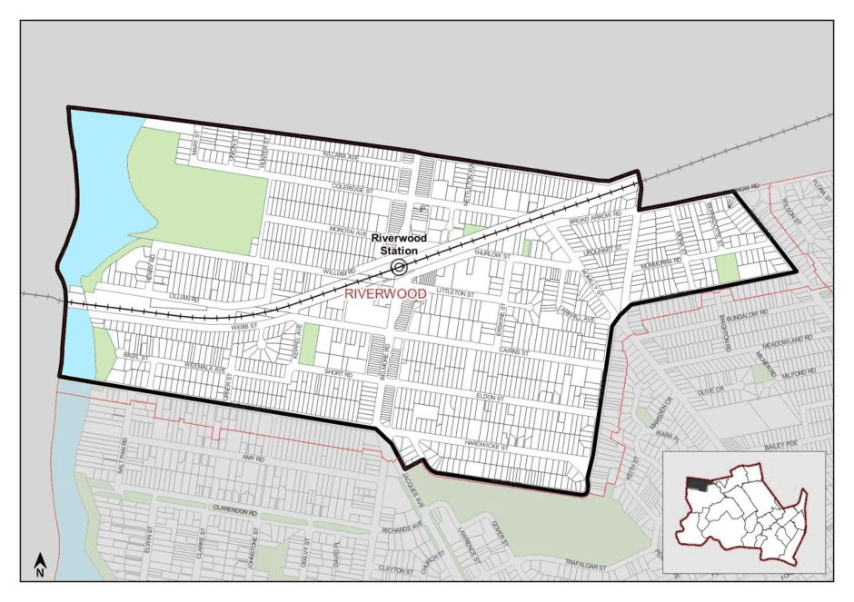
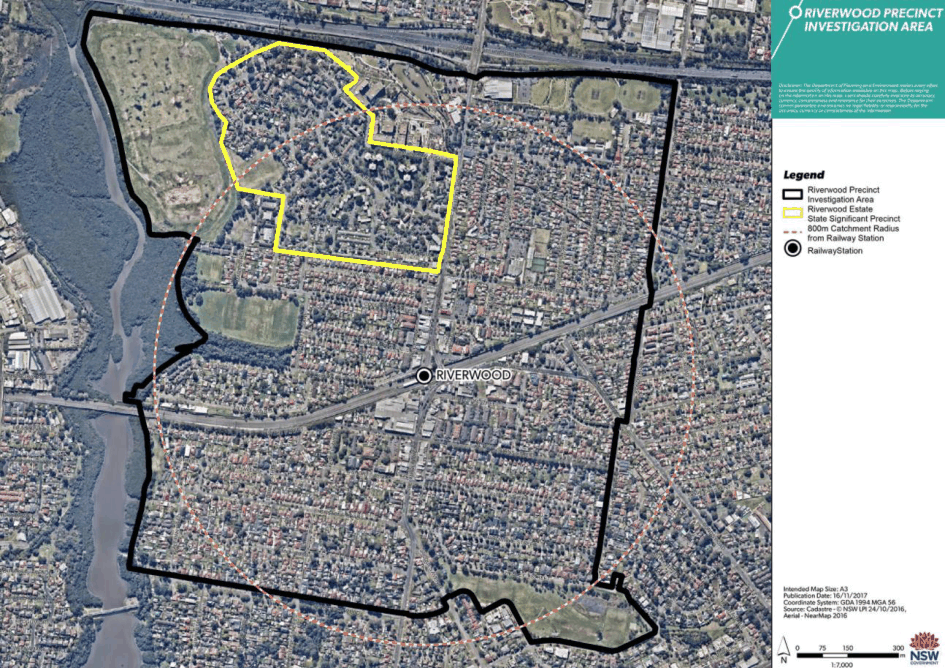

### 5.1 Riverwood Locality Statement

#### Map of locality

> [Picture on page 5: a picture, saved as a picture (images/part-05-residential-locality-statements-page-5-3.gif, 150 dpi).]

Figure 2: Riverwood

#### Existing Character

Location

This locality is bounded by the Canterbury-Bankstown LGA boundary to the north (rear of block on Killara Avenue and Josephine Street), Baumans Road, Charles Street and Talbot Street to the east, and Hedley Street and Shenstone Street to the south and Salt Pan Creek, beyond to the west. The railway line divides Riverwood into northern and southern parts. The suburb of Riverwood is divided between Canterbury-Bankstown and Georges River Councils. Background

The Traditional Owners of the area are members of the Aboriginal Bidjigal people of the Eora Nation, part of the Dharug language group.

The suburb of Riverwood was originally known as Herne Bay and was mainly used for market gardening and forestry. In 1942, Herne Bay was used as United States Army hospital barracks during World War II, which was located in the Riverwood Estate area located in the

Canterbury-Bankstown LGA.1  Most of the southern part of Riverwood within the Georges River LGA was developed between the inter-war period and the 1960s.

Heritage

This locality does not contain any heritage item under Schedule 5 Environmental Heritage within GRLEP 2021. Built Form and Setting

Riverwood is a predominately low density suburban area with pockets of residential flat building development mostly located around the Riverwood commercial centre and railway station. In the low density areas, post-war detached and semi-detached houses are the predominant built form. Some inter-war housing has also survived. Increasingly contemporary architectural styles are changing the prevailing post-war.

Due to the various stages of development that occurred in this locality, there is a diverse range of subdivision patterns. Many streets feature a grid-like pattern typical of inter-war and post-war development. There is consistency of lot depth in most streets featuring a grid-like layout, however the width of residential lots varies throughout the locality and a number of lots have been subdivided through recent dual occupancy developments.

Salt Pan Creek and the bordering bushland at the western edge of this locality provide a leafy character to the surrounding low density areas. These areas are also located within the Foreshore Scenic Protection Area (refer to GRLEP 2021 Foreshore Scenic Protection Area Map).

Riverwood Park and Wetlands is the major public recreation space in the locality. There are also several other small parks including Lillian Road Reserve, Basil Street Reserve, Bernadette Reserve and Philip Street Reserve.

Streetscape Character

The streets, although inconsistent in width throughout the locality, are generally tree-lined and present as a ‘green corridor’ through the provision of generous landscaping within the front setback space.  The prevailing leafy character of the streets has heightened the consistency and quality of streetscapes throughout this locality.

However, the larger building footprints occupied by the more recent residential flat buildings, multi dwelling housing and dual occupancy developments are accompanied by a significant reduction in the amount of landscaped area provided compared to the post-war dwelling houses. This has led to a gradual erosion of the leafy character of the locality.

#### Future Desired Character

• Low density residential suburban, transitioning to a mix of medium and high-density residential character towards Riverwood commercial centre.

1  Book of Sydney Suburbs, Frances Pollon (Angus and Robertson) 1990, page 222

• Encourage tree planting and landscaping within the front setback space to enhance the existing leafy streetscape character.

• Encourage the retention of treetop bushland views towards the west of the locality, overlooking Salt Pan Creek.

#### Riverwood Precinct Investigation Area

Riverwood is contained within the River wood Precinct Investigation Area. The boundary of the precinct is illustrated by the black line in Figure 3 below.

> [Picture on page 7: a picture, saved as a picture (images/part-05-residential-locality-statements-page-7-8.gif, 150 dpi).]

Figure 3: Riverwood Investigation Precinct

The planning for this wider Precinct will ensure that planning for this area is coordinated by the NSW State Government, Georges River Council and Canterbury/Bankstown Council. Infrastructure such as schools, parks, community facilities, public transport and road upgrades will also be delivered within the Precinct to support the future community needs.

#### Riverwood Estate State Significant Precinct

The Riverwood Precinct Investigation Area is separate from the State Significant Precinct (SSP) for the Riverwood Social Housing Estate. The Riverwood Estate Social Housing Estate is located within the Canterbury-Bankstown LGA. The boundary of the Estate is illustrated by the yellow line in Figure 3 above.

The Riverwood Estate currently has 994 social housing dwellings on over 30 hectares of government-owned land. In late 2019, the Minister for Planning and Public Spaces announced a new approach to precinct planning in NSW. This included a change of approach to planning for Riverwood Estate.

In collaboration with Land and Housing Corporation (LAHC), City of Canterbury Bankstown will now take the lead in planning for Riverwood Estate.
