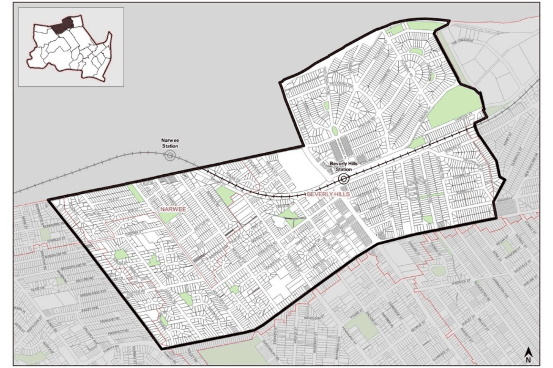

### 5.2 Beverly Hills – Narwee Locality Statement

#### Map of locality

> [Picture on page 9: a picture, saved as a picture (images/part-05-residential-locality-statements-page-9-3.gif, 150 dpi).]

Figure 4: Beverly Hills - Narwee

#### Existing Character

Location

This locality is bounded by the Canterbury-Bankstown LGA to the north (Broad Arrow Road, Allambee Crescent and the M5 motorway); Black Forest Reserve, The Crescent, Vanessa Street Reserve and Colwell Street to the east; Stoney Creek Road in the South and Baumans Road in the west. Broad Arrow Road follows along the highest ridge line, sloping down King Georges Road towards Stoney Creek Road.

Background

The Traditional Owners of the area are members of the Aboriginal Bidjigal people of the Eora Nation, part of the Dharug language group.

In the early twentieth century Beverly Hills was previously known as Dumbleton, however, it was first officially known as West Hurstville for postal services.2

2 ‘Beverly Hills Station – Dumbleton officially dead’, The Propeller, 22 August 1940, pg. 4,  viewed 7 May 2020, https://trove.nla.gov.au/newspaper/article/235584081?browse=ndp%3Abrowse%2Ftitle%2FP%2Ftitle%2F122 5%2F1940%2F08%2F22%2Fpage%2F25393849%2Farticle%2F235584081

Narwee was once known as 'Sunning Hill Farm' after a property in the area granted to Richard Podmore in the 1820s.3 The residential suburb began to be developed after 1900 with its own railway station opening in 1931.4

Heritage

There are several heritage items in this locality that relate to the area’s social history and architecture (refer to Schedule 5 Environmental Heritage within GRLEP 2021).

Built Form and Setting

This locality contains predominately low density detached residential dwellings with some areas of villa and town house developments and 3 storey residential apartments adjoining the Beverly Hills and Narwee commercial centres. There is a diverse range of architectural styles including single-storey Federation, inter-war, post-war and two-storey contemporary styles.

The north-eastern corner of this locality demonstrates an intact ‘Garden City’ style subdivision pattern mostly consisting of 1930s red-brick bungalows within established garden settings.

The former Narwee High School site between Chamberlain St and Mountview Street includes a mix of detached and attached single dwellings and two storey multi dwelling housing.

There are several public green spaces distributed throughout this locality including: Austin Avenue Reserve, Bell Avenue Reserve, Beverly Hills Park, Beverly Hills Memorial Park, Bridge View Road Reserve, Cooloongatta Road Reserve, Edgbaston Road Reserve, Gloucester Road Reserve No. 1, Gloucester Road Reserve No. 3, Merv Lynch Reserve, Narwee Park, Progress Park, Rasdall Park, Tallawalla Street Reserves, Wiggins Avenue Reserve and Yuruga Street Reserve.

Streetscape Character

The streets in this locality are green and leafy with mature street trees. Older dwellings have well established gardens which make a positive contribution to the streetscape. Due to the different architectural styles throughout this locality, there is inconsistency in fencing heights and materials.

#### Future Desired Character

• Retain and enhance the existing low density suburban residential character through articulated contemporary developments that respond to the human scale.

• Support appropriate medium and high density residential areas adjoining Narwee and Beverly Hills centres where applicable.

3 ‘Narwee’, The dictionary of Sydney, viewed 7 May 2020, https://dictionaryofsydney.org/place/narwee 4 ‘Narwee’, The dictionary of Sydney, viewed 7 May 2020, https://dictionaryofsydney.org/place/narwee

• Encourage tree planting and landscaping within the front setback space to enhance the existing leafy streetscape character.

• Retain the intact Garden City subdivision pattern at the north-eastern corner of this locality.
